# Preview

What Cornflower looks like today: the pages of the sample app, drawn by the Windows Phone 8.1 theme at the phone's
own size (450 × 800 view pixels), dark and light. Each control is measured against the Windows Phone 8.1 emulator;
its comparison is in [`docs/controls/`](docs/controls/).

The pictures are drawn headless, with Skia, by
[`PreviewGallery`](tests/Cornflower.Tests/Sample/PreviewGallery.cs), so they are the theme's own pixels and can be
drawn again on any OS:

```sh
CORNFLOWER_PREVIEW=/absolute/folder dotnet test tests/Cornflower.Tests --filter FullyQualifiedName~PreviewGallery
```

The sample's pages are test benches, one control each in every state, rather than an app. A page that looks like an
app is still to come.

## The catalogue and the accent

The sample's own list of pages, and its theme page: the accent (Cobalt, the phone's default) and the phone's 20
named accents. An app picks another by setting `SystemColorControlAccentColor`.

<p>
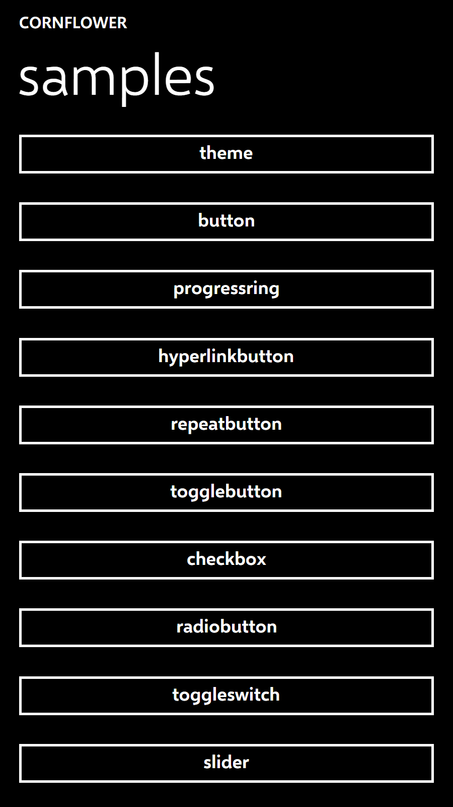
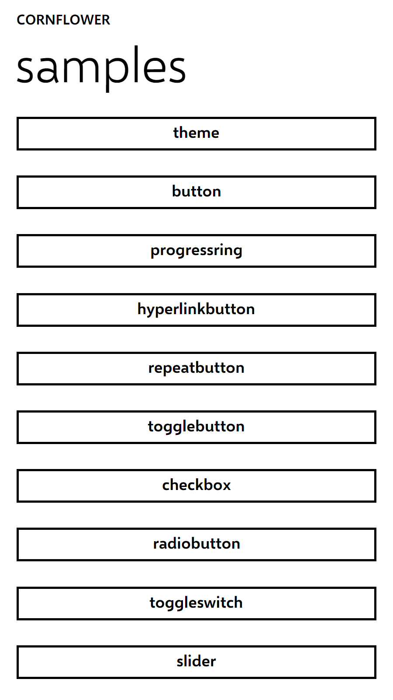
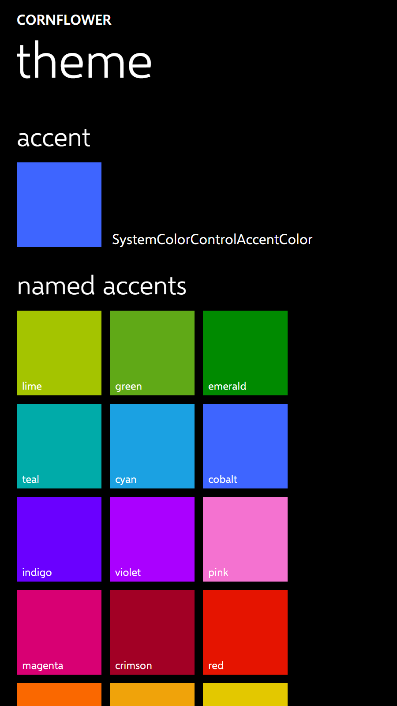
</p>

## Pivot and Hub

Pivot's header strip scrolls with its items and wraps from the last to the first. Hub's sections pan under a
parallax header and loop.

<p>
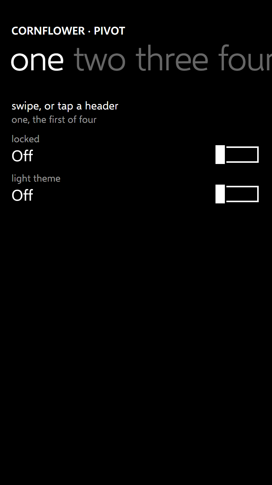

</p>
<p>

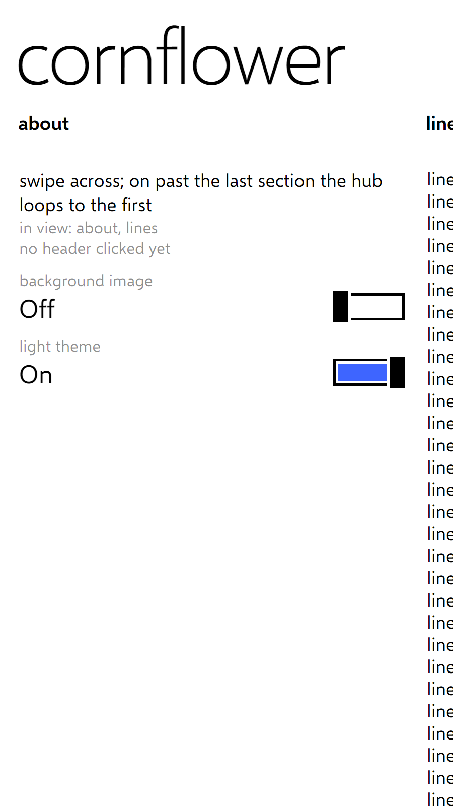
</p>

## The app bar and the list

The page's app bar (Avalonia's `CommandBar`), with its round buttons and the ellipsis. ListView, Avalonia's `ListBox`
themed, with the phone's tilt on a press and its check mode.

<p>
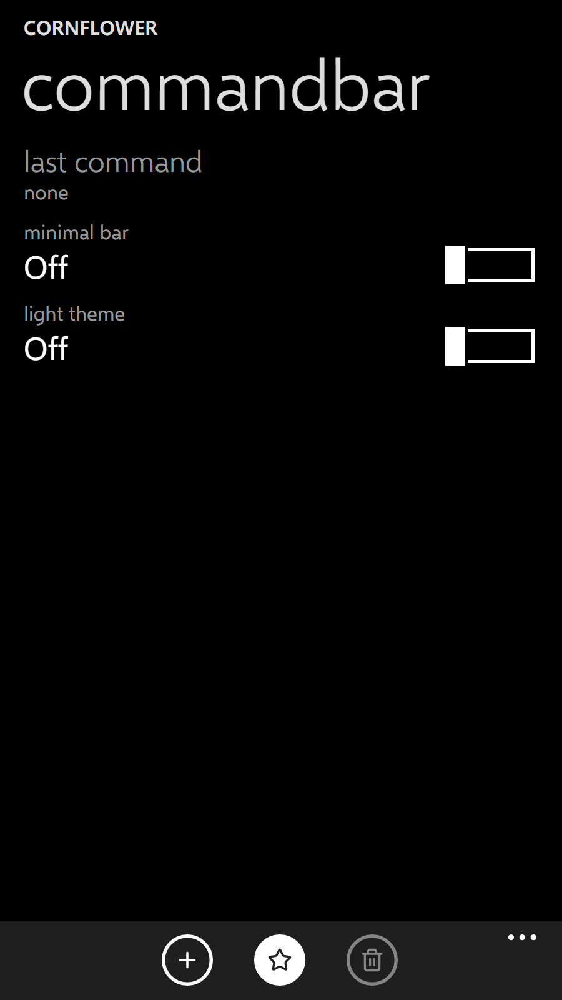

</p>
<p>
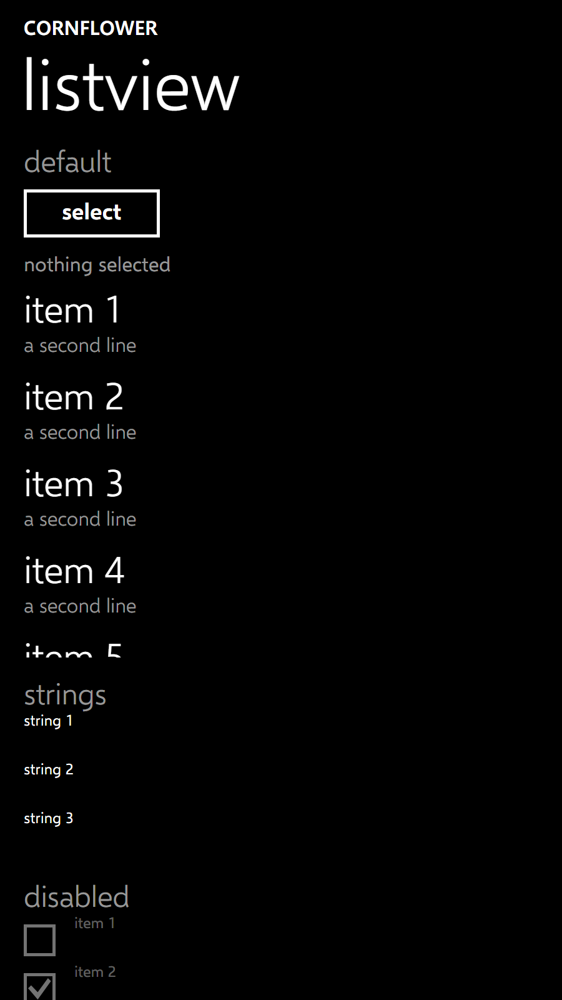

</p>

## Toggles, sliders and progress, in three accents

<p>

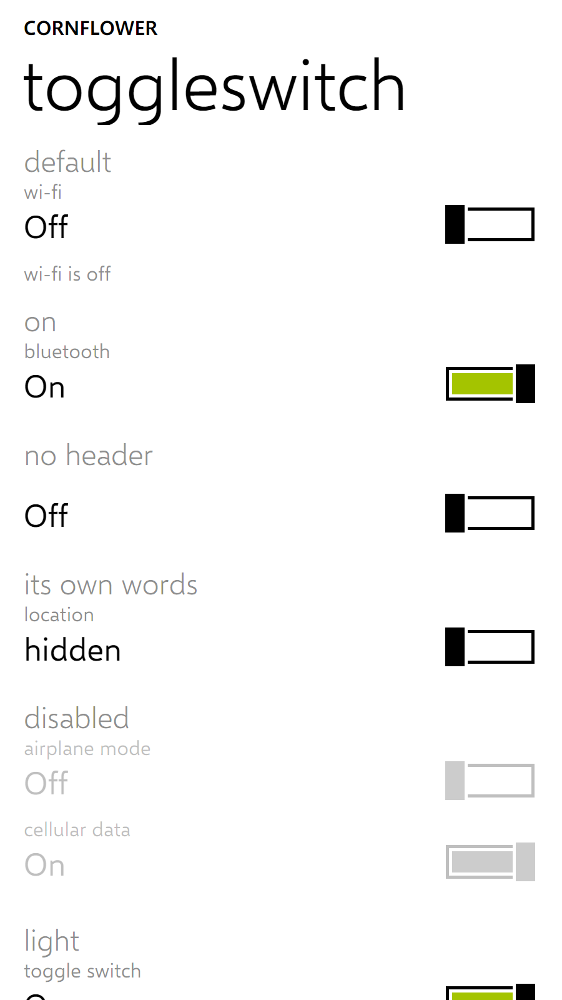
</p>
<p>
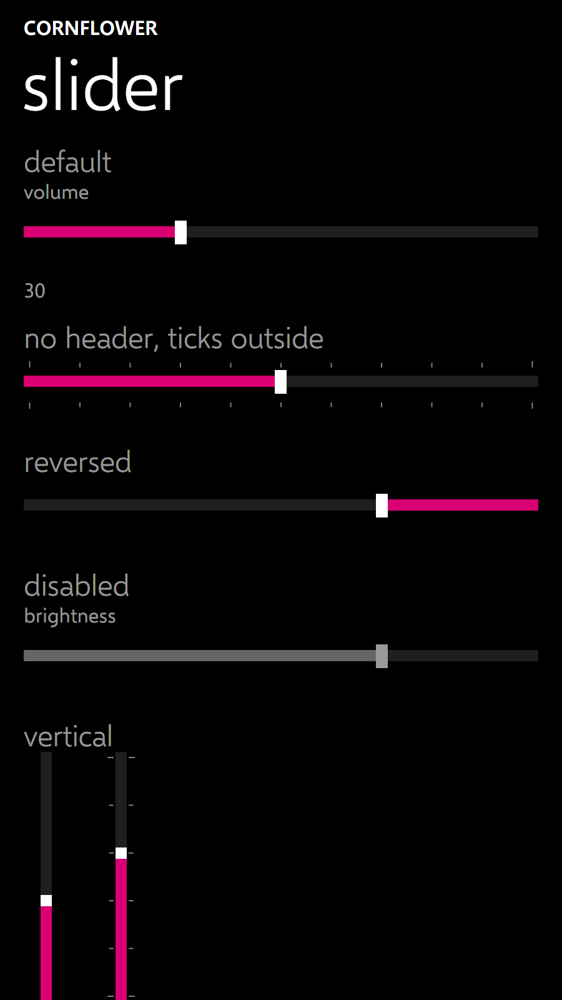
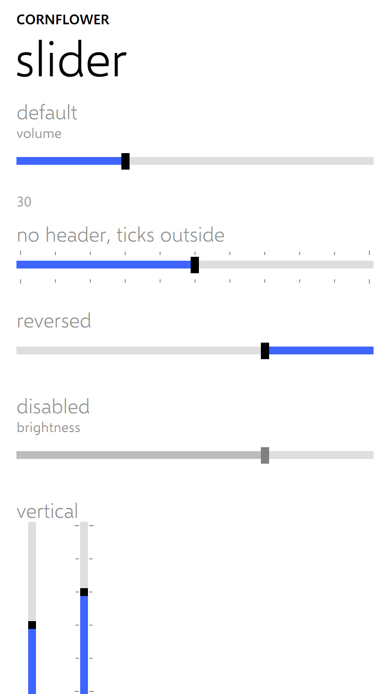
</p>
<p>
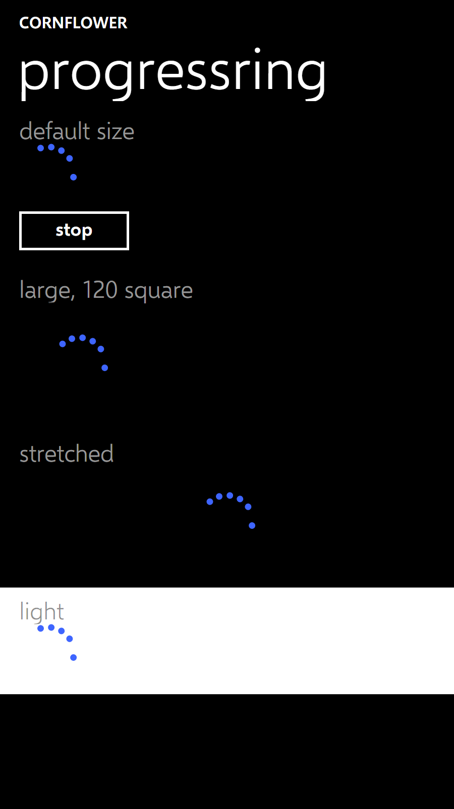

</p>

## Text and buttons

<p>
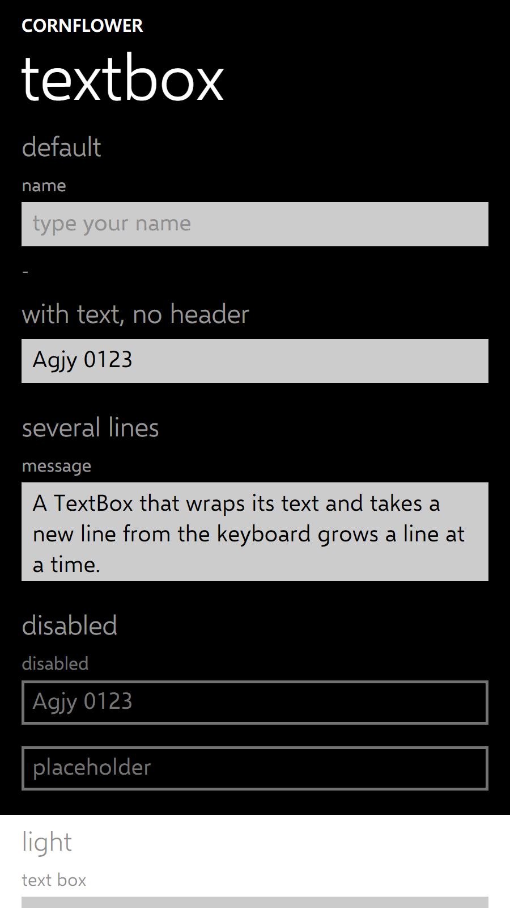

</p>
<p>


</p>
<p>
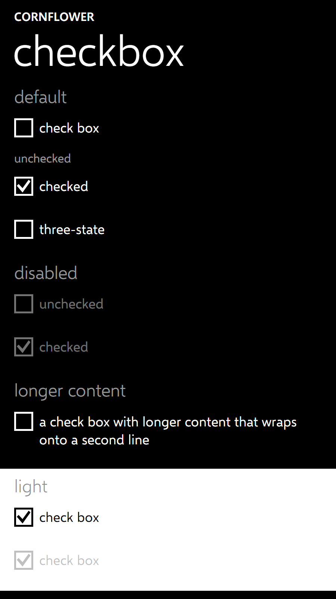
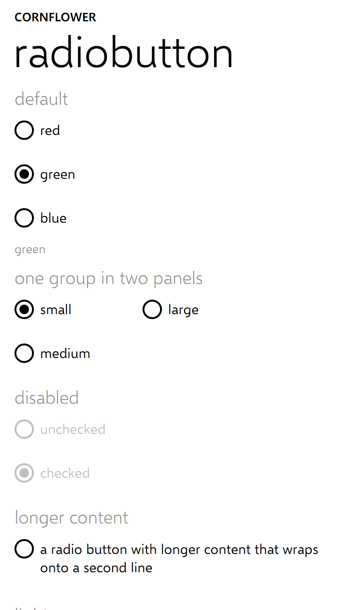
</p>

## Not shown

Motion: the tilt under a finger, the turnstile between pages, the Pivot's slide and the Hub's pan run on the phone's
own measured curves, which still pictures can't show. The pickers, flyouts and dialogs are in progress (Tier 3 of
the [roadmap](docs/ROADMAP.md)).
