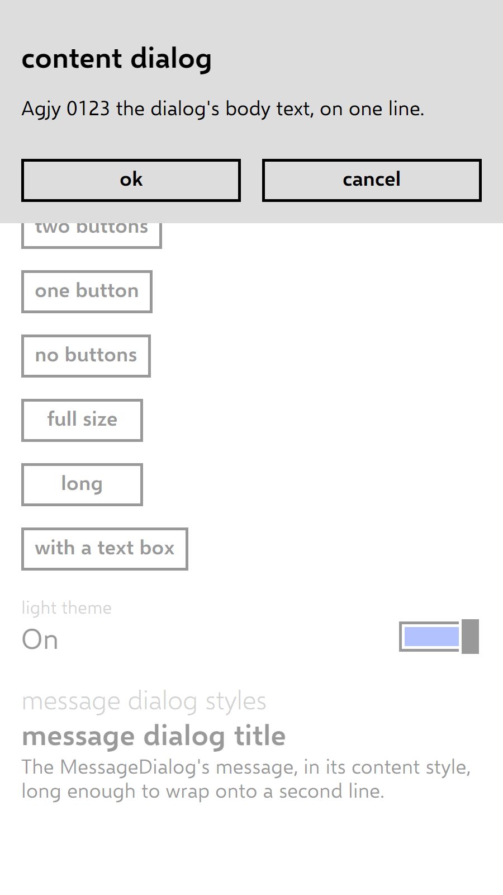
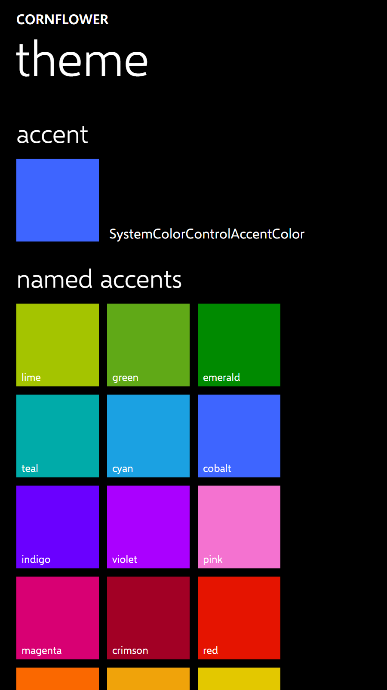

# Cornflower

A faithful reproduction of the Windows Phone design languages for
[AvaloniaUI](https://avaloniaui.net/), mobile first. The first era is Windows Phone 8.1.

<p>



</p>

More in [PREVIEW.md](PREVIEW.md).

> **Status: in progress, not yet published.** Done, each measured against the Windows Phone 8.1 emulator: the type
> ramp, Button, HyperlinkButton, RepeatButton, ToggleButton, CheckBox, RadioButton, ToggleSwitch, Slider,
> ProgressBar, ProgressRing, TextBox and PasswordBox (Tier 1, each also run on a phone); ScrollViewer,
> ContentControl, the app bar (CommandBar), ListView, Page with its transitions, Pivot and Hub (Tier 2, each also
> run on a phone); Flyout, MenuFlyout, ListPickerFlyout and PickerFlyout, LoopingSelector, ComboBox, DatePicker and
> TimePicker and their flyouts, ContentDialog, AutoSuggestBox, and the page moving up for the keyboard (Tier 3, each
> run on a phone and in the desktop window, but the keyboard's pan, which only a phone shows; a covered TextBox or
> PasswordBox stops at its caret, #201; the page slides, #206; and the Back that hides the keyboard takes the focus,
> #197); the 8.1 ListBox, GridView, grouped lists with their headers, FlipView and SemanticZoom (Tier 4, each run in
> the desktop window; the ListBox and GridView on a phone, the other three so far on the Android emulator, their phone
> run owed); a list's scroll to an item stays in the list, as on the phone (#220, its runs owed). Tier 2's follow-ups from the emulator's last reads (#162 to #169) are done and run. Motion is configurable
> (`CornflowerConfig`: off, or faster or slower, overall or by area), and faithful by default. Owed: the sample at
> speed 2 on a phone. Next: the plain themes for the controls the phone never had. The [roadmap](docs/ROADMAP.md) has
> the rest.

## What "faithful" means here

- **Measured, not remembered.** Geometry, colour, states and motion come from the Windows Phone
  8.1 SDK's own templates and API metadata, and from captures of the emulator.
- **Avalonia's controls, themed.** Where Avalonia has a control of the same shape, Cornflower
  themes it. Where it has none (Pivot, Hub, ProgressRing, ContentDialog and others), Cornflower
  adds one, with the WinRT name.
- **Fonts and icons are substituted.** No Microsoft font or file ships.
- **The phone's by default; quicker if you ask.** Every motion runs at the phone's measured time unless an app sets
  `CornflowerConfig` ([ADR 0006](docs/decisions/0006-faithful-defaults-and-cornflowerconfig.md)): `Animated`,
  `MotionSpeed` (2 is twice as fast), a speed for each area (`PopupSpeed`, `PageSpeed`, `TiltSpeed`,
  `PivotAndHubSpeed`, `ControlSpeed`), and `Deviations`, the named departures from the phone, each off by default.
  Set them at start-up or at any time: each motion reads them as it starts. The sample starts at speed 2, and its
  theme page changes them.

## Packages

| Package | Contents |
|---|---|
| `Cornflower` | Everything: the one most apps want |
| `Cornflower.Controls` | Cornflower's own controls and behaviours, no visual opinion |
| `Cornflower.Themes.Wp81` | The Windows Phone 8.1 theme |

Targets .NET 8, Avalonia 12.

## Building

```sh
dotnet build Cornflower.sln
dotnet test  Cornflower.sln
```

## Attribution

Cornflower reproduces the visual design of Microsoft's Windows Phone. It is an independent
implementation for the AvaloniaUI ecosystem and is not affiliated with or endorsed by Microsoft
or the AvaloniaUI team. Windows Phone is a trademark of Microsoft.

## Licence

Apache License 2.0; see [LICENSE](LICENSE). The Windows Phone 8.1 theme package bundles the
Selawik fonts under the SIL Open Font License 1.1
([`OFL.txt`](src/Cornflower.Themes.Wp81/Fonts/OFL.txt)), so its licence is
`Apache-2.0 AND OFL-1.1`.
