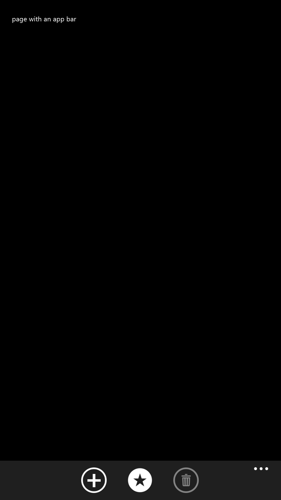
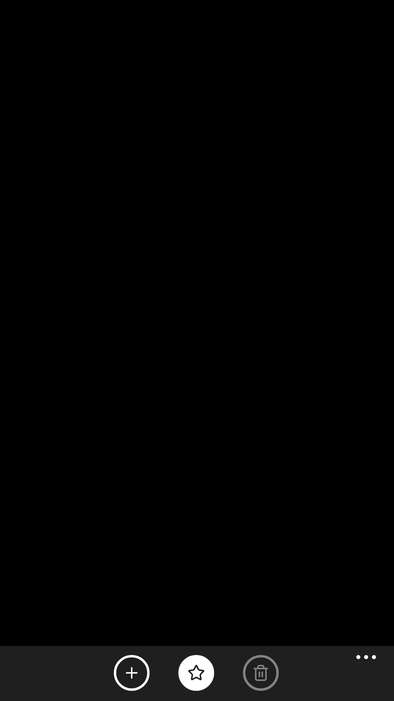
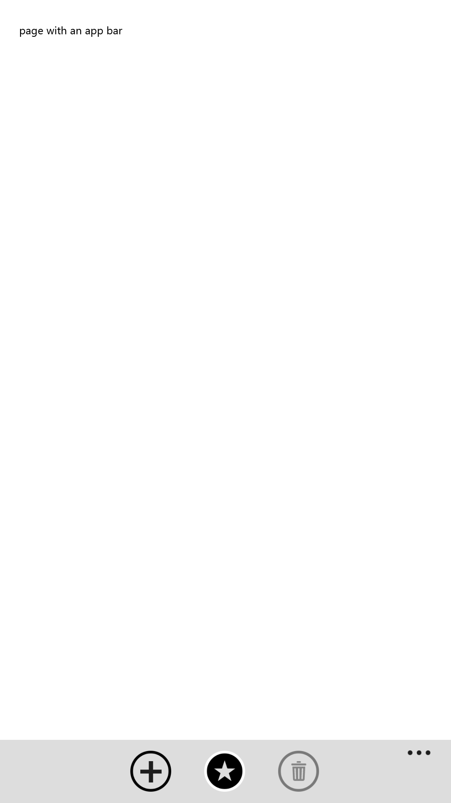
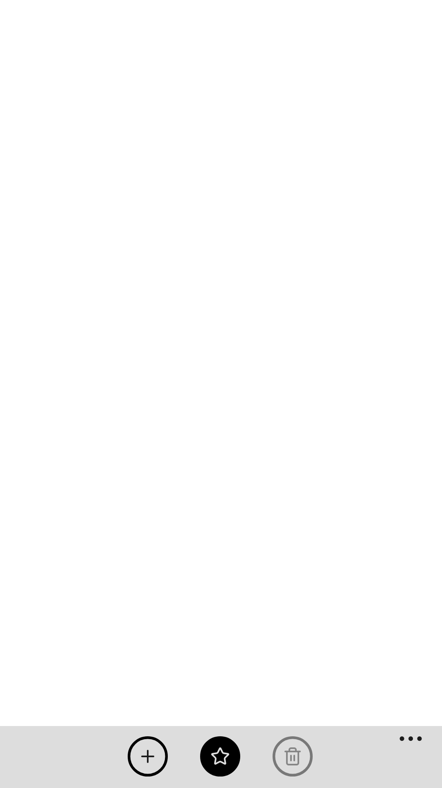
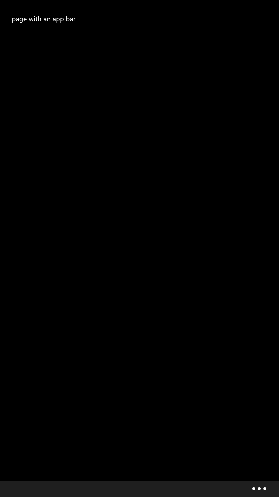
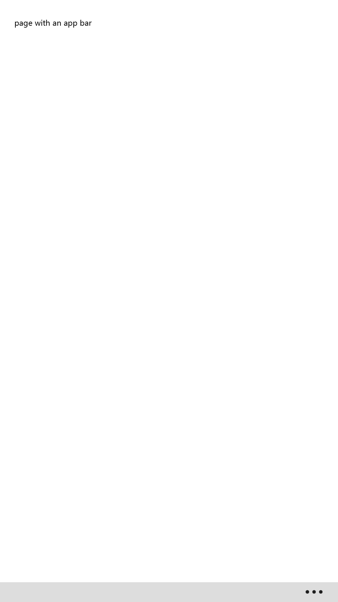
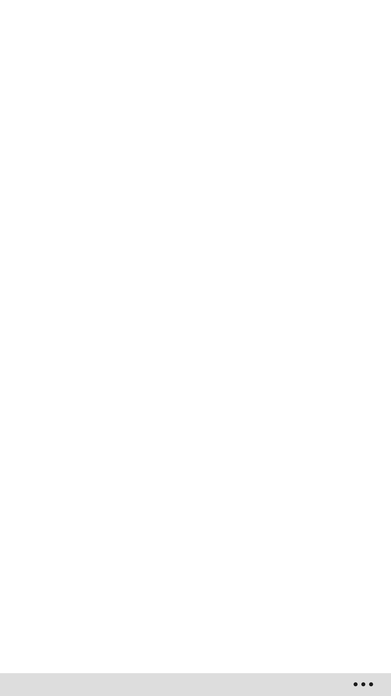
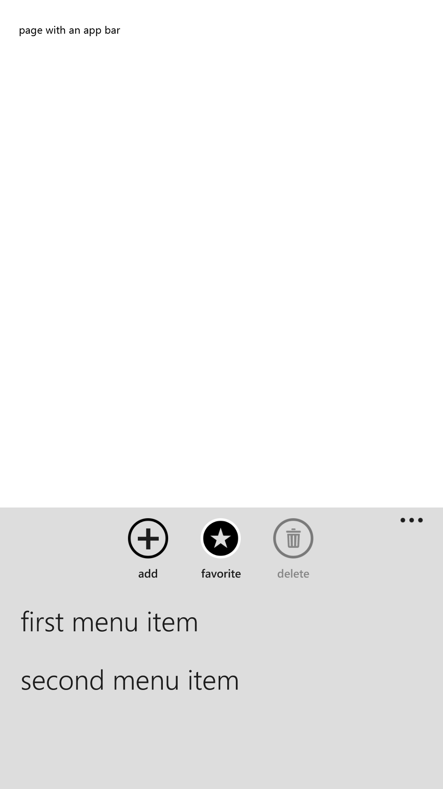
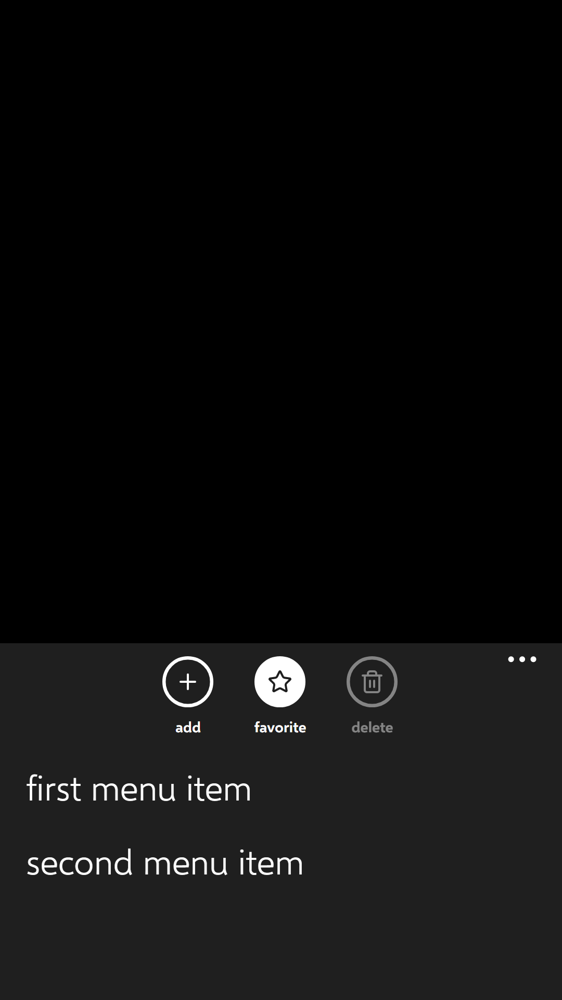
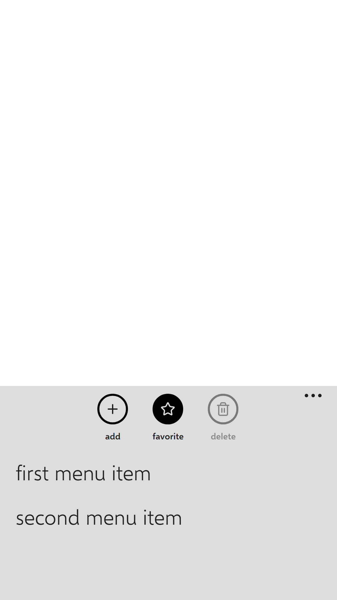

# CommandBar, AppBarButton, AppBarToggleButton and AppBarSeparator: comparison

**The phone:** the shell's screenshots of a page's app bar, Emulator 8.1 U1 1080P 5.5 inch (device 11), 1080 × 1920
at 2.4, run `20261109-2124-dev11`, in [`ref/wp81/CommandBar/`](../../../ref/wp81/CommandBar/README.md). Segoe WP and
Segoe UI Symbol.
**Ours:** headless frames from `tests/Cornflower.Tests/Controls/CommandBarFrames.cs`, Avalonia 12.1.4 with Skia, the
same page (450 × 800, the same commands, the icons Lucide's `Plus`, `Star` and `Trash`), in [`frames/`](frames).
Selawik.

Text isn't compared by pixel: the fonts differ by design ([ADR 0001](../../decisions/0001-what-faithful-means.md)).
The icons aren't either: Lucide's are their own.

| Variant | Phone, dark | Ours, dark | Phone, light | Ours, light |
|---|---|---|---|---|
| `compact` |  |  |  |  |
| `minimal` |  |  |  |  |
| `compact-open` |  |  |  |  |
| `minimal-open` |  |  |  |  |

The phone's page shows its title, "page with an app bar"; ours is the bare page.

## Measurements

Raw pixels (px) in the 1080 × 1920 frames, read the same way from both (the bounding box of each mark's ink against
the bar's colour).

| | Phone | Ours | |
|---|---|---|---|
| The bar's top, compact / minimal / open | 1769 / 1857 / 1235 | 1769 / 1857 / 1235 | match |
| The bar, dark / light | `#1F1F1F` / `#DDDDDD` | the same | match |
| The circles' boxes, compact | 312..409, 491..584 (checked, dark), 666..763; rows 1795..1892 | 312..409, 489..586, 666..763; rows 1794..1891 | match, within a raw pixel; the checked circle 98 across in dark, as the phone's is in light (the phone's dark one is 94: its outer 2 px are the bar's colour) |
| The ring, left column on row 1844 | 312..318, 6.44 px of ink | 312..318 | match |
| The ring, dark / light | 255 / 0 | 255 / 0 | match |
| The disabled ring, dark / light | 132 / 121 | 132 / 120 | match, within a level |
| The checked circle's fill, dark / light | 255 / 0 | 255 / 0 | match |
| The ellipsis's dots, compact | 976..987, 998..1009, 1019..1030; rows 1794..1805 | 976..987, 998..1008, 1019..1030; rows 1794..1805 | match, within a raw pixel (the glyph's own test, #63) |
| The dots' colour, dark / light | 255 / 29 | 255 / 28 | match, within a level |
| The labels' baseline, open | row 1406 | row 1407 | match, within a raw pixel |
| The label "add", open | x 338..382 | x 337..385 | text; Selawik SemiBold against Segoe WP |
| The list's baselines, open | rows 1537, 1679 | rows 1537, 1679 | match |
| The list's first ink ("f"), open | x 51, rows 1486..1536 | x 51, rows 1486..1536 | match |
| The open bar's foot | 100 view px below the last baseline | the same | match, for two secondary commands |
| The icons | Segoe UI Symbol: the plus inks 51 px | Lucide 20 × 20: the plus inks 32 px | deliberate difference: Lucide's shapes and sizes |

## Behaviours

| Behaviour | |
|---|---|
| The closed compact and minimal bars, and the open bar, as the shell draws them | match |
| The labels show only while the bar is open | match |
| The ellipsis always shows, and opens and closes the bar | match |
| The checked toggle: the circle filled, the icon the bar's colour | match |
| A disabled command at 0x73 | match |
| The pressed command: the circle filled, the icon the bar's colour | no reference on the shell's bar; the template's state with the bar's colour for the page's |
| Checked and pressed: the ring alone | no reference on the shell's bar; the template's state |
| A press outside the open bar closes it | Avalonia's light dismiss; not read on the phone |
| Invoking a command closes the open bar | ours does, as the phone's menu does by common account; not read |
| The open bar's height with other numbers of secondary commands, and a list that doesn't fit | gap: not read; ours keeps the 100 px foot (none with no list) and scrolls a list longer than the room |
| The opening and closing motion | gap: not read; ours opens at once |
| `ActualHeight`: 57.5 on the phone, the control under the shell's 62.92 | deliberate difference: ours is the drawn 62.9166 (PLAN, "The bar") |
| The open bar: on the phone the shell draws it over the page and the control stays 57.5 | deliberate difference: ours grows upwards from its foot; a page lays it over its content (README, "On a page") |
| A command off the bar | deliberate difference: ours looks as on the bar; the phone's template draws a smaller circle and label ([`ref/wp81/AppBarButton/`](../../../ref/wp81/AppBarButton/README.md)) |
| `AppBarSeparator`: no style on the phone, so nothing drawn | match |
