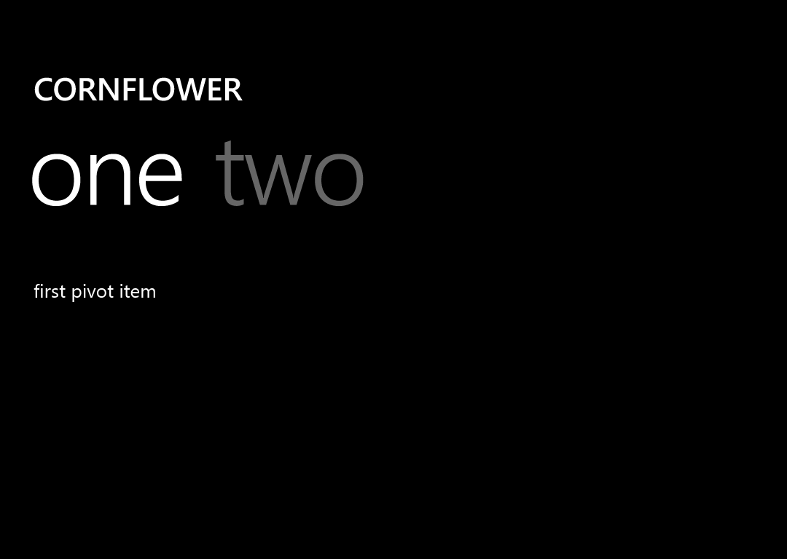
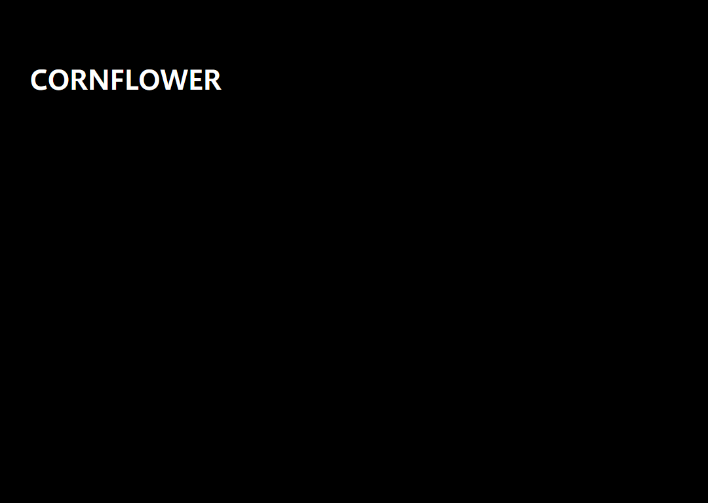
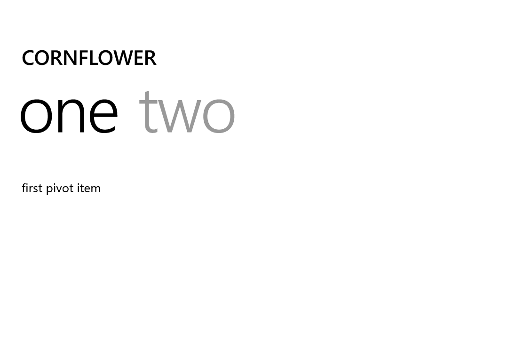
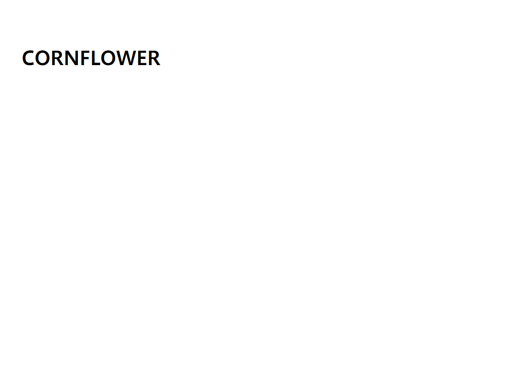

# ContentControl and ContentPresenter: comparison

**The phone:** the reference app's Pivot captures, Emulator 8.1 U1 1080P 5.5 inch (device 11), 1080 × 768 at 2.4,
2026-11-08, in [`ref/wp81/ContentControl/`](../../../ref/wp81/ContentControl/README.md), Segoe WP Semibold: Pivot's
title is a ContentControl laid out by the default style. And the dumps of run `20261108-1732-dev11`.
**Ours:** headless frames from `tests/Cornflower.Tests/Controls/ContentControlFrames.cs`, Avalonia 12.1.4 with Skia, on
the same stage, in [`frames/`](frames), Selawik Semibold: a ContentControl in `Wp81ContentControlTheme` with Pivot's
title's content, font and margin, and nothing else (the Pivot's headers and item aren't this control's).

| | Phone | Ours |
|---|---|---|
| Dark |  |  |
| Light |  |  |

## Measurements

| | Phone | Ours | |
|---|---|---|---|
| The ContentControl | 19.1667, 37.9167, 430.8333 × 24.1667 | 19.1667, 37.9167, 430.8333 × 24.1667 in a row its own height (the test); in the frame's stage it runs on down, drawing nothing | **match** |
| Its content alignment | Left, Top | Left, Top | **match** |
| The presenter, in the control | 0, 0, 119.5833 × 24.1667 | 0, 0, 121.6667 × 24.1667 | **match** in place and height; Selawik Semibold is 1.7% wider (ADR 0001), so the width is asserted within 10% |
| The text's line | 24.1267 (Segoe WP's 1.33 em; 1.33 × 18.14 is 24.1262) | 24.1667: 1.33 × 18.14, rounded up to the raw pixel | **match** |
| The title's ink, raw pixels | x 47 to 332, y 106 to 138 | x 47 to 337, y 106 to 137 | **match** at the left and top; 5 px wider (Selawik Semibold, ADR 0001's 1.5 to 1.8%), its bottom 1 px higher |
| A background, a border | not drawn (the template binds none) | not drawn: the slot's pixels are the page's, dark and light | **match** (tested: `Background_And_Border_Draw_Nothing_And_The_Padding_Takes_No_Hits`) |
| The padding | the presenter's margin | the presenter's margin | **match** |
| A string's access key | none | none | **match** |
| A ContentPresenter in a template, nothing set | Stretch, filling 61.25 × 16.6667 (the ToggleSwitch's curtain) | Stretch, filling 61.25 × 16.6667 | **match** (no theme) |

## Behaviours

| Behaviour | |
|---|---|
| Content at the top left at its own size | **match** |
| Content alignments set by an app place it | **match** |
| Padding | **match** |
| Background, BorderBrush, BorderThickness not drawn; no hits on the padding | **match** |
| A string in the phone's line | **match**, with Selawik for Segoe WP (ADR 0001) |
| An app's `ContentTemplate` keeps its own line | **match** |
| `ContentTransitions` | **deliberate difference**: Avalonia has none; the phone's default is none |
| `IsTabStop` true | **deliberate difference**: Avalonia's ContentControl isn't focusable ([PLAN](PLAN.md#istabstop)) |
| A bare ContentControl in the phone's look | **match**, by type since the Tier 2 roll-up ([README](README.md#by-type)) |
| A ContentPresenter written in a page | **match**: #114 read that the phone's style doesn't reach it (run `20261115-2048-dev11`); no theme here either |

## Tier 1 frames

Checked with the theme keyed by type, before choosing the key: every templated control (Avalonia's that Simple themes
by type, and Cornflower's), each shown with Simple then Wp81, and a MenuItem with an icon, a Menu, a TextBox, a
NumericUpDown and an AutoCompleteBox each with an error, and a ComboBox closed and open; each frame's pixels and its
tree's bounds hashed, with and without the theme. Every Tier 1 control's frame (Button, HyperlinkButton, ToggleButton,
RepeatButton, CheckBox, RadioButton, ProgressBar, ProgressRing, Slider, TextBox, ToggleSwitch, the PasswordBox, the
icon) was the same. What changed were Simple's ComboBox, DataValidationErrors, MenuItem and the managed file dialog's
trees and frames (NotificationCard's and TimePickerPresenter's frames change from run to run on their own). As shipped,
keyed, the theme changes nothing it isn't set on: the full suite is green, and `A_Bare_ContentControl_Keeps_Avalonias_Own`
holds it. *At the Tier 2 roll-up* the theme went in by type, with `HoleParts.FallBackToOwn` for the holes; the same
check, on every frame saver's frames and every hole's and sample page's frame and tree, found nothing changed
([README](README.md#by-type)), and that test became `A_Bare_ContentControl_Wears_The_Phones_Theme`.
