# DatePicker and TimePicker, and their pickers: comparison

**The phone:** the emulator's grabs, Emulator 8.1 U1 1080P 5.5 inch (device 11), at 2.4: the closed controls on the
reference app's 450 × 140 stage (run `20261116-1934-dev11`, #150, in [`ref/wp81/DatePicker/`](../../../ref/wp81/DatePicker/README.md)
and [`ref/wp81/TimePicker/`](../../../ref/wp81/TimePicker/README.md)), headed "date picker" and "time picker", 15 July
2014 and 12:30; the DatePickerFlyout and TimePickerFlyout at rest, 1080 × 1920 (run `20261108-2254-dev11`, in
[`ref/wp81/DatePickerFlyout/`](../../../ref/wp81/DatePickerFlyout/README.md) and
[`ref/wp81/TimePickerFlyout/`](../../../ref/wp81/TimePickerFlyout/README.md)). Segoe WP.
**Ours:** headless frames from `tests/Cornflower.Tests/Controls/DateTimePickerFrames.cs`, Avalonia 12.1.4 with Skia, the
same controls on the same stage, and their pickers opened by a tap and at rest, in [`frames/`](frames). Selawik.

Text isn't compared by pixel: the fonts differ by design ([ADR 0001](../../decisions/0001-what-faithful-means.md)).

| Variant | Phone, dark | Ours, dark | Phone, light | Ours, light |
|---|---|---|---|---|
| DatePicker | 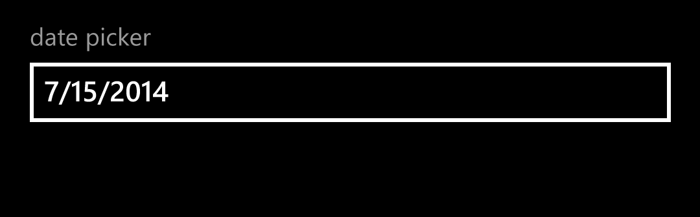 | 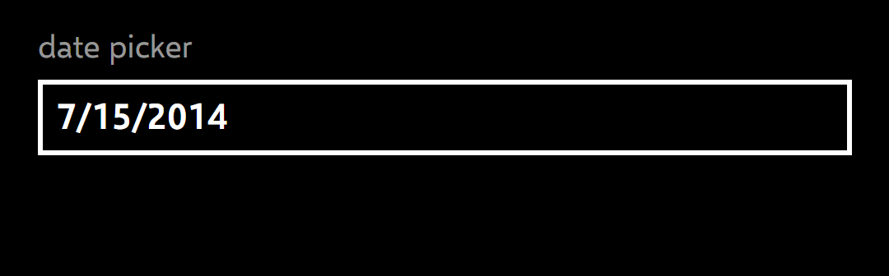 | 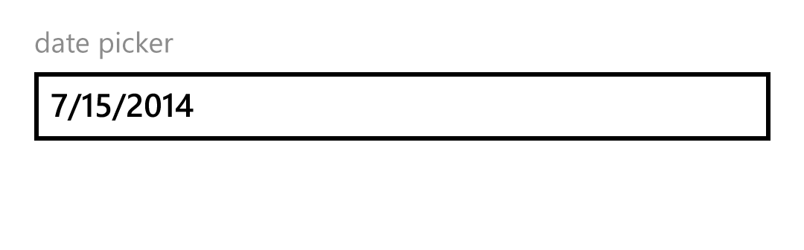 | 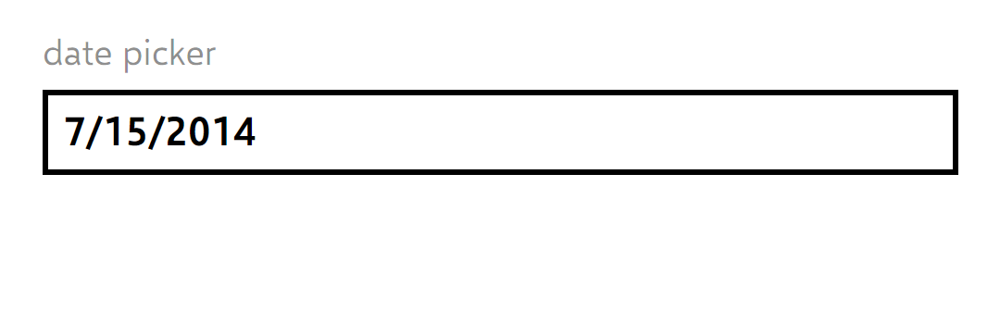 |
| TimePicker | 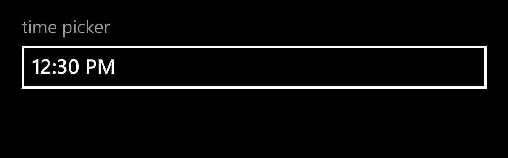 | 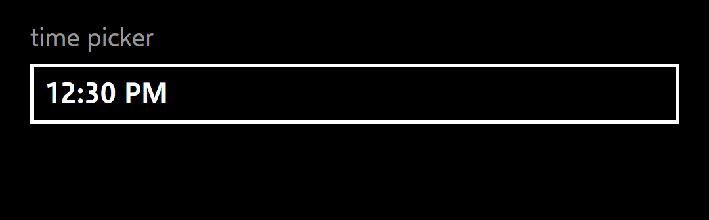 | 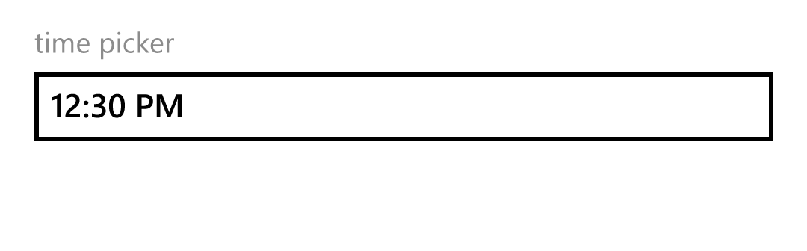 | 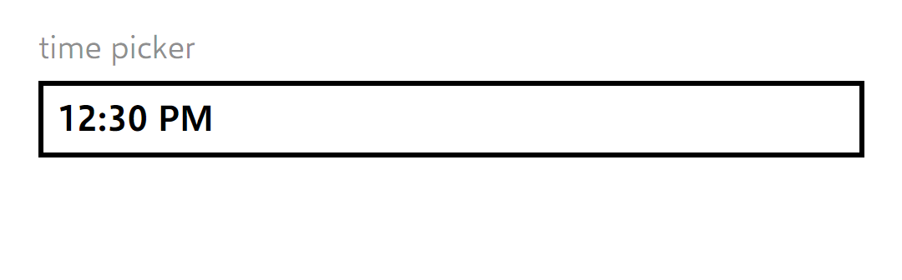 |
| The date picker open | 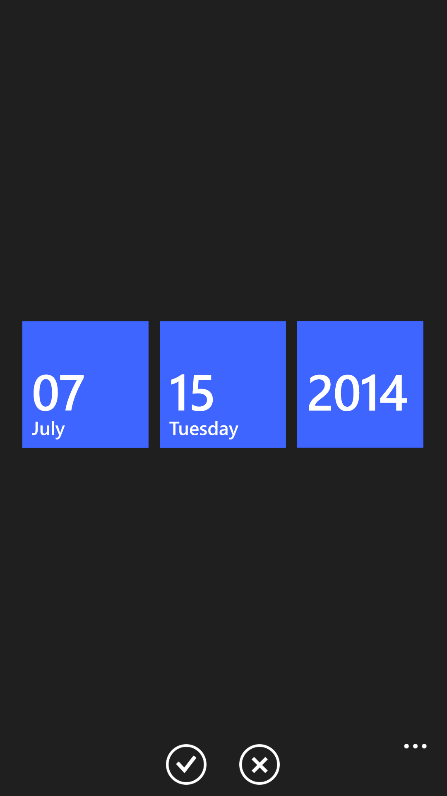 | 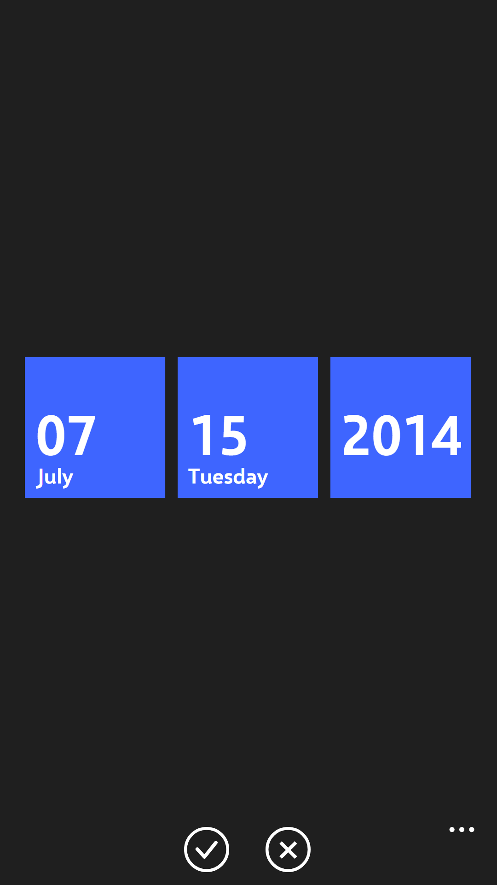 | 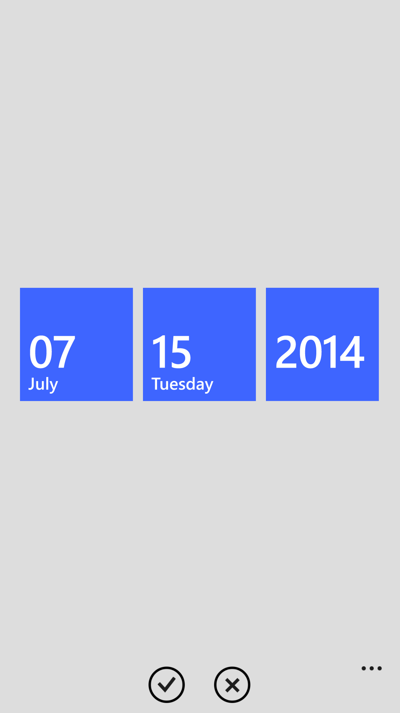 | 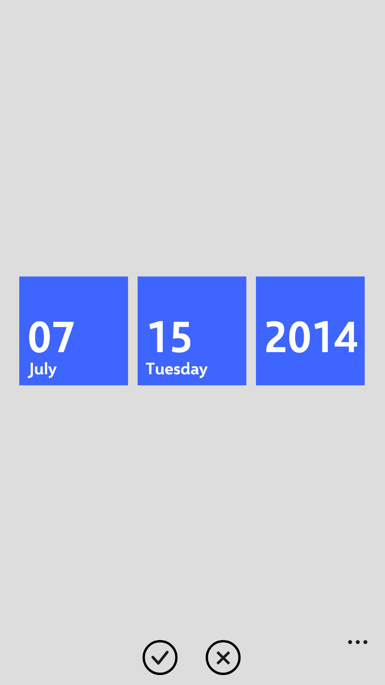 |
| The time picker open | 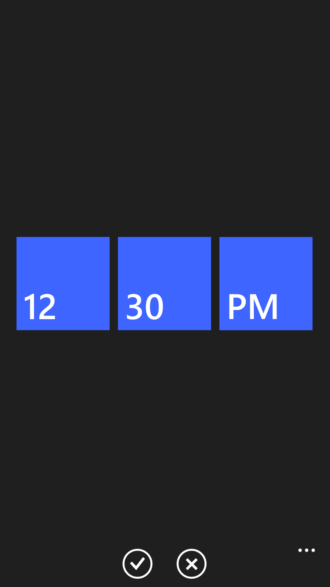 | 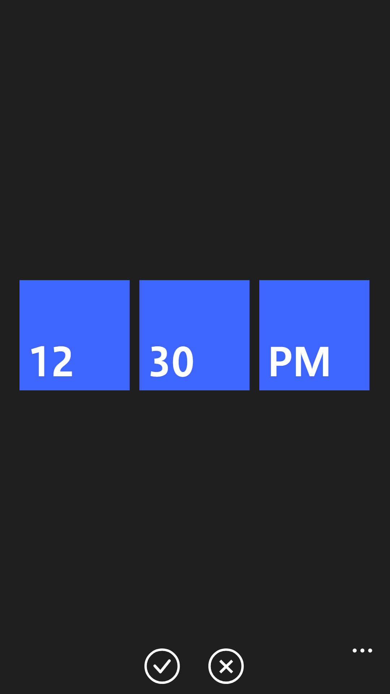 | 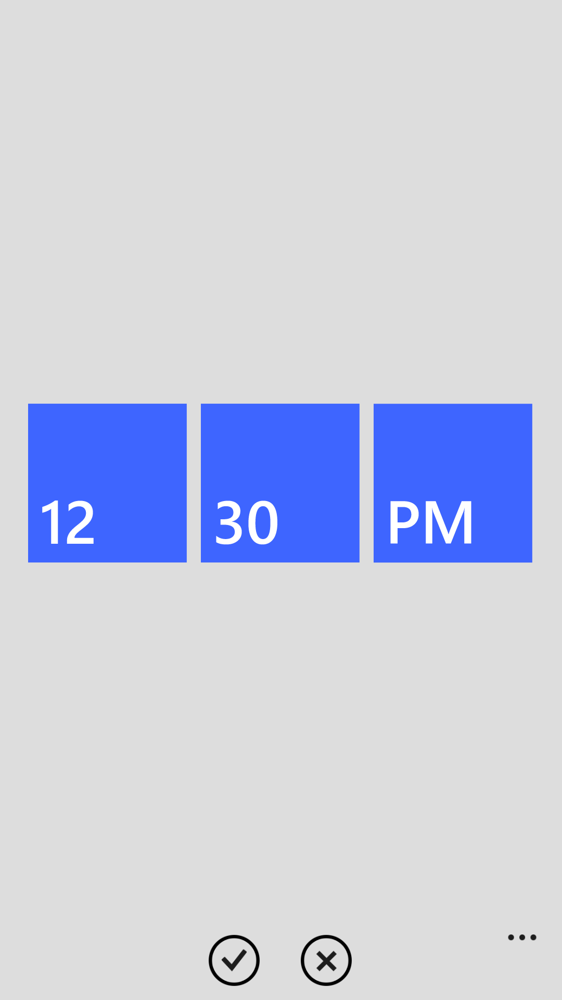 |  |

## Measured

Raw pixels, the first and last of each run of ink (the border: the foreground; the wheels: the accent), the same in
dark and light. Read with a short script over the PNGs (zlib, no imaging library).

| What | Phone | Ours | |
|---|---|---|---|
| The closed button's border, across (row 150) | 46 to 51, 1029 to 1034 | the same | **match**, both pickers |
| Its border, down (column 700) | 97 to 102, 183 to 188 | the same | **match**, both pickers |
| The three selected items, across | 54 to 357, 386 to 689, 718 to 1021 | 54 to 358, 386 to 690, 718 to 1022 | **deliberate difference**, one raw pixel: #154's items are drawn where the panel puts them, unrounded |
| The selected items, down | 775 to 1079 (the time's 776 to 1079) | 775 to 1079 | **match**; the phone's AM/PM item sits 0.08 lower (its dump: 318.02, the others 317.94) |
| The picker | 0, 0, 1080 × 1920, `#1F1F1F` / `#DDDDDD` | the same | **match** |
| The bar's rings and "..." | as #153's | the same | **match** (#153's comparison) |
| The text | Segoe WP | Selawik | **deliberate difference** (ADR 0001) |

The layout in view pixels (the header's 21.67, the button 18.75 down and 57.5 tall, its Border 28.33 down and 38.33
tall, the text 9.17 in; the wheels 138.33 × 700 at 17.5, 155.83 and 294.17, 37.08 down; the bar from 737.08) is held
by `DateTimePickerTests`, as are the states' colours.

## The states

Not compared by pixel here: B19's forced states are the Button's (`PhoneBaseLowColor` disabled; the accent and white
pressed), which `Its_Buttons_States_Are_The_Phones_Pressed_The_Accent_Disabled_Base_Low` checks by colour in both
themes, and the Button's own comparison by pixel (#27).

## The motion

Not compared by frame: #149 read it as angles, and the tests hold them (`It_Opens_In_Five_160_Rows_Turning_Slower_Down_The_Window`,
`Accept_Sets_The_Value_In_The_Taps_Frame_And_It_Closes_In_Five_Bands_At_16_Ticks`). The phone draws its bar at rest and
last; ours turns with the bottom row (README, known gaps).
