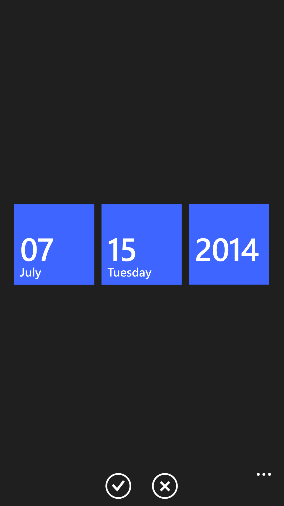
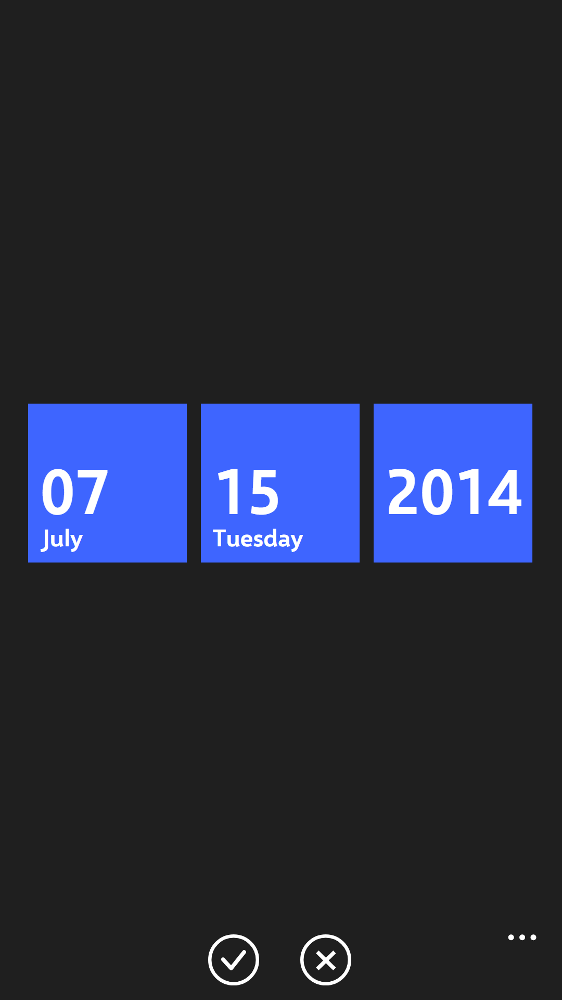
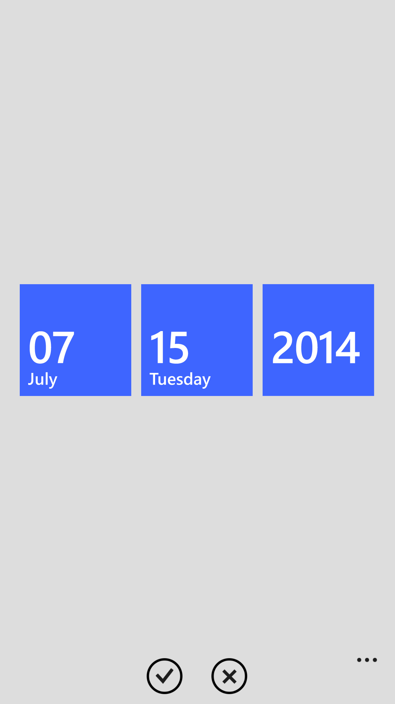
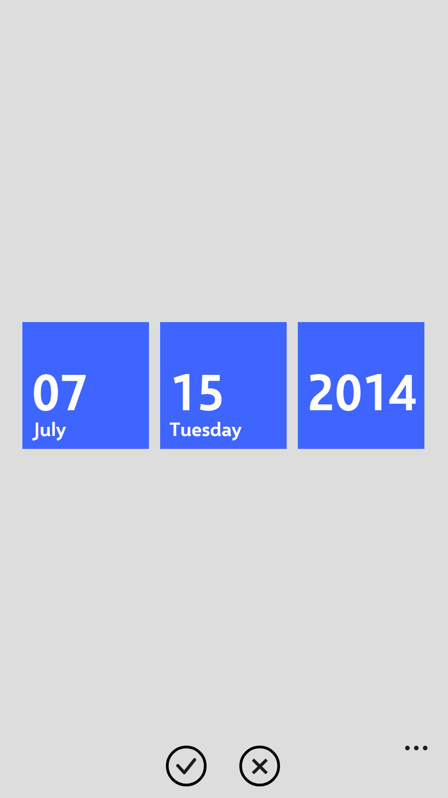
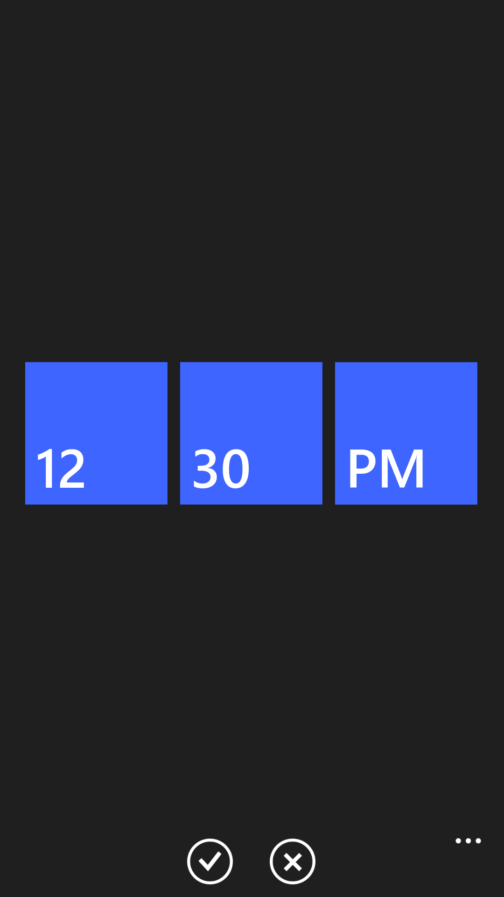
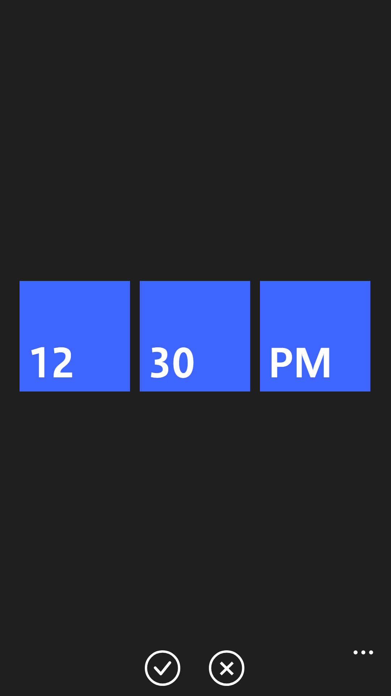
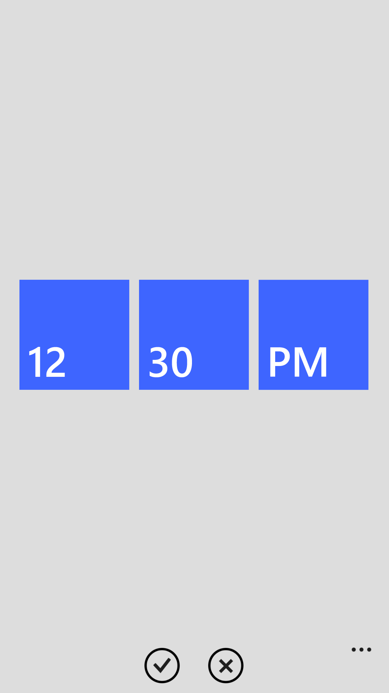

# DatePickerFlyout and TimePickerFlyout: comparison

**The phone:** the emulator's grabs of the reference app's DatePickerFlyout (15 July 2014) and TimePickerFlyout (12:30),
opened from code, at rest, 1080 × 1920 at 2.4 (Emulator 8.1 U1 1080P 5.5 inch, device 11; run `20261108-2254-dev11`, in
[`ref/wp81/DatePickerFlyout/`](../../../ref/wp81/DatePickerFlyout/README.md) and
[`ref/wp81/TimePickerFlyout/`](../../../ref/wp81/TimePickerFlyout/README.md)). Segoe WP.
**Ours:** the same flyouts shown with `ShowAt`, at rest, headless at the reference profile. They are drawn pixel for
pixel as the DatePicker's and TimePicker's open pickers (`At_Rest_It_Is_Drawn_As_The_Pickers_Own_Picker`, dark and
light), so ours are #156's frames, in [`../DatePicker/frames/`](../DatePicker/frames). Selawik.

| Variant | Phone, dark | Ours, dark | Phone, light | Ours, light |
|---|---|---|---|---|
| DatePickerFlyout |  |  |  |  |
| TimePickerFlyout |  |  |  |  |

## Measured

As #156's: docs/controls/DatePicker/COMPARISON.md, "Measured" (the picker 0, 0, 1080 × 1920 in `#1F1F1F` / `#DDDDDD`, a
**match**; the selected items one raw pixel wider, a **deliberate difference**; the text Selawik's). The wheels' places
and the bar's top are held again for the flyouts by `ShowAt_Opens_The_Pickers_Own_Presenter_Filling_The_Window_On_The_Phones_Host`.

## The motion

Not compared by frame: #149 read it as angles, and `DatePickerFlyoutTests` holds them: five 160 px rows at #149's rates
opening, the rows turning away at 10.95° a tick two ticks apart, and `Closed` at 17 ticks, where the DatePicker's popup
closes at 16.
