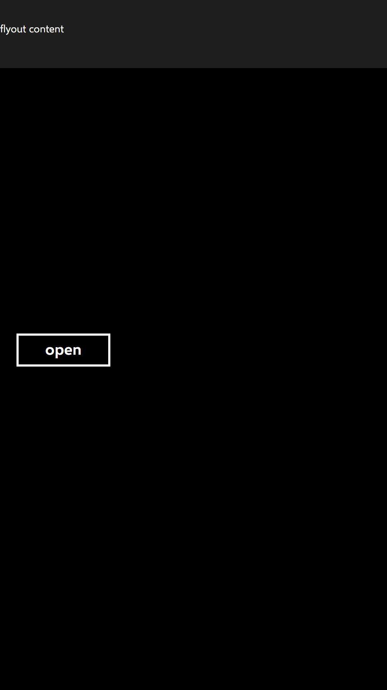
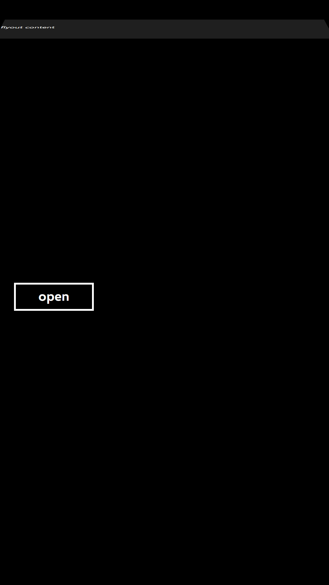
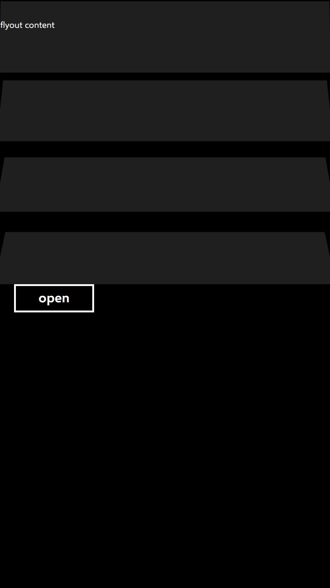

# Flyout and FlyoutPresenter: comparison

**The phone:** the emulator's screenshots of a `Flyout` shown on a Button "open", its content "flyout content",
Emulator 8.1 U1 1080P 5.5 inch (device 11), 1080 × 1920 at 2.4, run `20261108-2254-dev11`, in
[`ref/wp81/Flyout/`](../../../ref/wp81/Flyout/README.md). Segoe WP; the flyout's text in XAML's default 11 px "Global
User Interface", as the presenter is in a root of its own.
**Ours:** headless frames from `tests/Cornflower.Tests/Controls/FlyoutFrames.cs`, Avalonia 12.1.4 with Skia, the same
stage (450 × 800, the Button at 19, 377.08), at rest after the opening, in [`frames/`](frames). Selawik, the text in
the page's inherited font.

Text isn't compared by pixel: the fonts differ by design ([ADR 0001](../../decisions/0001-what-faithful-means.md)).

| Variant | Phone, dark | Ours, dark | Phone, light | Ours, light |
|---|---|---|---|---|
| `default` (top) |  |  |  |  |
| `full` |  |  |  |  |

## Measured

Raw pixels of the 1080 × 1920 frames unless named view pixels.

| What | Phone | Ours | |
|---|---|---|---|
| Top flyout: left, top, width | 0, 0, 1080 | 0, 0, 1080 | **match** |
| Top flyout: height (rows of the chrome) | 188 (78.33 view) | 189 (78.75 view) | **deliberate difference**: the ScrollBar's 53 rounded up to the raw grid, the phone's to the nearest (ADR 0003) |
| Full flyout | 0, 0, 1080 × 1920 | 0, 0, 1080 × 1920 | **match** |
| Chrome, dark / light | `#1F1F1F` / `#DDDDDD` | `#1F1F1F` / `#DDDDDD` | **match** |
| The page under a top flyout | black / white, not dimmed | black / white | **match** |
| Content's top (the ScrollViewer's) | 25.42 view (dump) | 25.42 view | **match** |
| Content's ink | rows 66 to 90, columns 0 to 162 | rows 68 to 96, columns 0 to 177 | text: the phone's 11 px font against the page's; position at the left edge **matches** |
| The page's Button | rows 928 to 1019 | rows 928 to 1019 | the stage, placed to match |

## The motion

#149's reading of the recording of run `20261116-1835-dev11` (`tools/refapp/README.md`, "The popups' bands"), in ticks
of the phone's 64 Hz clock; ours from `FlyoutTests` on a `TestClock` on the same ticks.

| What | Phone | Ours | |
|---|---|---|---|
| Top: opens | one band about its centre line, the lower edge toward the eye, 80° to 0 at 9.31° a tick (134 ms) | the same | **match** |
| Full: opens, bands 0 to 2 | 100 px bands about their centre lines, all from 80°, 12.61, 9.57, 7.58° a tick | the same | **match** |
| Full: opens, band 3 | not read | 6.32° a tick: 12.65 ticks, 2.1 more than band 2, as each band down takes | **chosen** |
| Full: opens, below 400 px | nothing turns: drawn at rest downwards, to 428, 551, 673 and 800 px at 119, 144, 206 and 269 ms (#150, call 1) | the same | **match** |
| Full: at rest | when the last piece is drawn, 269 ms | 269 ms | **match** |
| Top: closes | no turn; gone in one frame 98 to 122 ms after `Hide()`; `Closed` 9 ticks after | no turn; gone at 110 ms; `Closed` at 140.6 ms | **match** |
| Full: closes | band k from 2k ticks after `Hide()`, the lower edge back, 10.95° a tick to 90°; `Closed` 22 ticks after | the same | **match** |
| The camera | one for the screen, 999 px in front, over y 400 | the same, over the window's centre | **match** |

Mid-motion, at the ticks nearest #149's stills ([`ref/wp81/Flyout/motion/`](../../../ref/wp81/Flyout/motion/README.md);
the phone's are 540 × 960, ours 1080 × 1920):

| | Phone | Ours |
|---|---|---|
| Top, opening (the still 51.9°; ours 52.1°, tick 3) |  |  |
| Full, opening (4.4, 22.2, 33.4, 41.4°; ours tick 6: 4.3, 22.6, 34.5, 40.6°) |  |  |
| Full, closing (−66.3, −45.6, −24.5°; ours tick 8: −65.7, −43.8, −21.9°) |  |  |

Measured down the column at x 416 (view px), the chrome's rows:

| | Phone | Ours |
|---|---|---|
| Top, opening | 25.0 to 55.0 | 27.1 to 52.5 |
| Full, opening | 1.7–110.8, 119.2–213.3, 230.8–318.3, 340.0–426.7, nothing below | 1.7–98.8, 109.6–192.1, 214.2–287.9, 315.8–386.7, nothing below |
| Full, closing | 125.0–193.3, 228.3–315.8, 337.5–438.3, then flat 448.3–800 | 29.6–68.3, 116.7–180.4, 207.5–289.6, 302.1–396.2, then flat 400–800 |

The full stills' bands look about 111 px apart, but their centre lines, read off every frame, are 100 apart (#150:
49.3, 149.0, 248.9, 348.2 opening): a turned band's near half is drawn larger and an edge-on half not at all. Ours
were taken at tick 6, before the first piece below 400 px is drawn at 119 ms, so they show nothing there, as the phone's
does.

## Dismissal

#150's reading (PR #172, `tools/refapp/README.md`).

| What | Phone | Ours | |
|---|---|---|---|
| Back, top and full | closes it; the app's Back isn't raised while it is open, handled or not | closes the topmost popup, marked handled, ahead of the page's `NavigationPage` | **match** |
| `Closed` after Back | 125 to 139 ms top, 312 ms full | 140.6 ms and 343.8 ms, as after `Hide()` | **difference**: one to two ticks later than the reading after Back; the same as after `Hide()` (#149) |
| A tap below a top flyout | closes it (`Closed` about 45 ms after the touch) | closes it, the top flyout's close (140.6 ms) | **match**, but for the close's length |
| A tap on the flyout itself | doesn't close it | doesn't close it | **match** |
| What the closing tap reaches | nothing: no press on the Button under it or the page | nothing | **match** |
| A dim layer (the dialog's) | takes the tap, does nothing | takes the tap (`PhonePopupDismissal.DimPassesTaps` off) | **match**; no Flyout dims |
| Events | `Opening`, `Opened` in `ShowAt`'s frame; `Closed` when the close is drawn; no `Closing` | Avalonia's `Opening`, `Opened` at once; `Closed` after the motion; Avalonia's `Closing` when asked and again as the motion ends | **match**, with Avalonia's extra event |
