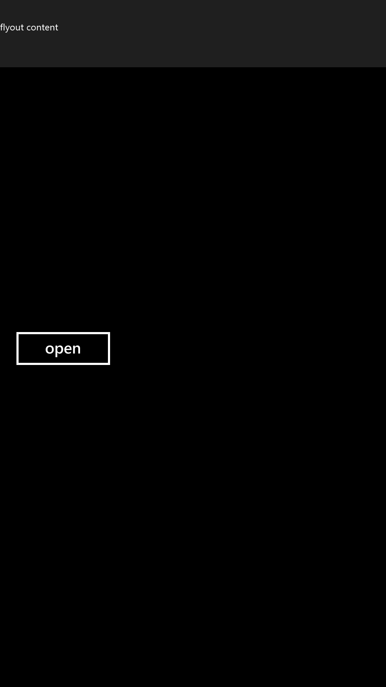
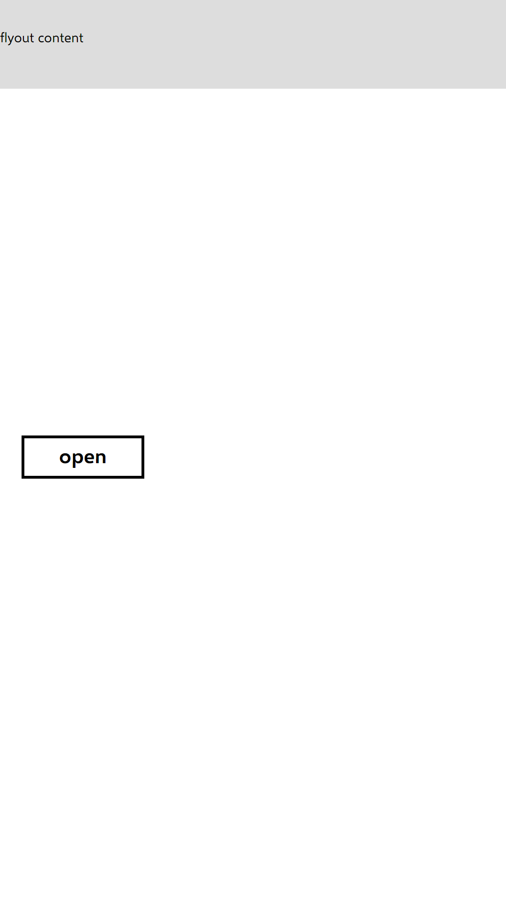
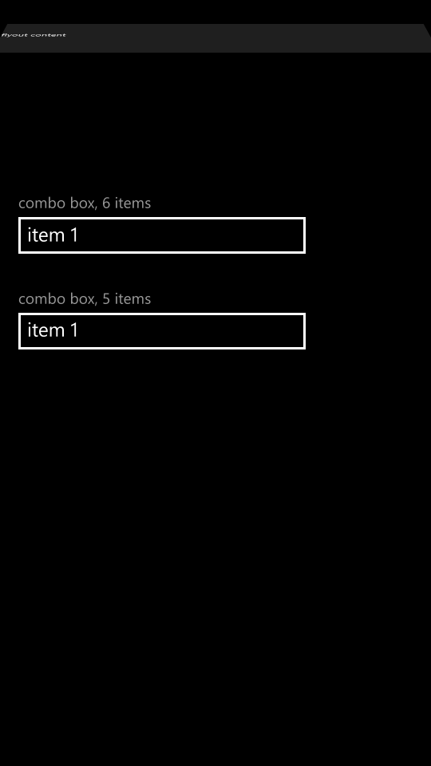
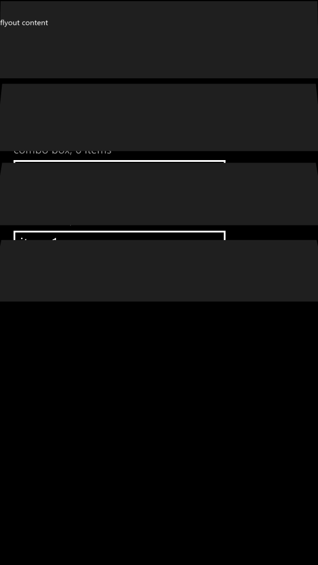
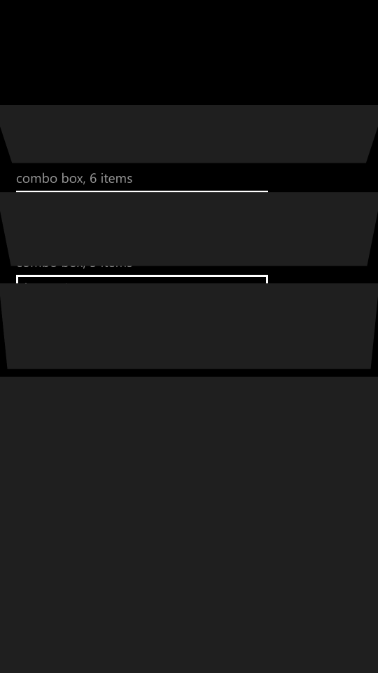
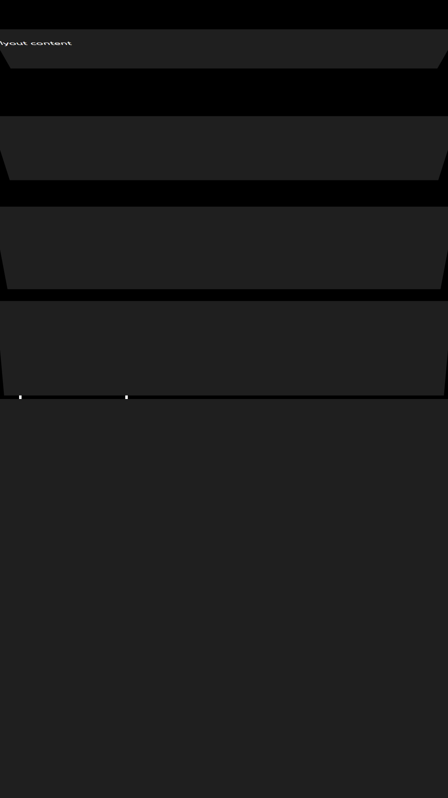

# Flyout and FlyoutPresenter: comparison

**The phone:** the emulator's screenshots of a `Flyout` shown on a Button "open", its content "flyout content",
Emulator 8.1 U1 1080P 5.5 inch (device 11), 1080 × 1920 at 2.4, run `20261108-2254-dev11`, in
[`ref/wp81/Flyout/`](../../../ref/wp81/Flyout/README.md). Segoe WP; the flyout's text in XAML's default 11 px "Global
User Interface", as the presenter is in a root of its own.
**Ours:** headless frames from `tests/Cornflower.Tests/Controls/FlyoutFrames.cs`, Avalonia 12.1.4 with Skia, the same
stage (450 × 800, the Button at 19, 377.08), at rest after the opening, in [`frames/`](frames). Selawik, the text in
the page's inherited font.

Text isn't compared by pixel: the fonts differ by design ([ADR 0001](../../decisions/0001-what-faithful-means.md)).

| Variant | Phone, dark | Ours, dark | Phone, light | Ours, light |
|---|---|---|---|---|
| `default` (top) |  |  |  |  |
| `full` |  |  |  |  |

## Measured

Raw pixels of the 1080 × 1920 frames unless named view pixels.

| What | Phone | Ours | |
|---|---|---|---|
| Top flyout: left, top, width | 0, 0, 1080 | 0, 0, 1080 | **match** |
| Top flyout: height (rows of the chrome) | 188 (78.33 view) | 189 (78.75 view) | **deliberate difference**: the ScrollBar's 53 rounded up to the raw grid, the phone's to the nearest (ADR 0003) |
| Full flyout | 0, 0, 1080 × 1920 | 0, 0, 1080 × 1920 | **match** |
| Chrome, dark / light | `#1F1F1F` / `#DDDDDD` | `#1F1F1F` / `#DDDDDD` | **match** |
| The page under a top flyout | black / white, not dimmed | black / white | **match** |
| Content's top (the ScrollViewer's) | 25.42 view (dump) | 25.42 view | **match** |
| Content's ink | rows 66 to 90, columns 0 to 162 | rows 68 to 96, columns 0 to 177 | text: the phone's 11 px font against the page's; position at the left edge **matches** |
| The page's Button | rows 928 to 1019 | rows 928 to 1019 | the stage, placed to match |

## The motion

#149's reading of the recording of run `20261116-1835-dev11` (`tools/refapp/README.md`, "The popups' bands"), in ticks
of the phone's 64 Hz clock; ours from `FlyoutTests` on a `TestClock` on the same ticks.

| What | Phone | Ours | |
|---|---|---|---|
| Top: opens | one band about its centre line, the lower edge toward the eye, 80° to 0 at 9.31° a tick (134 ms) | the same | **match** |
| Full: opens, bands 0 to 2 | 100 px bands about their centre lines, all from 80°, 12.61, 9.57, 7.58° a tick | the same | **match** |
| Full: opens, band 3 | not read | 6.01° a tick, so the popup is at rest at 208 ms | **chosen** (the read rest is 208 to 248 ms) |
| Full: opens, below 400 px | no turn read; at 119 ms nothing is drawn below 427 px, then the lowest row reaches 550, 672, 794 on successive recorded frames | drawn flat from the start | **gap**: how the lower bands come in isn't read (requested) |
| Full: at rest | 208 to 248 ms | 208 ms | **match** |
| Top: closes | no turn; gone in one frame 98 to 122 ms after `Hide()`; `Closed` 9 ticks after | no turn; gone at 110 ms; `Closed` at 140.6 ms | **match** |
| Full: closes | band k from 2k ticks after `Hide()`, the lower edge back, 10.95° a tick to 90°; `Closed` 22 ticks after | the same | **match** |
| The camera | one for the screen, 999 px in front, over y 400 | the same, over the window's centre | **match** |

Mid-motion, at the ticks nearest #149's stills ([`ref/wp81/Flyout/motion/`](../../../ref/wp81/Flyout/motion/README.md);
the phone's are 540 × 960, ours 1080 × 1920):

| | Phone | Ours |
|---|---|---|
| Top, opening (the still 51.9°; ours 52.1°, tick 3) |  |  |
| Full, opening (4.4, 22.2, 33.4, 41.4°; ours tick 6: 4.3, 22.6, 34.5, 40.6°) |  |  |
| Full, closing (−66.3, −45.6, −24.5°; ours tick 8: −65.7, −43.8, −21.9°) |  |  |

Measured down the column at x 416 (view px), the chrome's rows:

| | Phone | Ours |
|---|---|---|
| Top, opening | 25.0 to 55.0 | 27.1 to 52.5 |
| Full, opening | 1.7–110.8, 119.2–213.3, 230.8–318.3, 340.0–426.7, nothing below | 1.7–98.8, 109.6–192.1, 214.2–287.9, 317.1–385.4, then flat 400–800 |
| Full, closing | 125.0–193.3, 228.3–315.8, 337.5–438.3, then flat 448.3–800 | 29.6–68.3, 116.7–180.4, 207.5–289.6, 302.1–396.2, then flat 400–800 |

**Gap, sent back to the reference:** on all three full stills the bands' centre lines fall about 111 px apart (55, 166,
275, 383 opening; 159, 272, 388 closing), not the 100 px slices #149 gives. Ours are 100 px, as read; the band height is
one constant (`PhonePopupMotion.BandHeight`). And how the bands below 400 px come in, opening, isn't read.

## Dismissal

| What | Phone | Ours | |
|---|---|---|---|
| Back | not read | closes the topmost popup, ahead of the page's `NavigationPage` | **gap until #150** (`PhonePopupDismissal`) |
| A tap below a top flyout | not read | closes it; the tap doesn't reach the page | **gap until #150** |
| Event order | not read | Avalonia's | **gap until #150** |
