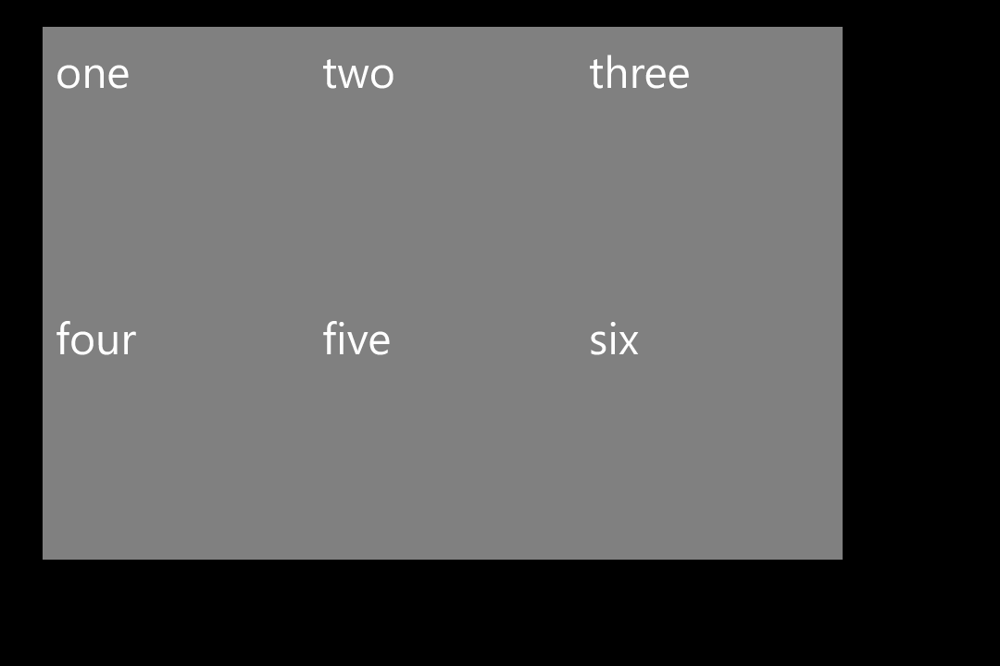
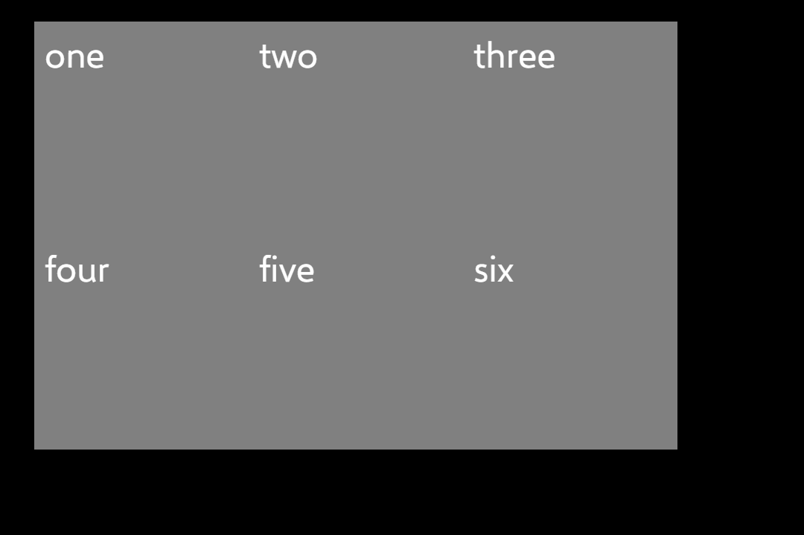
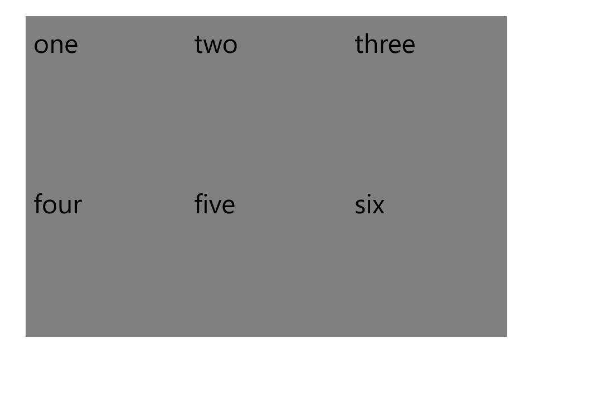
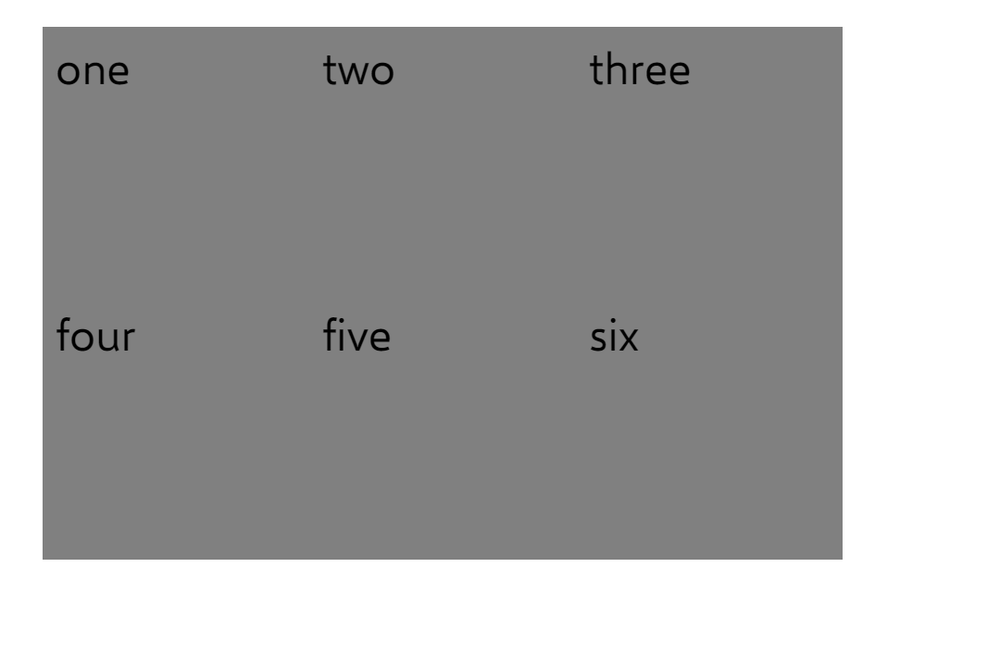
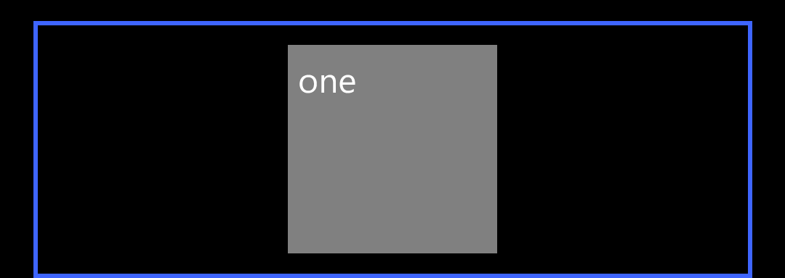
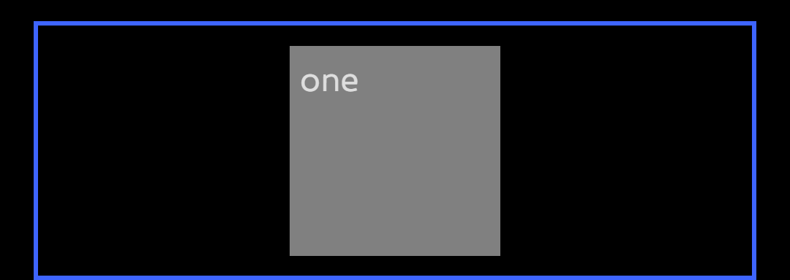
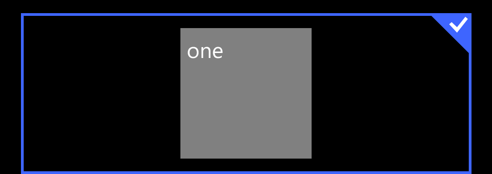
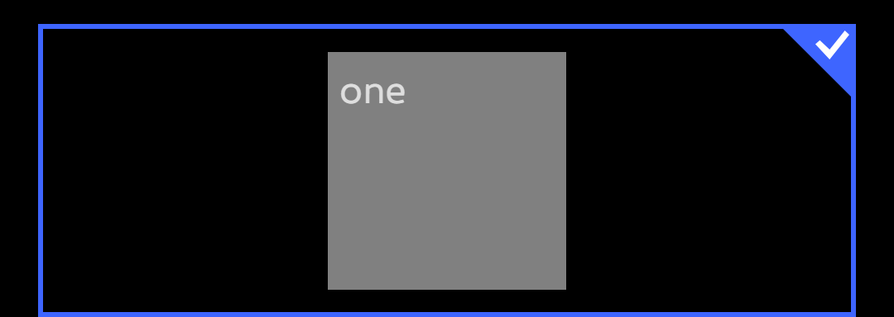
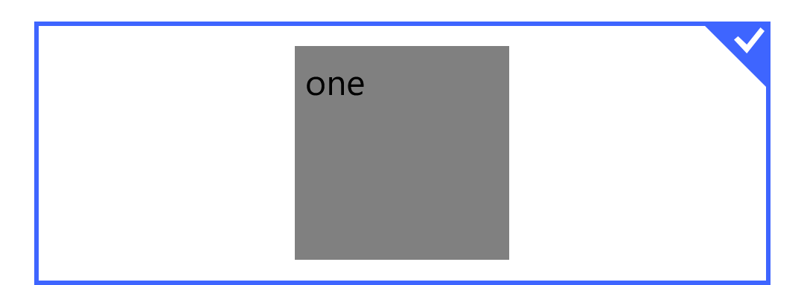
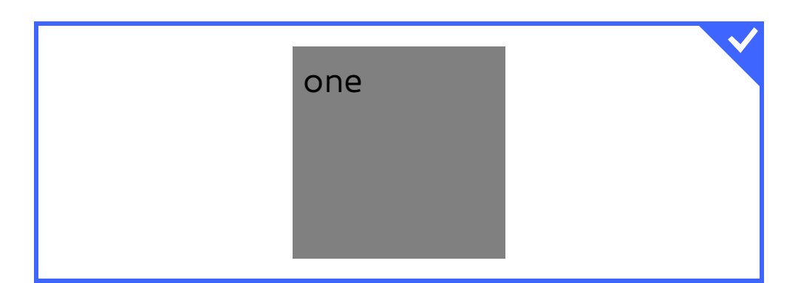

# GridView and GridViewItem: comparison

**The phone:** the reference app's captures, Emulator 8.1 U1 1080P 5.5 inch (device 11), 1080 × 1920 at 2.4,
2026-11-18, run `20261118-2210-dev11` (#211), in [`ref/wp81/GridView/`](../../../ref/wp81/GridView/README.md), Segoe WP:
a `GridViewItem` holding a 120 × 120 #FF808080 tile (`Catalog.Tile`) on its own, at rest, with `GridMultiSelect` forced
on it, and selected with it forced; and a GridView of six tiles with the second selected.
**Ours:** headless frames from `tests/Cornflower.Tests/Controls/GridViewFrames.cs`, Avalonia 12.1.4 with Skia, on the same
stage, in [`frames/`](frames), Selawik: the item in `Wp81GridViewItemTheme`, the check mode by `PhoneListMultiSelect.IsOn`
set on it (as the list sets it), and the grid in `Wp81GridViewTheme`.

| | Phone | Ours |
|---|---|---|
| Grid, dark |  |  |
| Grid, light |  |  |
| Item, dark |  |  |
| Item in the check mode, dark |  |  |
| Selected in the check mode, dark |  |  |
| Selected in the check mode, light |  |  |

The light frames not shown are in [`frames/`](frames) beside the phone's.

## Pixels

Each frame against the phone's, pixels whose channels differ by more than 24 (a script in the PR's scratch folder, not
kept):

| Frame | Dark | Light | Where |
|---|---|---|---|
| Grid, six tiles | 5,510 | 5,321 | the tiles' names (Segoe WP and Selawik), raw (60, 55) to (744, 383) |
| Item | 1,580 | 1,260 | the tile's name, and its bottom row: our tile one raw pixel lower |
| Item in the check mode | 2,278 | 1,958 | as the item, and the right border's column: our item one raw pixel narrower |
| Selected in the check mode | 2,529 | 2,209 | as the check mode, and the earmark's and the tick's right-hand edges, one raw pixel to the left |

No difference of colour: the tile, the accent border, the earmark and the white tick are the phone's in both variants.

## Behaviours

| Behaviour | Result |
|---|---|
| Three tiles a row from the left, wrapping, abutting; the grey's extent | **match**, to the pixel |
| An item's tile centred in it | **match** across; **one raw pixel** lower (ADR 0003) |
| Scrolls down, not across; 840 in a 720 view | **match** |
| Single: a selected item draws nothing | **match** |
| The check mode's 2.5 accent border on every item, no box, the content still | **match** |
| The earmark and its tick on a selected item, dark and light | **match**, one raw pixel to the left (the item is one raw pixel narrower, ADR 0003) |
| A tap in the check mode toggles | **match** |
| The press: Pressed at once, the first frame's depth, RotationY 6 px from the left | **match**, within the tilt model's tolerances |
| Item click | **assumed**, #148's rule; unread on the phone |
| Disabled: the selected parts transparent | from the template; not captured |
| Items of different sizes | **gap**: the phone gives every item the first's size, `WrapPanel` each its own |
| Virtualisation | **gap**: `WrapPanel` realises every item |
