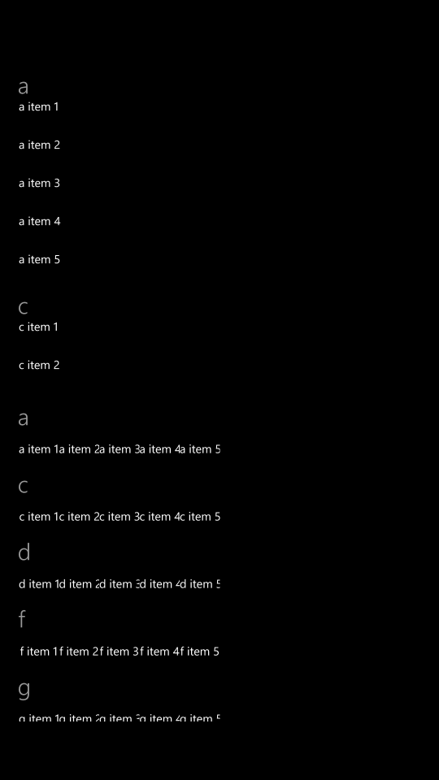
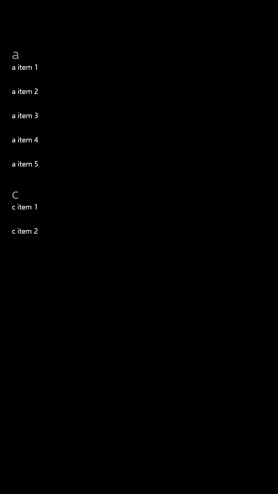
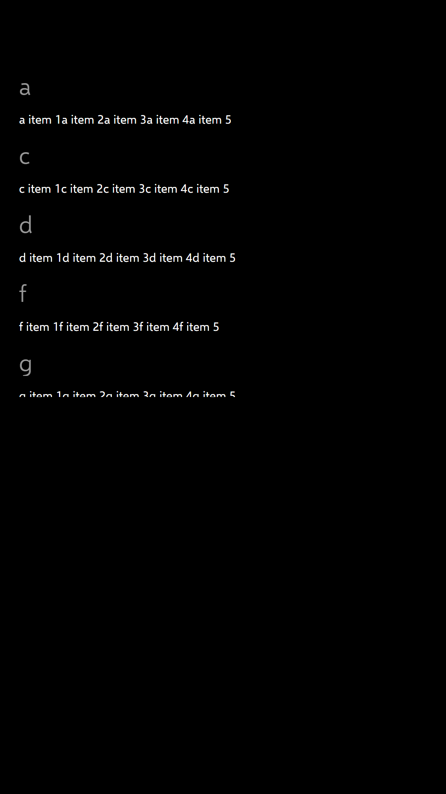
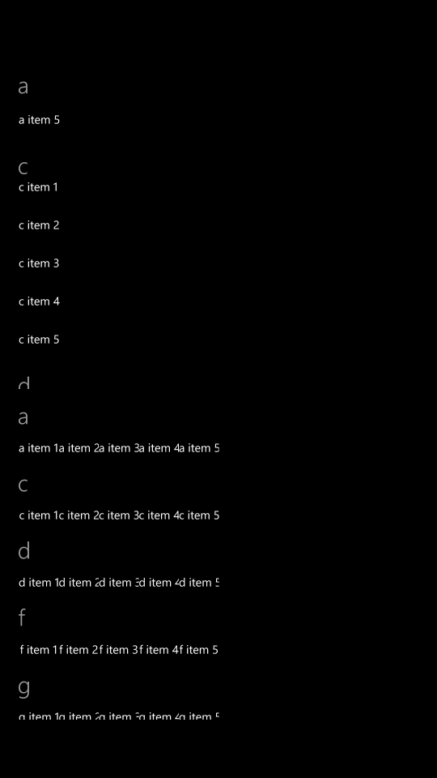
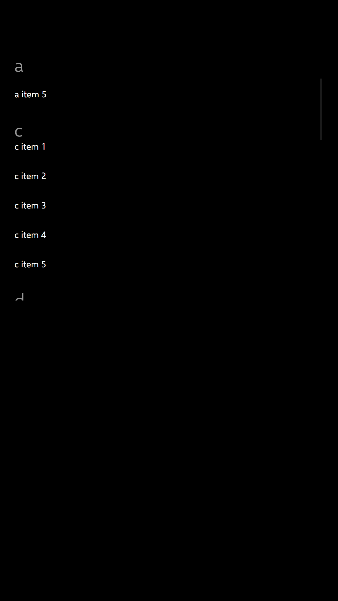
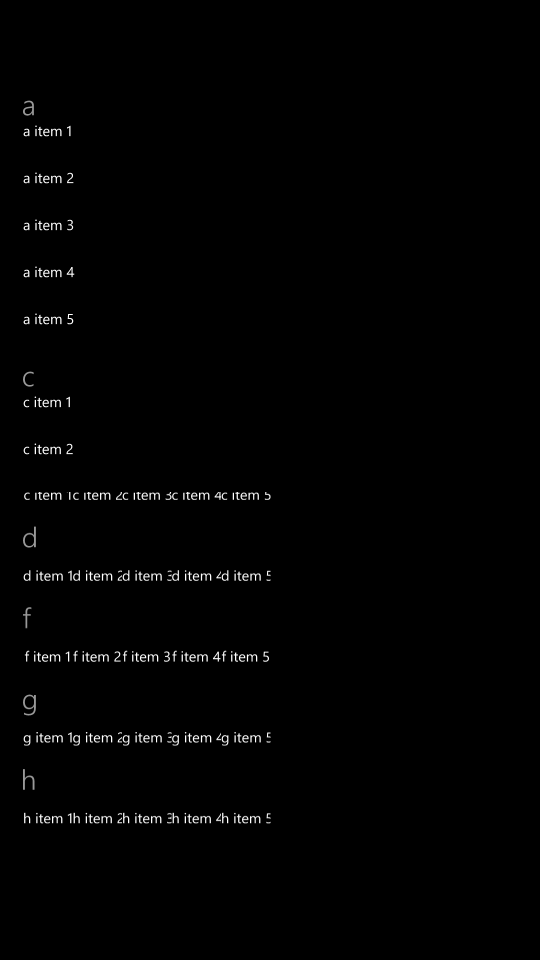
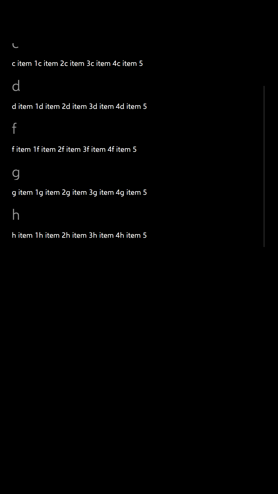

# Grouped lists: comparison

The phone: #211's probe of a grouped ListView over a grouped GridView (run `20261118-2221-dev11`) and its screen
recording (`20261118-2249-dev11`), numbers in `tools/refapp/README.md`, "Tier 4's reads", Grouped lists. The pinned
header shows only in the recording: `RenderTargetBitmap` leaves it out. Ours: `GroupedListTests` (measurements) and
`GroupedListFrames` (headless, 450 × 800 at 2.4, dark), the probe's page: each list 19 in, 330 tall, groups a to h of
five items, b and e empty, each header the letter in `GroupHeaderTextBlockStyle`.

Fonts: the phone's Segoe WP, ours Selawik (ADR 0003), so text is compared by place and size.

## At rest

| Phone (the recording) | Ours |
|---|---|
|  |   |

The phone's frame holds both lists, the ListView over the GridView; ours shows each on its own page, at the ListView's
place.

| Reading | Phone | Ours | |
|---|---|---|---|
| ListView: header a's top | 70 | 70 | match |
| header width | 412.08 | 411.67 (the list's, snapped at 2.4, as every item's) | match |
| header height (its text's line) | 30 | 30 | match |
| first item's top, straight under the header | 100 | 100 | match |
| header c's top (b hidden) | 295.8 | 295.8 | match |
| GridView: a group's five items in one row under its header | yes | yes | match |
| GridView: headers apart | 69.2 | 69.17 | match |
| Header: margin, padding, background, content alignment | 0, 0, Transparent, Left Top | the same | match |
| `GroupItem`s | none | none | match |

## Panned

| Phone (the recording) | Ours |
|---|---|
|  |  |
|  |  |

| Behaviour | Phone | Ours | |
|---|---|---|---|
| ListView panned about 140: header a pinned at the top, "a item 5" below it | yes | yes (panned 140) | match |
| Items under the pinned header don't show through | "a item 4", under it, doesn't show | drawn over `ApplicationPageBackgroundThemeBrush` | match on the page's brush; deliberate difference on a page with a background of its own |
| The next header pushes the pinned one up | not in the frames | yes (`A_ListViews_Header_Sticks_At_The_Top`) | not read: ours pushes it, so the two never overlap |
| GridView panned: no header over the top row; header c gone up with its group | yes | yes | match |

## The press

| Reading | Phone | Ours | |
|---|---|---|---|
| Pressed 20 from the left, halfway down, held: `RotationX`, `RotationY`, `GlobalOffsetZ` | −4.8°, +7.6°, −6.8 | −4.79°, +8.11°, −6.24 | match within 0.6 (the Button's tilt, `Tilt`) |
| Release: `Pressed` > `PointerOver`, then `Normal` 355 ms later | yes | the tilt returns on release; `PointerOver` draws nothing on either | match to the eye |
| A tap selects nothing, clicks nothing | (WinRT's headers aren't items) | yes | match |

## Differences that stand

- `SelectedIndex` counts the headers (WinRT's counts items alone): Avalonia's selection is by index into `ItemsSource`.
- Empty groups are always hidden (`HidesIfEmpty` on).
