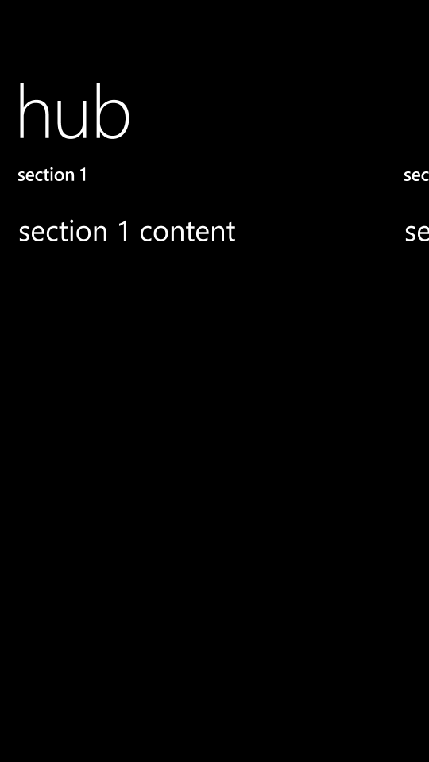
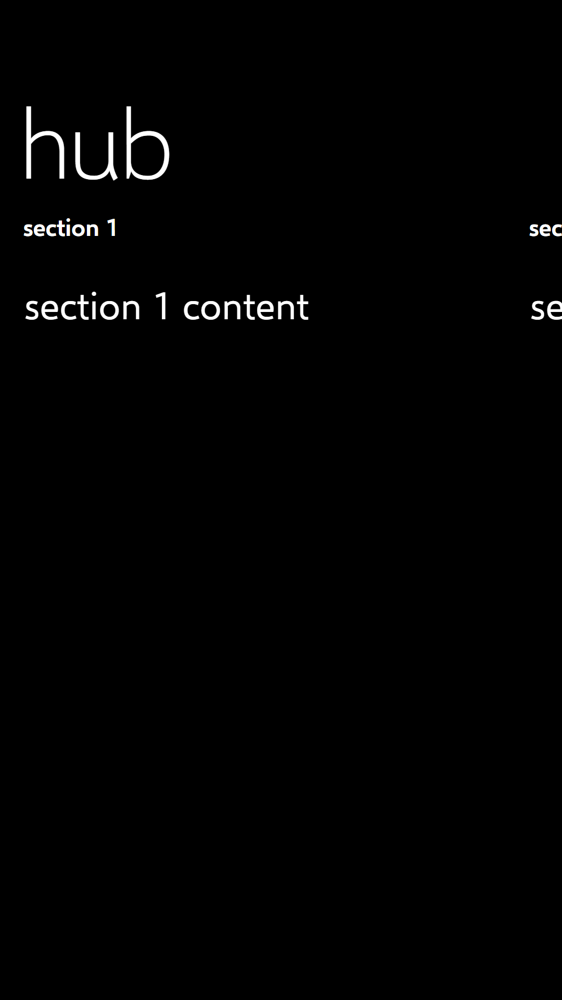
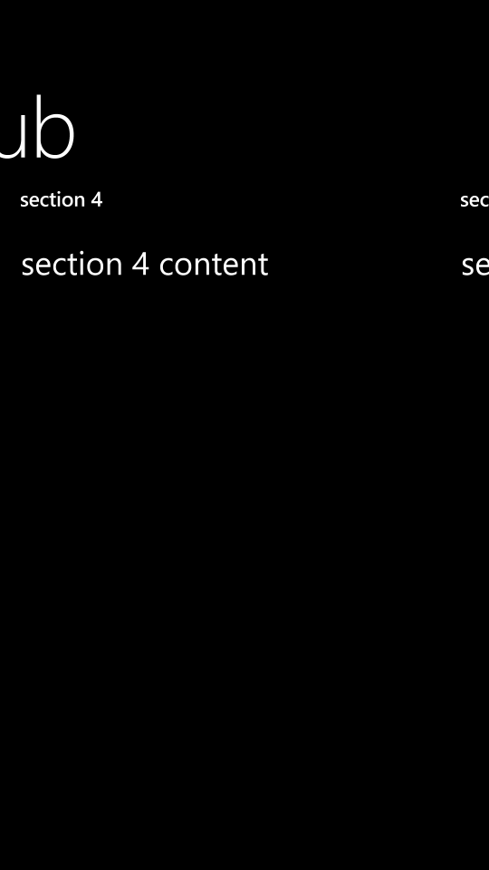

# Hub: comparison

The phone's Hub beside ours. The phone's: the reference app on Emulator 8.1 U1 1080P 5.5 inch (device 11), its
recording's frames at rest (run `20261115-2059-dev11`, 540 × 960, 1.2 window px a view px) and the catalogue's
captures (run `20261108-1443-dev11`, all mid-entrance, [`ref/wp81/Hub/`](../../../ref/wp81/Hub/README.md)). Ours:
headless (Avalonia.Headless + Skia) at the reference profile, 450 × 800 at 2.4, saved by `HubFrames`
(`CORNFLOWER_FRAMES=<folder> dotnet test --filter FullyQualifiedName~HubFrames`), which also measures our ink.

## At rest

The probes' Hub: the header "hub" and four sections of 30 px text, below a 60 px band, so the Hub is 450 × 740.

| | The phone (recording) | Ours |
|---|---|---|
| At the first section |  |  |
| At the last, the first past it |  |  |

The ink's bounds (pixels lighter than mid grey) in view pixels of the window, the phone's from its 1.2× frame (so to
0.83 px), ours from our 2.4× frame (to 0.42):

| Region | The phone, first | Ours, first | The phone, last | Ours, last |
|---|---|---|---|---|
| "hub" | 21.67, 87.50 to 135.00, 145.83 | 21.25, 85.00 to 135.42, 144.58 | 0, 87.50 to 67.50, 145.83 | 0, 85.00 to 67.92, 144.58 |
| The left section's header | 19.17, 175.83 to 89.17, 190.00 | 18.75, 174.58 to 92.08, 189.17 | 19.17, 175.83 to 94.17, 190.00 | 18.75, 174.58 to 94.58, 189.17 |
| Its content | 20.83, 230.83 to 246.67, 253.33 | 20.42, 233.33 to 246.67, 255.83 | the same | the same |
| The right edge's header (the next section, or at the last the first) | 424.17, 180.00 to 450 | 423.75, 179.17 to 450 | 424.17, 180.00 to 450 | 423.75, 179.17 to 450 |
| The right edge's content | 425.83, 237.50 to 450 | 425.42, 240.83 to 450 | 425.83, 237.50 to 450 | 425.42, 240.83 to 450 |

Across, every edge is within 0.42 px, but the section header's right edge (2.9 px wider: Selawik SemiBold against
Segoe WP SemiBold). Down, the header's ink is 1.25 to 2.5 px higher and the content's 2.5 to 3.3 px lower: the fonts'
ascents differ (Selawik for Segoe WP, by design), and the probes' content is a plain `TextBlock`, in Avalonia's line
(Selawik's 1.2 em) where the phone's is Segoe WP's. The layout boxes match the probes' layout lines to the raw pixel
grid (`The_Layout_Is_The_Probes`): the header host at 15, 0.83 (the phone's 1, rounded down to the raw grid, ADR 0003)
and 103.75 tall; the sections 405 × 740 at 0, 405, 810, 1215; the section header 0.33 px right of the phone's (the
19 inset is 19.17 on the raw grid).

At the last section the first section's edge shows past it, as the phone's, at 405 (the phone's 404.58: its offset ends
at 1,215.417, the extent 0.417 px longer than ours).

The light theme ([ours](frames/light__Hub__four-sections__first__ours.png)) is the same layout in black on white.

## The catalogue's captures

The eight captures (`two-sections`, base and the three `BackgroundImageLoadStates`, dark and light) were all taken while
the Hub's entrance animation still turned it (−53.7° to −3.2° about Y), so none is a frame at rest: they confirm the
header's size (78) and weight (Light), the section headers' (19 SemiBold) and the colours (`#FFFFFFFF` on black, dark;
`#FF000000` on white, light), which the tests assert from the dumps' values, not pixel by pixel. The entrance itself
isn't ours (README, "Known gaps").

## A background image

Ours with the probes' 1600 × 800 picture, at an offset of 603.56: [frame](frames/dark__Hub__four-sections__image-at-603__ours.png).
The image is 1600 × 800 from the Hub's top (the window's height; the Hub is 740), clipped at the Hub's edge; its left
edge at −593.25, the phone's at that offset (run `20261116-0009-dev11`: −593.245). Against every logged offset:

| Offset | The phone, 1600 px | Ours | The phone, 900 px | Ours |
|---|---|---|---|---|
| 22.103 | −21.725 | −21.725 | | |
| 205.045 | −201.540 | −201.540 | | |
| 599.066 | | | −230.410 | −230.410 |
| 603.562 | −593.245 | −593.245 | | |
| 810 | −796.154 | −796.154 | −311.538 | −311.538 |
| 1,215.417 | −1,195.316 | −1,195.316 | −495.32 | −495.316 |

The copy flips from W − 1 left to W − 1 right between offsets 582.9 and 586.3 on the phone; ours at (L − V) / 2, 585.

## The motion

Each against the phone's frames, on an emulator-grid `TestClock` with the release on a frame:

| What | The phone | Ours | Difference |
|---|---|---|---|
| The header against the offset | 15 − offset / 18, worst 0.0005 px | The same, to 0.001 | none |
| A swipe's offset after the release | 20 swipes' median a frame | `KeySpline` fit | within 0.0036 of the way a frame (0.7 px of the probes' 205), 0.36 px rms of all 20 |
| Where it settles | 405 exactly, 52 to 54 frames after the release (0.01 px) | 405 exactly, 743.75 ms (48 frames) | ours settles 4 to 6 frames sooner, by under 0.2 px |
| Back after a slow release | 5 drags' median | `KeySpline` fit | within 0.008 a frame (1.2 px of 150), 1.05 px rms |
| The loop's sections | 4 loops' median, then 0 on frame 19 | `KeySpline` fit to L, 0 on frame 19 | within 0.0041 a frame; the phone stops 1.42 px short of L, ours reaches it: a 1.4 px step on the phone at the reset, none on ours |
| The loop's header: hold and fly-out | Held 2 frames, then 16.04 px a frame | The same | under 0.05 px |
| The jump | On frame 6 (one run 7), to 451 to 459 drawn | On frame 6, to 465 | ours 6 to 14 px further right on that one frame: the phone jumps between frames, on its stopwatch |
| The fly-in | Each frame 0.7699 to 0.7708 of the last's way left | 0.7708 | at its place 27 frames after the jump, as the phone |
| The background against the offset | Two straight lines, within 0.001 px | The same | none |

## Deliberate differences

- **The offset's curves are fits** to the phone's frames (above): the swipe's 0.36 px rms, the way back's 1.05, the
  loop's 0.93.
- **The ScrollViewer doesn't scroll**: the Hub moves its panel (PLAN.md, "The ScrollViewer").
- **The background is clipped at the Hub's edge**; the phone's code clips it to a rectangle dumped as 450 × 800 from
  the Hub's top left, so on the phone a tall image can draw below a short Hub.
- **The wrapped first section** moves as a whole (its own `RenderTransform`), not its template's root, so it can be
  tapped where it is drawn.
- **Avalonia's `ImageBrush`** stretches `Uniform` by default; WinRT's `Fill`. Write `Stretch="Fill"` for the phone's
  look (the sample does).
- **The fonts**: Selawik for Segoe WP, so the text's ink differs by a pixel or two.
