# ListBox and ListBoxItem: comparison

**The phone:** the reference app's captures, Emulator 8.1 U1 1080P 5.5 inch (device 11), 1080 × 1920 at 2.4,
2026-11-18, run `20261118-2210-dev11` (#211), in [`ref/wp81/ListBox/`](../../../ref/wp81/ListBox/README.md), Segoe WP: a
`ListBoxItem { Content = "list box item" }` on its own, its states forced with `VisualStateManager.GoToState`, and a
ListBox of "one", "two" and "three" with the second selected. And the run's dumps.
**Ours:** headless frames from `tests/Cornflower.Tests/Controls/ListBoxFrames.cs`, Avalonia 12.1.4 with Skia, on the same
stage, in [`frames/`](frames), Selawik: the item in `Wp81ListBoxItemTheme`, its states real (pressed by a touch at its
centre and settled 160 ms; `IsEnabled` false; `IsSelected`), and the list in `Wp81ListBoxTheme`.

| | Phone | Ours |
|---|---|---|
| List, dark | 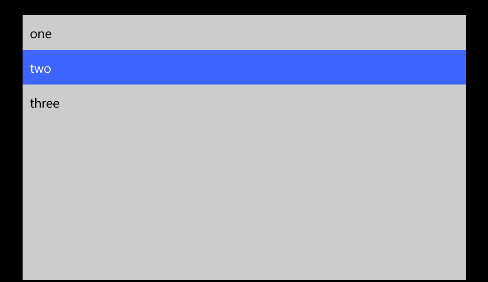 | 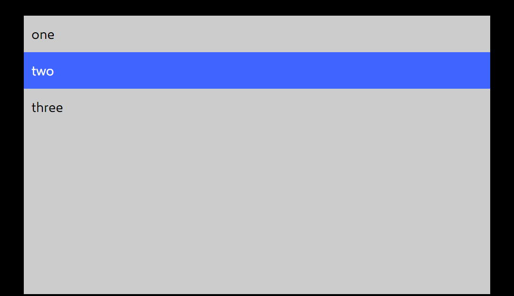 |
| List, light |  | 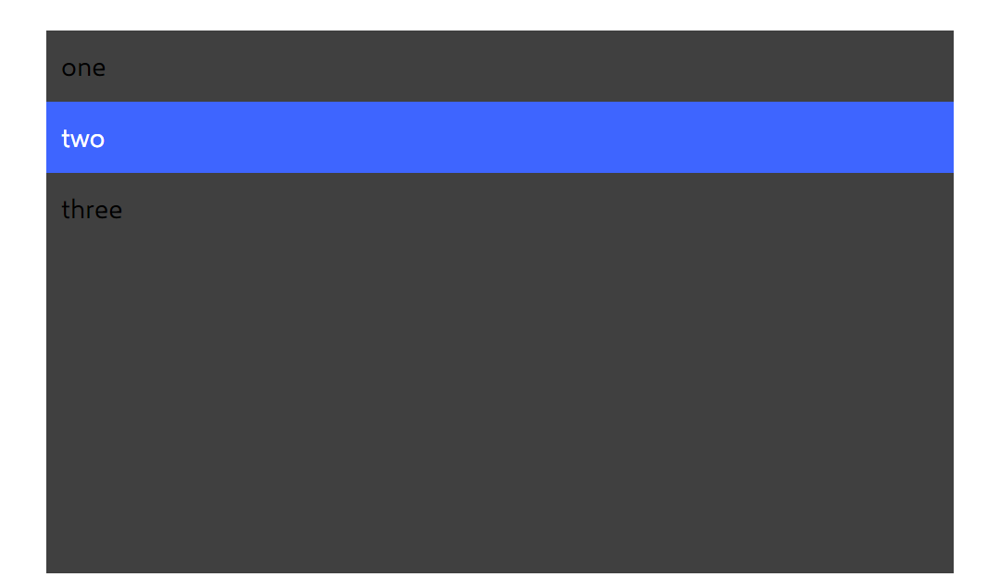 |
| List disabled, dark | 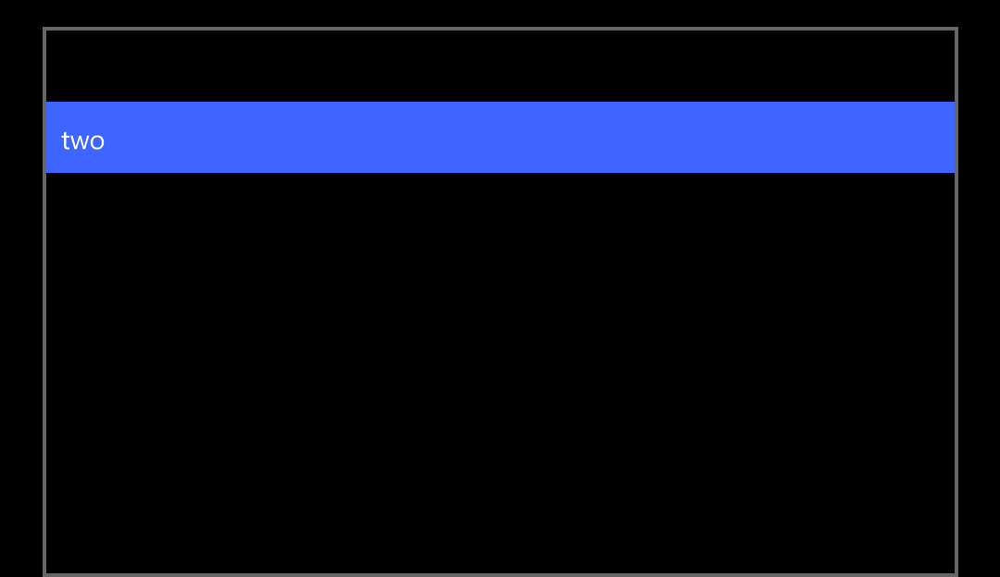 | 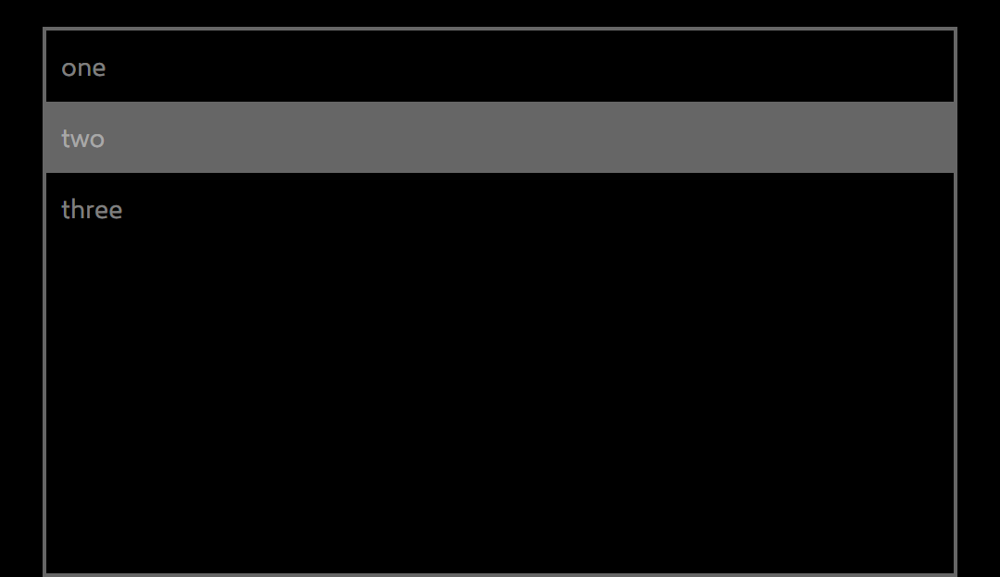 |
| List disabled, light | 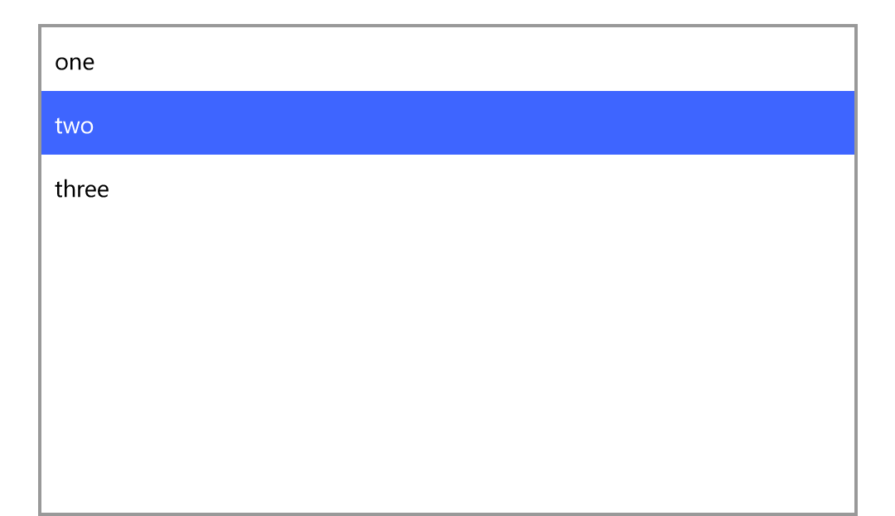 | 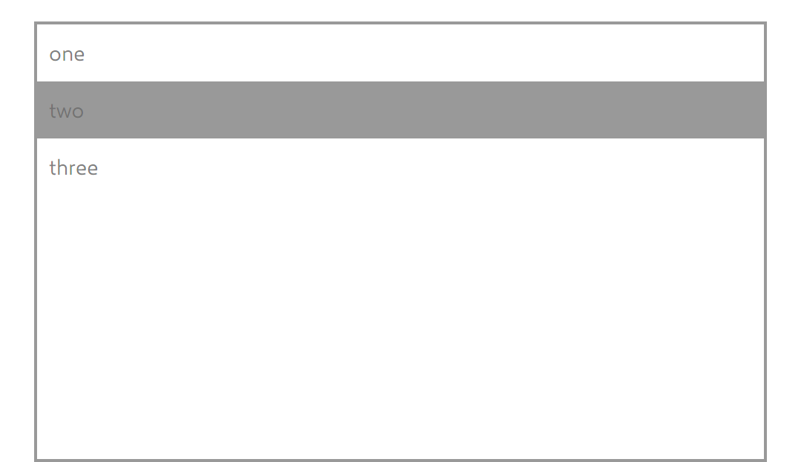 |
| Item, dark | 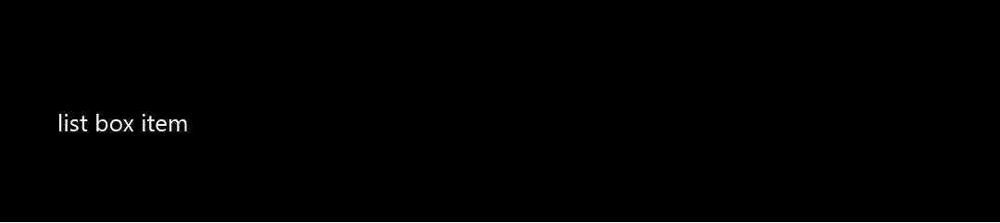 |  |
| Item pressed, dark | 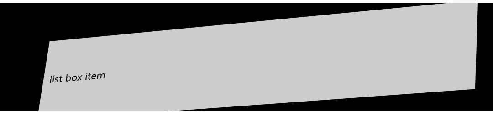 | 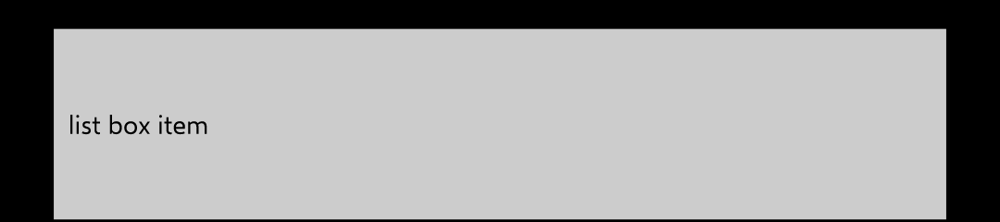 |
| Item pressed, light | 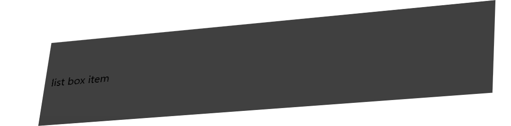 | 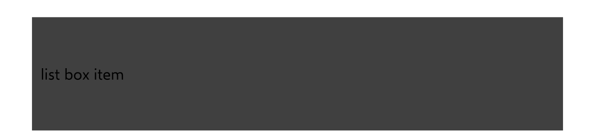 |
| Item disabled, dark |  | 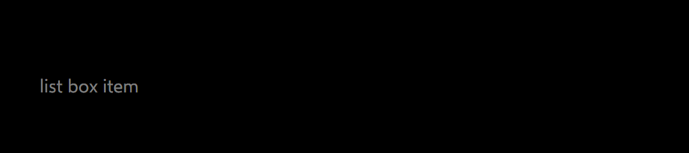 |
| Item selected, dark | 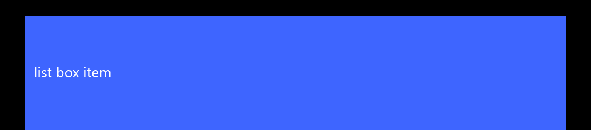 | 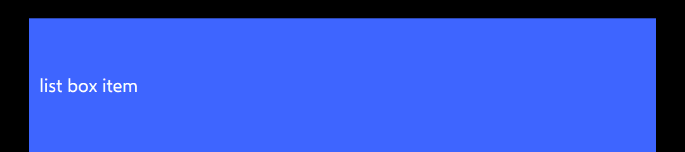 |
| Item selected disabled, dark | 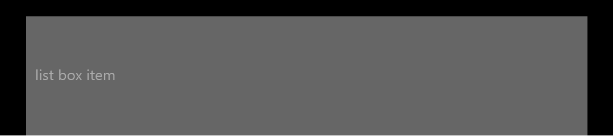 | 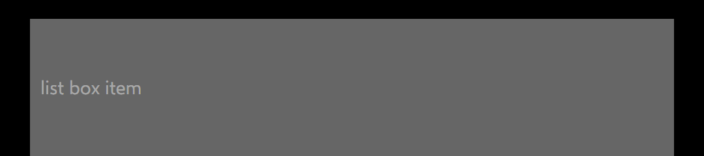 |
| Item selected disabled, light | 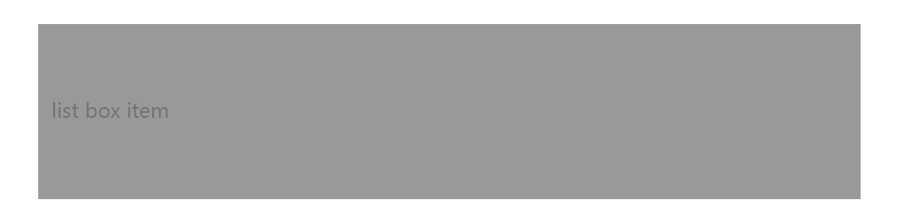 | 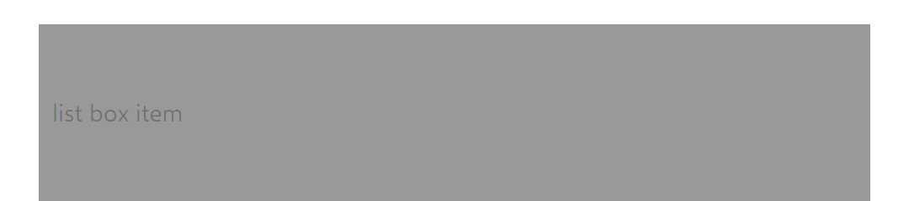 |

The light item frames not shown are in [`frames/`](frames) beside the phone's.

## Pixels

Each frame against the phone's, pixels whose channels differ by more than 24 (a script in the PR's scratch folder, not
kept):

| Frame | Differ | Why |
|---|---|---|
| The list, dark and light | 0.30%, 0.26% | the text's glyphs (Selawik for Segoe WP, ADR 0001) |
| The item at rest, disabled, selected, selected disabled, dark and light | 0.48% to 0.70% | the glyphs; the phone's capture is one raw row taller (241) |
| The item pressed, dark and light | 19.5%, 21.8% | by design: the capture's forced `Pressed` tilted the item by −17.19°, 17.19°, which no touch gives (as the ListView's); ours is a touch at the centre, sunk evenly |
| The list disabled, dark and light | 11.5%, 11.5% | by design: the capture forced `Disabled` on the list alone, its items enabled (black text, the accent); a list with `IsEnabled` false disables its items, so ours draws them `Disabled` and `SelectedDisabled` |

## Measurements

| | Phone | Ours | |
|---|---|---|---|
| The list | 19.1667, 12.0833, 412.0833 wide | 19.1667, 12.0833, 411.6667 wide | **match** (one raw pixel narrower, ADR 0003) |
| The pale box | inside the border: the page in the 4 raw pixels of the 1.5 border | the same (`BackgroundSizing` InnerBorderEdge) | **match** (tested) |
| The items | at 1.6667, 1.6667; 33.75; 65.8333; 32.0833 tall | the same | **match** (tested) |
| The content, in the item | 6.6667, 7.9167, 16.25 tall, its own width | the same | **match** (tested) |
| The item on its own | 87.9167 tall, the content centred | the same, centred within a raw pixel | **match** (tested) |
| Colours: the box, the text, the accent, the pressed brush, the disabled brushes | the dumps' | the tokens' | **match** (tested, dark and light) |

## Behaviours

| | Phone | Ours | |
|---|---|---|---|
| A press | the pale brush, black text, the Button's tilt on InnerGrid (the template; not probed by touch) | the same: `Tilt` on InnerGrid, LayoutRoot untilted | **match** the template; the device run checks it by eye |
| A press on a selected item | not read | the pale brush over the accent, the press's black text | **decided** (PLAN.md) |
| Focus, the pointer over | nothing | nothing | **match** (tested) |
| `IsSelected` on an item outside a list | drawn unselected | drawn selected | **gap** (README) |
