# ListPickerFlyout and PickerFlyout: comparison

**The phone:** the emulator's grabs of run `20261116-1934-dev11` (#150), Emulator 8.1 U1 1080P 5.5 inch (device 11),
1080 × 1920 at 2.4, in [`ref/wp81/ListPickerFlyout/`](../../../ref/wp81/ListPickerFlyout/README.md) and
[`ref/wp81/PickerFlyout/`](../../../ref/wp81/PickerFlyout/README.md): a ListPickerFlyout of "one" to "five" titled "LIST
PICKER" (Single, "two" selected; Multiple, "two" and "four" checked) and a PickerFlyout of "picker flyout content" (a
TextBlock with a 19 margin), with and without its buttons. Segoe WP; the PickerFlyout's content in XAML's 11 px default.
**Ours:** headless frames from `tests/Cornflower.Tests/Controls/ListPickerFlyoutFrames.cs`, Avalonia 12.1.4 with Skia,
the same pickers at rest after the opening, in [`frames/`](frames). Selawik; the PickerFlyout's content in the page's
inherited font.

Text isn't compared by pixel: the fonts differ by design ([ADR 0001](../../decisions/0001-what-faithful-means.md)).

| Variant | Phone, dark | Ours, dark | Phone, light | Ours, light |
|---|---|---|---|---|
| ListPickerFlyout, `single` | 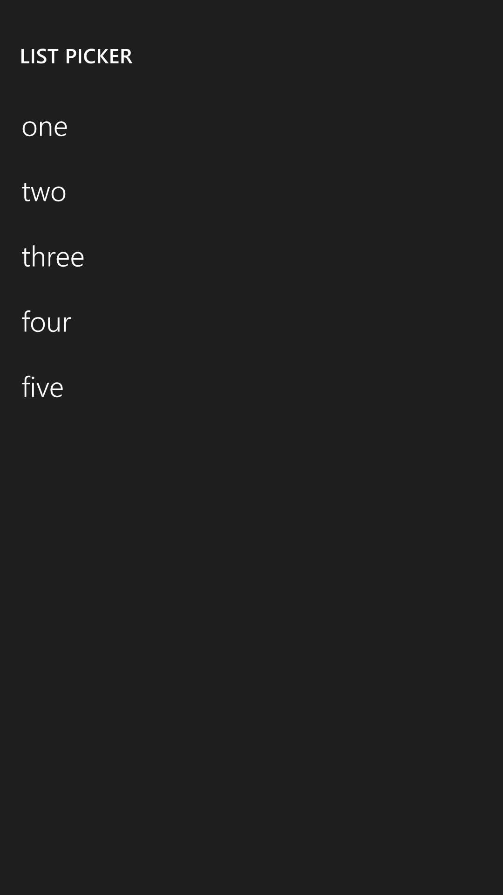 | 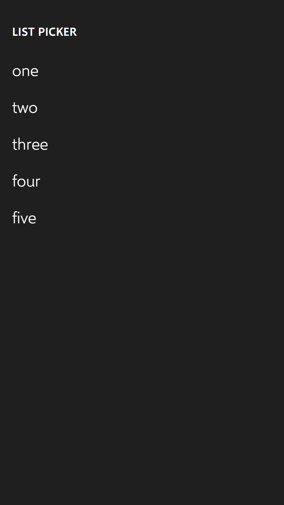 | 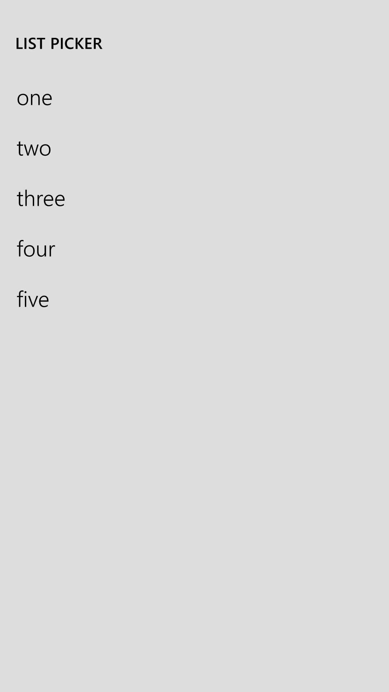 | 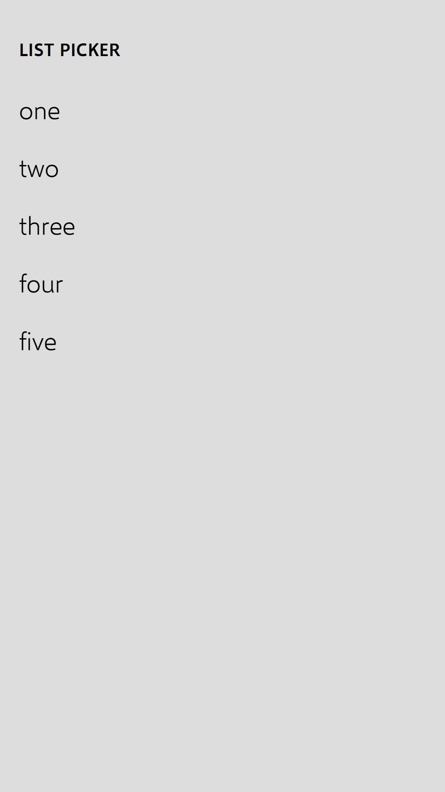 |
| ListPickerFlyout, `multiple-two-checked` | 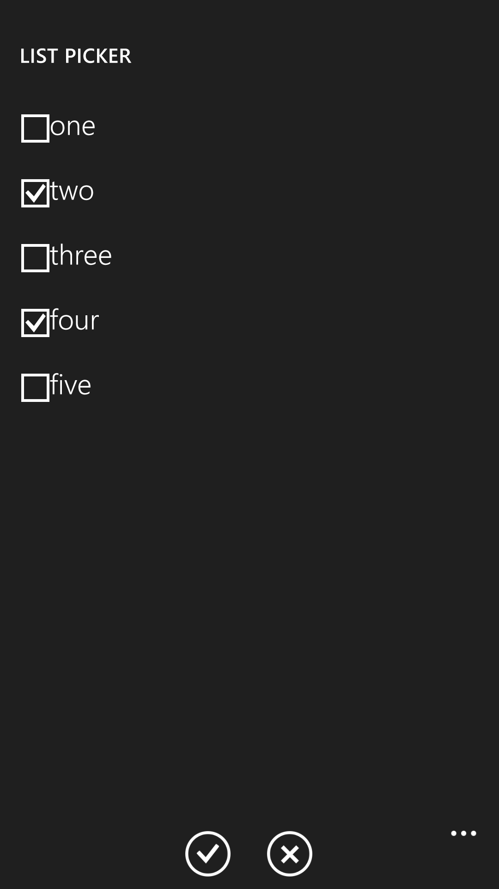 | 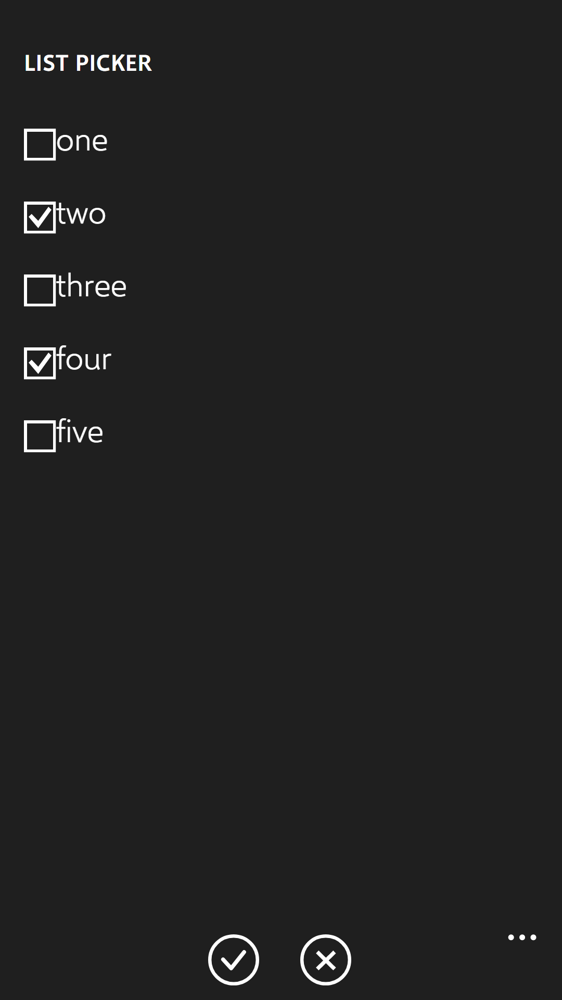 | 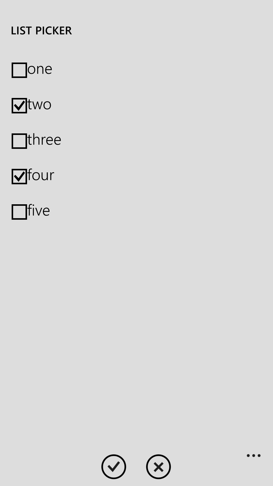 | 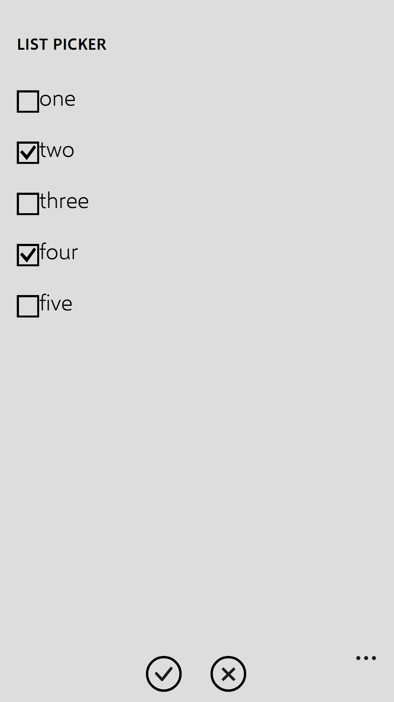 |
| PickerFlyout, `confirmation-buttons` | 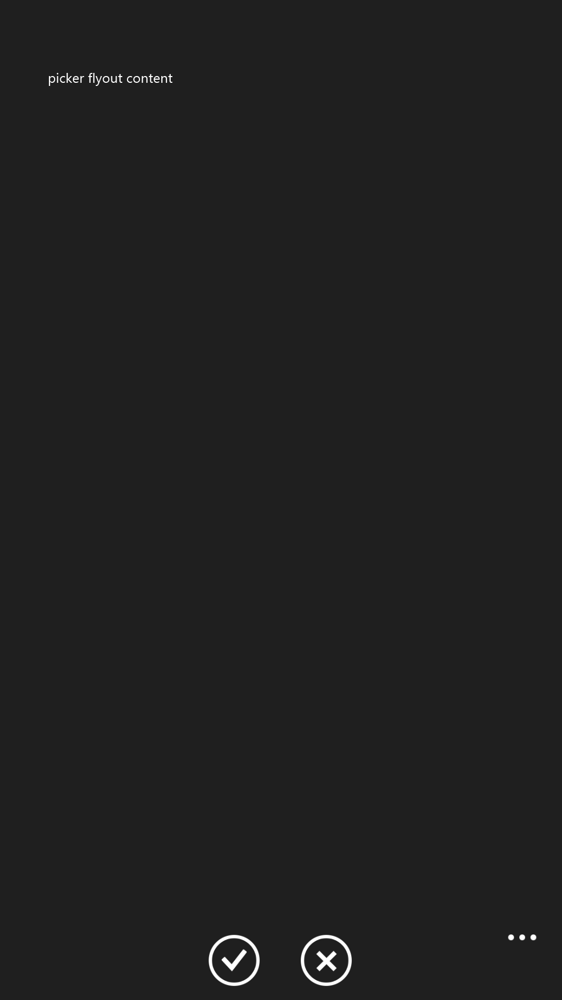 | 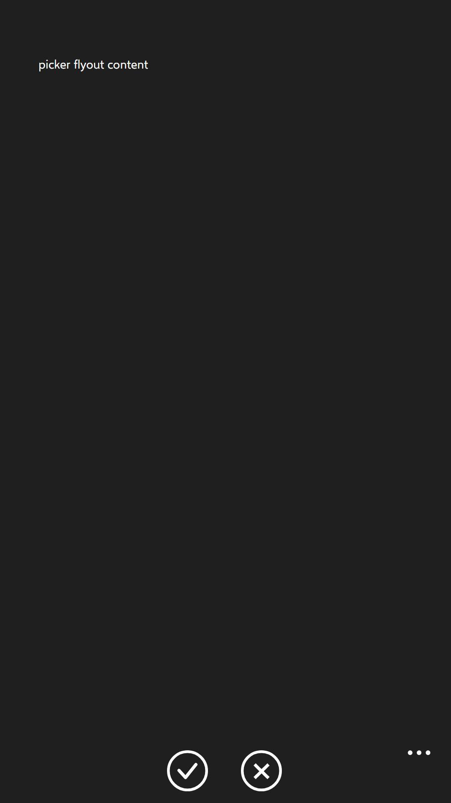 | 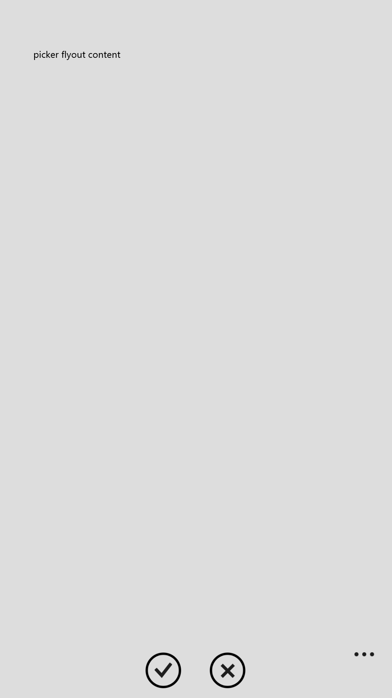 | 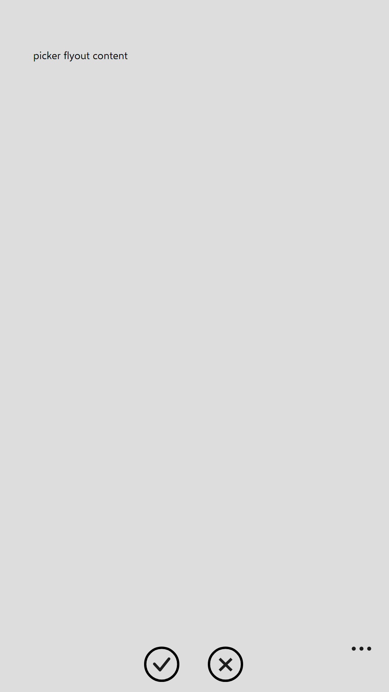 |
| PickerFlyout, `no-confirmation-buttons` | 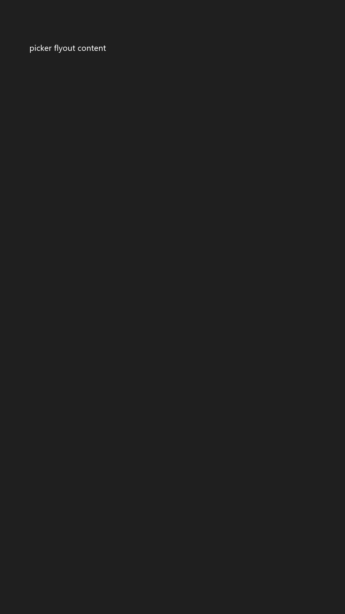 |  |  |  |

## Measured

Raw pixels of the dark 1080 × 1920 frames (left, top, right, bottom of the ink brighter than half way), unless named
view pixels.

| What | Phone | Ours | |
|---|---|---|---|
| The picker | 0, 0, 1080 × 1920, `#1F1F1F` / `#DDDDDD` | the same | **match** |
| The content panel (view) | 19.17, 37.08, 412.08 × 762.92; 700 tall with the bar | 19.17, 37.08, 411.67 × 762.92; 700 | width: **deliberate difference**, each margin rounded up to the raw grid (ADR 0003) |
| The title's ink | 46, 105 to 283, 135 | 50, 104 to 291, 136 | text: Selawik's side bearing and width; the line's place **matches** |
| Multiple, item 1's check box | 46, 247 to 106, 307 | 46, 247 to 106, 307 | **match** |
| Multiple, item 1 (box and text) | 46, 247 to 204, 307 | 46, 247 to 205, 307 | **match** |
| Items 58.33 apart (view), 39.17 tall | dump | laid out the same | **match** |
| Single, item 1's text | 49, 260 to 142, 291 | 48, 259 to 143, 289 | text |
| The accept ring | 401, 1795 to 498, 1892 | 400, 1794 to 497, 1891 | one raw px left and up: the CommandBar's centring (#144) |
| The cancel ring | 578, 1795 to 675, 1892 | 577, 1794 to 674, 1891 | the same |
| The "..." | 977, 1794 to 1030, 1804 | 977, 1794 to 1029, 1804 | **match** |
| The check's ink box (view) | 20.00 × 17.23 dark, 19.92 × 17.12 light, centred within 0.13 | about 20.0 × 16.1, centred within 0.3 | ours, drawn to the measures: round ends and corner give the width and the centre; 1.1 shorter |
| The cross's ink box (view) | 16.06 × 15.87 dark, 15.95 × 15.76 light, centred +0.19, +0.48 | within 0.6 of their mean, centred within 0.5 | ours, drawn to the measures |
| PickerFlyout's content | 94, 140 to 330, 164 | 94, 142 to 353, 170 | the place **matches**; the text is the page's font, not the phone's 11 px |

## The motion

The PickerFlyout's bands are the full Flyout's, as #149 read them: 100 px bands from 80° at 12.61, 9.57 and 7.58° a
tick, below 400 px revealed at rest, and closed band by band at 10.95° a tick, `Closed` at 22 ticks. Ours are the
host's, the same (`A_Picker_Flyout_Opens_And_Closes_As_The_Full_Flyout_Does`; the Flyout's tests hold the curves).
The ListPickerFlyout's are its rows (`PhonePopupMotion.ListPickerRows`): `The_List_Picker_Opens_In_Its_Rows_The_Top_Five_Turning_Slower_Down_The_List`
and `The_List_Picker_Closes_In_Twelve_Bands_Closed_At_30_Ticks`.

| What | Phone | Ours | |
|---|---|---|---|
| PickerFlyout: bands, rates, close | as the full Flyout | as the full Flyout | **match** |
| PickerFlyout: `Closed` after accept | 323 ms (318 after Back) | 343.8 ms (22 ticks) | one to two ticks later, as the Flyout's (#161's known gap) |
| ListPickerFlyout: bands | rows of 66.7 px, from 80°: rows 0 to 4 at about 12.5, 9.6, 7.8, 6.6 and 5.7° a tick, then the rest drawn downwards | the same rows and rates; below 333 px drawn downwards by the Flyout's steps, scaled, all of it at 269 ms | **match** for the rows; the fill below them isn't read finer (README, "Known gaps") |
| ListPickerFlyout: `Closed` | 30 ticks (468.8 ms) after `Hide()`; 447 ms after a pick, 483 after accept, 427 to 453 after Back | 30 ticks (468.8 ms) after `Hide()`, a pick, accept or Back | **match** after `Hide()`; within 21 ms of the others |
| The bar | a popup of its own (the date picker's comes in last, by 400 ms) | in the presenter, moving with its bands | **deliberate difference**: one popup; not read for the list pickers |
