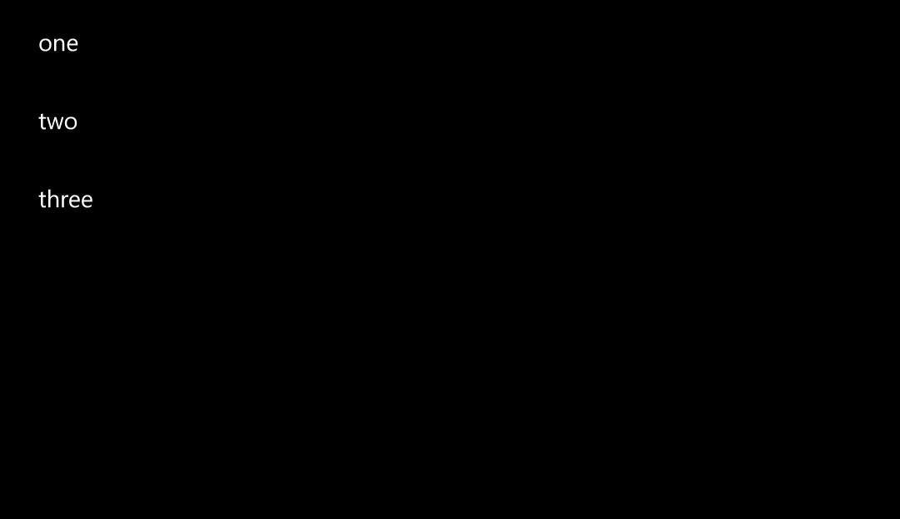
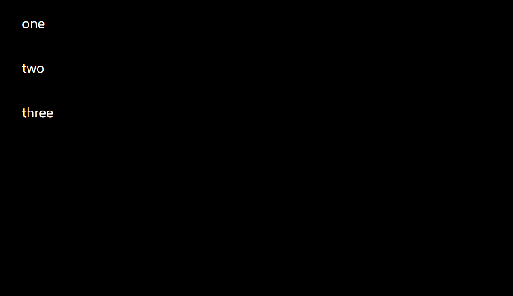
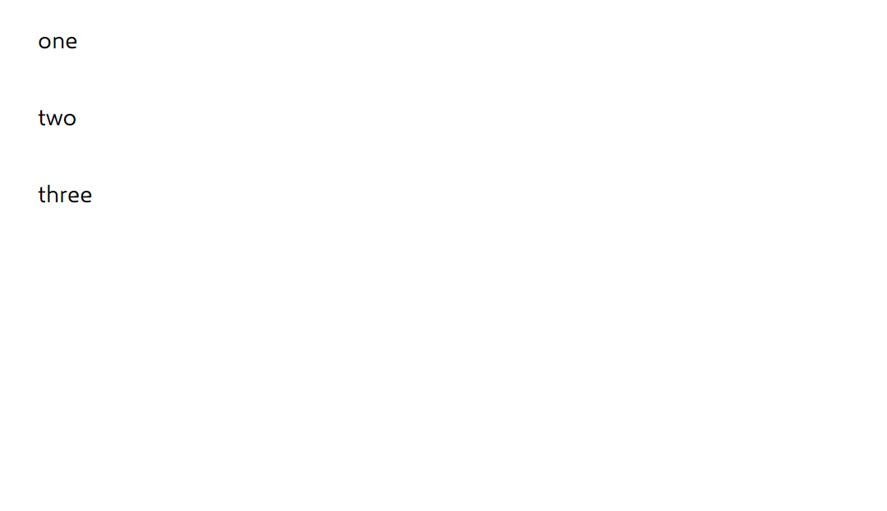
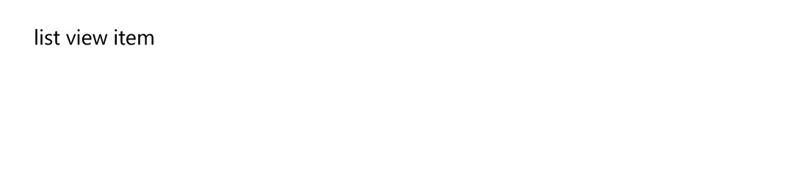
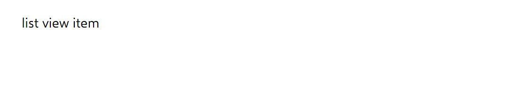
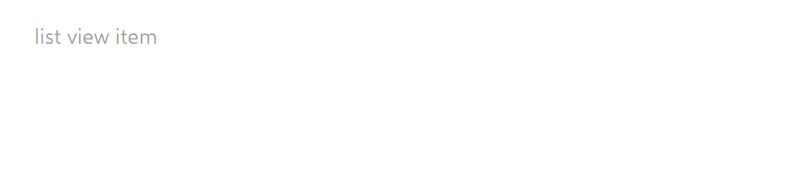
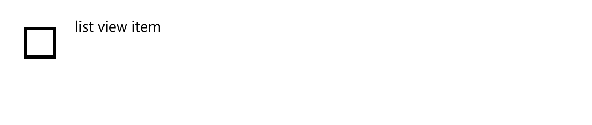
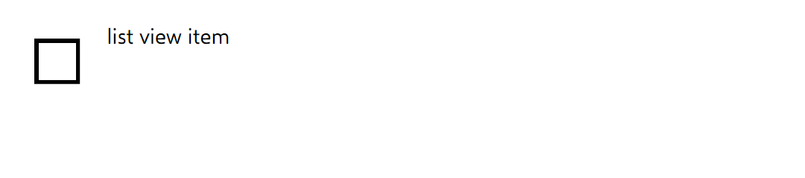
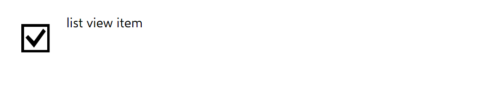
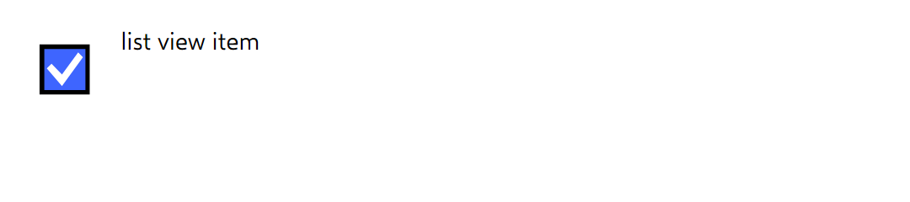

# ListView and ListViewItem: comparison

**The phone:** the reference app's captures, Emulator 8.1 U1 1080P 5.5 inch (device 11), 1080 × 1920 at 2.4,
2026-11-08, in [`ref/wp81/ListView/`](../../../ref/wp81/ListView/README.md), and #113's press probes, runs
`20261115-1941-dev11` and `20261115-1948-dev11`. Segoe WP.
**Ours:** headless frames from `tests/Cornflower.Tests/Controls/ListViewFrames.cs`, Avalonia 12.1.4 with Skia, on the
same stages: 450 × 100 at 2.4 for the item, 450 × 260 for the list, in a slot 19 in and 12 down, in [`frames/`](frames).
Selawik. Our Pressed is a touch at the item's centre, left 160 ms to settle; the phone's is the state forced with no
finger (below). Our check mode is set before the item is shown, as a forced state is, so there is no slide in it.

Text isn't compared by pixel: the fonts differ by design ([ADR 0001](../../decisions/0001-what-faithful-means.md)).
Sizes, positions and colours are compared by measurement, here and in the tests.

## Dark

| State | Phone | Ours |
|---|---|---|
| the list, "two" selected |  |  |
| item, `base` |  |  |
| item, `Pressed` |  |  |
| item, `Disabled` |  |  |
| item, `ListMultiSelect` |  |  |
| selected, `ListMultiSelect` |  |  |
| selected, `ListMultiSelect`, pressed (ours only) | |  |

## Light

| State | Phone | Ours |
|---|---|---|
| the list, "two" selected |  |  |
| item, `base` |  |  |
| item, `Pressed` |  |  |
| item, `Disabled` |  |  |
| item, `ListMultiSelect` |  |  |
| selected, `ListMultiSelect` |  |  |
| selected, `ListMultiSelect`, pressed (ours only) | |  |

The phone's `Pressed` is tilted by −17.19°, 17.19°, the angle its `PointerDownThemeAnimation` takes with no press
point; no finger gives it, so it isn't compared. The phone has no capture of the check mode pressed: CheckboxPressed
forced outside the check mode is `base`, as its box is clipped away.

## Measurements

In view pixels unless raw. The phone's from the dumps, ours from the tests.

| What | Phone | Ours | |
|---|---|---|---|
| The list, in the stage | 19.1667, 12.0833, 412.0833 wide | 19.1667, 12.0833, 411.6667 wide | one raw pixel narrower: ADR 0003's rounding of the 19 margins |
| Each item | 39.1667 tall, one under the other | 39.1667, the same | match: SelectedBorder's 2.5 + 34 + 2.5 |
| The content | 0, 0 in the item, 16.25 tall; its text 15.96, 1.33 em at 12 | 0, 0, 16.25; `LineHeight` 15.96 | match |
| The box | 0, 9.5833; 25.4167 laid out (61 raw), drawn 61 raw | 0, 9.5833; 25.8333 laid out (62 raw), drawn 25.5 (61.2 raw) | within a fifth of a raw pixel drawn |
| The box's border, raw, `ListMultiSelect` | columns 46-51 and 101-106, rows 52-57 and 107-112 | 46-51 and 102-106 whole, 101 at 0.8 and 107 at 0.2; rows likewise | match within a fifth of a raw pixel |
| At rest | the box 40.5 to the left, clipped: nothing left of the item | the same | match |
| The tick, in the box | 3.75, 4.1667; 18.3333 × 17.0833 | the same | match |
| `ListMultiSelect` | the box at 0, the content 40.5 across, 0.15 s each way | the same; 0.15 s linear transitions | match |
| SelectedCheckMark | 375.4167, 2.5; 34.1667 square | 375, 2.5; 34.1667 | the item one raw pixel narrower |
| Disabled | the content at 0.4: `#666666` stems on black | the content at 0.4: its fullest ink 0.4 of the enabled text's, within 8 of 255 (83 against 88.8) | match; Skia's coverage under an opacity isn't exactly linear |
| The selected item, Single mode | drawn as the others | the same frame | match |

**The tilt**, each held press of the probes against ours, `RotationX`, `RotationY`, `GlobalOffsetZ` (the probe's
list 19.1667, 80 in the view; ours the same, one raw pixel narrower):

| Press | Phone | Ours |
|---|---|---|
| item 1 centre | -2.127, 0.009, -21.894 | -2.105, 0.000, -21.939 |
| item 2 centre | -1.523, 0.009, -22.771 | -1.500, 0.000, -22.819 |
| item 3 centre | -1.591, 0.009, -22.673 | -1.585, 0.000, -22.695 |
| item 2 at 5% across | -2.630, 8.087, -9.413 | -2.549, 8.095, -9.519 |
| item 2 at 25% across | -1.646, 4.398, -16.209 | -1.613, 4.398, -16.257 |
| item 2 at 75% across | -1.644, -4.415, -16.187 | -1.618, -4.433, -16.200 |
| item 2 at 95% across | -2.627, -8.104, -9.393 | -2.562, -8.132, -9.446 |
| item 2 at 10% down | -8.110, 0.009, -13.191 | -8.129, 0.000, -13.177 |
| item 2 at 90% down | 5.572, 0.009, -16.882 | 5.560, 0.000, -16.914 |
| item 4 centre | -0.956, 0.009, -23.597 | -0.953, 0.000, -23.614 |

The worst is 0.081° (`RotationX`, 5% across) and 0.106 of depth: the Button's model, on a short item, within a tenth
of a degree. The phone's 0.009° of `RotationY` at the centre is its item's half raw pixel off centre.

## Behaviours

| Behaviour | Phone | Ours | |
|---|---|---|---|
| Pressed at once | `Normal` > `Pressed` 0.3 to 2.6 ms after `PointerPressed` | `:pressed` in the same dispatch | match |
| The release | holds 182.6 ms, eases back over 167.0 ms | `Tilt`'s, the same | match |
| A tap | selects; `ItemClick` and `Tapped` with the release | selects with the release; `ItemClick` with `ListBoxOptions` (#132) | match |
| A pan | the pointer taken about 50 ms into the move; the tilt holds and returns from then; no `ItemClick` | the pointer taken once the move passes the gesture recogniser's threshold; the same return; nothing selected | match, the moment Avalonia's |
| Dragged off, the list can't pan | the tilt follows on the item, returns about 190 ms after leaving | holds 182.6 ms, returns; nothing selected | match |
| 10 px sideways | a tap; `RotationY` −0.42° at 10 px | a tap; the tilt follows | match |
| Single selection | draws nothing | draws nothing | match |
| Multiple | the check boxes; a tap toggles | `Multiple, Toggle`: the same | match |
| Extended | not read | `Multiple`: the check boxes, Ctrl and Shift | unread: a selection of several must show |
| CheckboxPressed | the template's: the box in the accent, the tick over it, the tilt on the box | the same | from the template; not probed |

## Gaps and deliberate differences

- **`ItemClick` and `IsItemClickEnabled`**: Avalonia's ListBox has none; `ListBoxOptions` adds them (#132,
  [ItemClick](../ItemClick/README.md)).
- **`SelectionMode="None"`**: Avalonia has no mode without selection. In Single mode the selection draws nothing, so
  only `SelectedItem` tells the difference.
- **`Header` and `Footer`**, which scroll with the items: none in Avalonia's ListBox. An app puts its header in the
  first item, or round the list.
- **Grouping**, so ListViewHeaderItem and GroupItem: none in Avalonia (PLAN.md). Deferred.
- **Add, delete and reorder transitions**, and **reorder**: deferred.
- **The check mode's offsets** are literals in the theme, so an app's `ListViewItemContentOffsetX` doesn't move them.
- **A selection set in code** scrolls the item into view, Avalonia's `AutoScrollToSelectedItem`; the phone's is believed
  not to, unprobed.
- **`IsHoldingEnabled`** isn't turned off, so a long press still opens an item's `ContextFlyout`.
- **One raw pixel** here and there: the list's width, the box's laid-out size (ADR 0003).
- **The scroll physics** are Avalonia's: the ScrollViewer's recorded deviation (#116).
