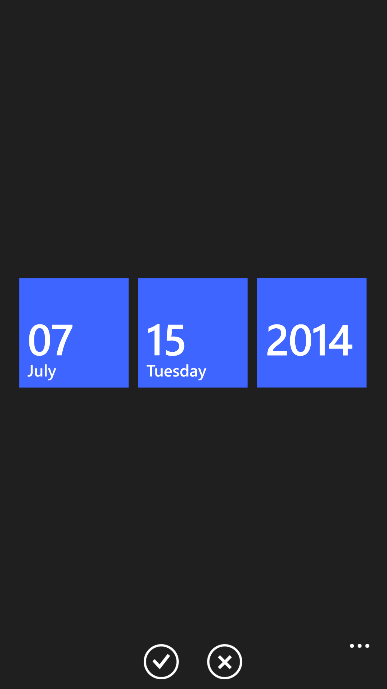
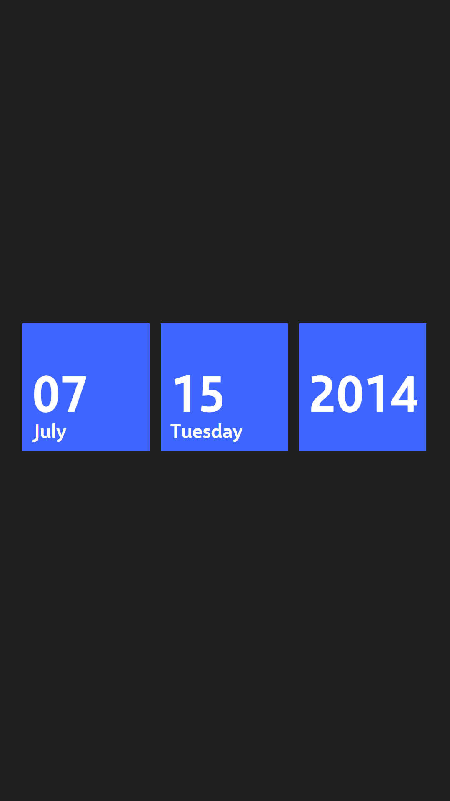
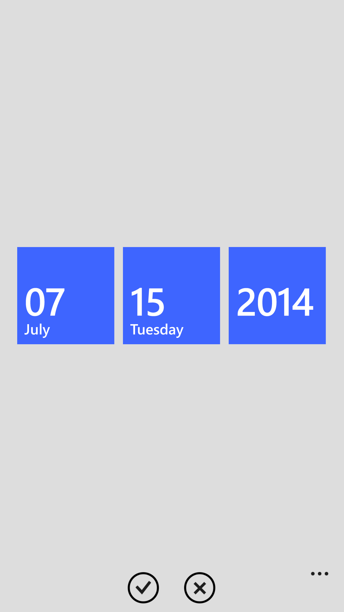
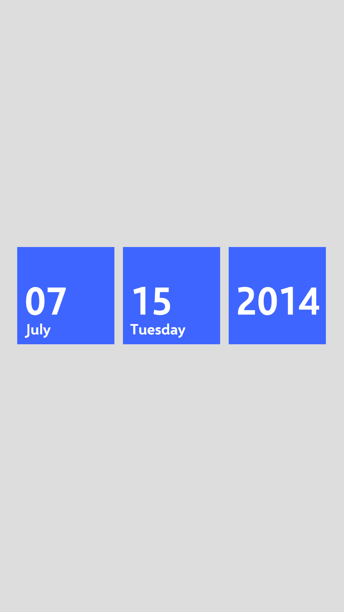
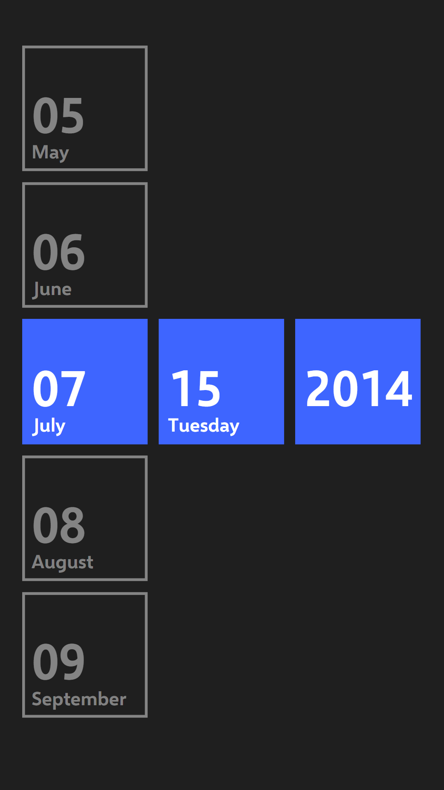

# LoopingSelector: comparison

The phone's wheels beside ours. The phone's: the DatePickerFlyout (15 July 2014) on Emulator 8.1 U1 1080P 5.5 inch
(device 11), the emulator's own screenshots (run `20261108-2254-dev11`,
[`ref/wp81/LoopingSelector/`](../../../ref/wp81/LoopingSelector/README.md)), and #149's probe readings, every frame
(runs `20261116-1828-dev11` and `20261116-1904-dev11`). Ours: headless (Avalonia.Headless + Skia) at the reference
profile, 450 × 800 at 2.4, three `DateTimePickerPanel`s in `Wp81LoopingSelectorTheme` at the phone's places on the
flyout's background (`FlyoutBackgroundThemeBrush`), saved by `LoopingSelectorFrames`
(`CORNFLOWER_FRAMES=<folder> dotnet test --filter FullyQualifiedName~LoopingSelectorFrames`). The flyout's bar and its
swing are #153's and #156's; the frames show the wheels alone.

## At rest

| | The phone | Ours |
|---|---|---|
| Dark |  |  |
| Light |  |  |

Measured in raw pixels of the 1080 × 1920 frames:

| | The phone | Ours | |
|---|---|---|---|
| The tiles, across (full accent) | 54–357, 386–689, 718–1021, the next column part-covered | 54–358, 386–690, 718–1022 | **match**, within a raw pixel: ours is 127.125 wide (113 × 1.125), the phone's 127.03 (112.917, its 123 rounded to the raw grid) |
| The tiles, down | 776–1078, 775 and 1079 part-covered | 775–1079 | **match**, within a raw pixel |
| The tile's colour | `#3E65FF` | `#3E65FF` | **match** |
| The background | `#1F1F1F`, `#DDDDDD` | the same | **match** (the flyout's, not the wheel's) |
| "07" (ink, white) | x 81–201, y 904–991 | x 82–205, y 901–988 | **match** across; 3 raw px (1.25 view px) higher: Selawik SemiBold's ascent against Segoe WP's |
| "July" | x 77–155, y 1015–1059 | x 78–158, y 1015–1059 | **match** |
| "15" / "Tuesday" | 414–513, 903–991 / 409–574, 1015–1059 | 419–533, 900–987 / 410–581, 1015–1059 | the same 3 px; wider (Selawik) |
| "2014" | 746–982, 903–991 | 747–1001, 900–988 | the same; the empty second line takes its line on both |

The text is compared by position and size only (docs/PROCESS.md): Selawik for Segoe WP, by design. Its lines are the
phone's 1.33 em (`PhoneTextLine`), and the first line's spacing −24 (−1.08 px at 45).

## A wheel active (`Expanded`)

No capture shows one (ref/wp81/LoopingSelector/README.md): the state comes from a finger. Ours, the month wheel tapped:

What the probes read, against ours:

| | The phone | Ours | |
|---|---|---|---|
| The other items | opacity 1, the selected `Selected` | the same | **match** |
| Their border | 2.5, in `LoopingSelectorForegroundThemeBrush`, scaled: 6.75 raw px | 6.7 raw px, `#848484` on `#1F1F1F` (`#73FFFFFF` over it) | **match** |
| The pitch | 138.375 | 138.375, unrounded | **match** |
| The other wheels | `Normal`: their selected item alone | the same | **match** |
| The fade between | 0.0469 a frame, 21.3 frames, both ways | 1/330 a ms: 0.0473 a 15.625 ms frame, 21.1 frames | **match** (within 0.001 a frame) |
| When the last wheel starts fading | about 47 ms (3 frames) after the new one expands | at once | **gap**: 47 ms |
| The first expansion | at 1 at once | the same | **match** |

**Owed**: a still of an expanded wheel, dark and light, to compare by pixel.

## The motion

Against the probes' frames, offsets in view px from the first inertial frame (`LoopingSelectorTests`):

| | The phone | Ours | |
|---|---|---|---|
| Held still, let go 0.43 of an item past: drift then back | +9.1 px over 7 frames, back over 375 ms, at rest at 500 | +8.4 px over 98 ms, a sine back over 390 ms, at rest at 488; within 4.3 px of each of the 32 frames (rms 2.0) | **match** (a fit, two pieces: no simple ease fits the phone's) |
| The five such releases | at rest 438 to 531 ms | 414 to 495 | **match** within 36 ms; rms 1.0 to 2.2 px |
| Held still, let go 0.52 past: on to the next | constant deceleration 0.000834 px/ms², at rest in 328 ms | the law, within 2.8 px of each frame; at rest at 394 | **match**; the last 66 ms are under 2 px on both |
| A flick, 14 items (1,687 px) | 1,844 ms | 1,802 ms; within 19.3 px of each frame (rms 9.5) | **match** |
| The eight coasts of both runs | 297 to 2,062 ms | 1.5 to 11.7 px rms each, at rest within 130 ms | **match** |
| Where a release goes | decided at the release, in whole items | the same | **match** |
| Which item a flick ends on | the phone's own reading of the finger's speed | the moves of the last 50 ms | **deliberate difference**: a flick's count can differ by one from the phone's for the same finger (the phone's flick of 1.77 px/ms over its last 100 ms went 8 items; ours, from 1.77, would go 9) |
| The drag's start | 5 to 10 px of the finger not moved | `ScrollStartDistance` not moved | **match** in kind |
| A tap | no scroll, no selection, the wheel active | the same | **match** |
| A press on a coast | held within a frame (0.0 px over 592 ms) | held at once | **match** |
| The wrap | month and day; the year stops | the same | **match** |
| At a non-looping wheel's end | unread | stops there | **gap**: owed, a drag past the year's end |
| `SelectionChanged` | at rest | on every move (Avalonia's panel) | **gap**: an app using the DatePicker sees none; #156's presenter keeps its columns in step from it |

## Known differences, not gaps

- The phone's wheel is in a ScrollViewer; ours isn't (PLAN.md, "The decision"): nothing drawn shows it.
- A mouse wheel turns ours one item a notch; the phone has none.
