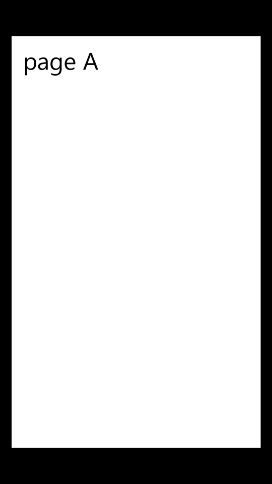
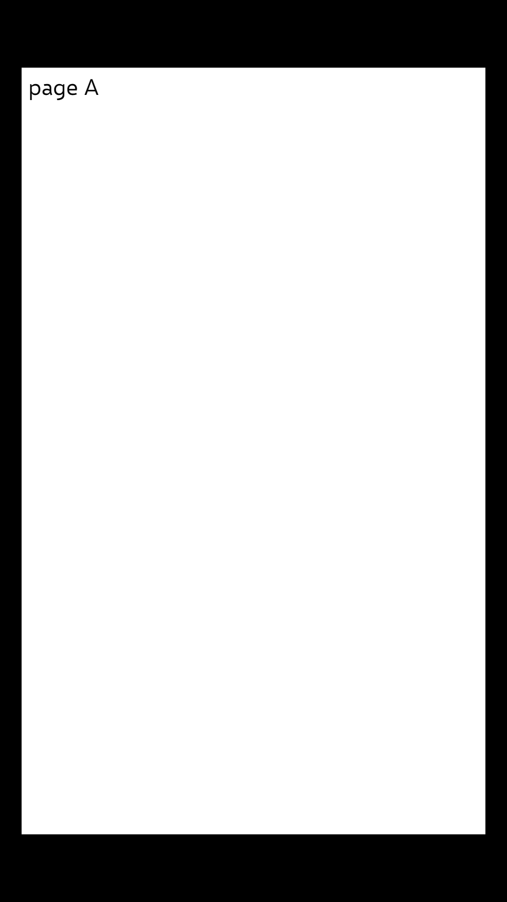
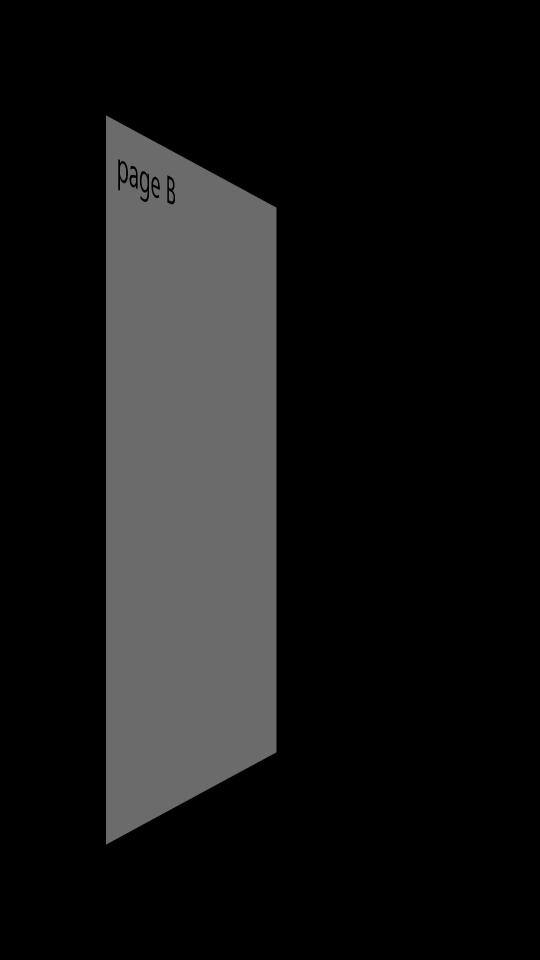
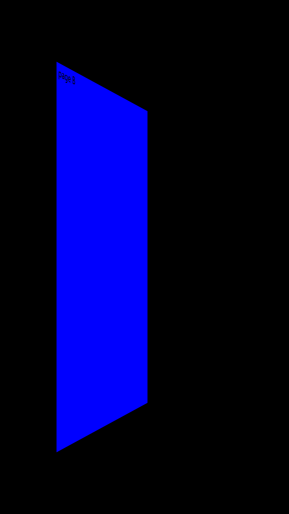
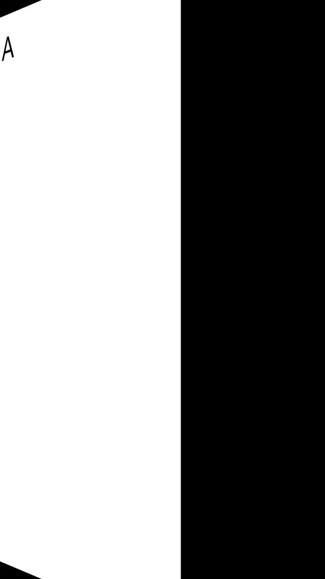
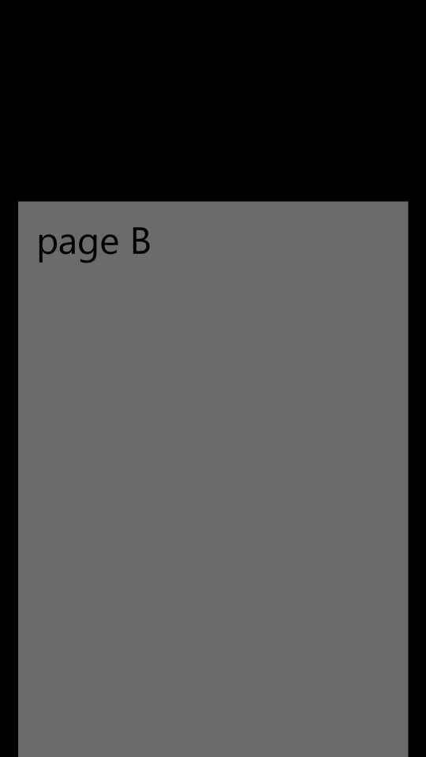
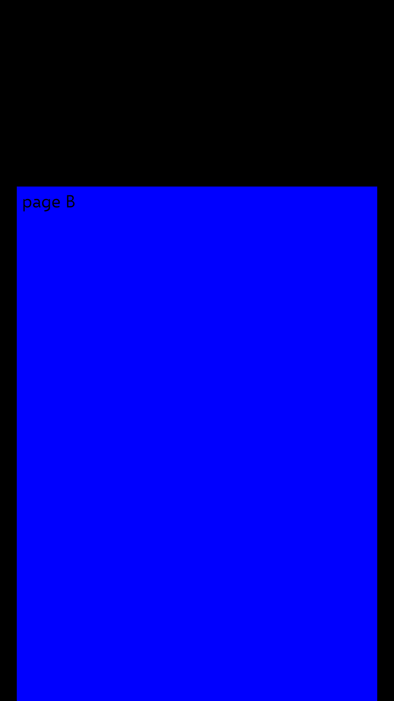
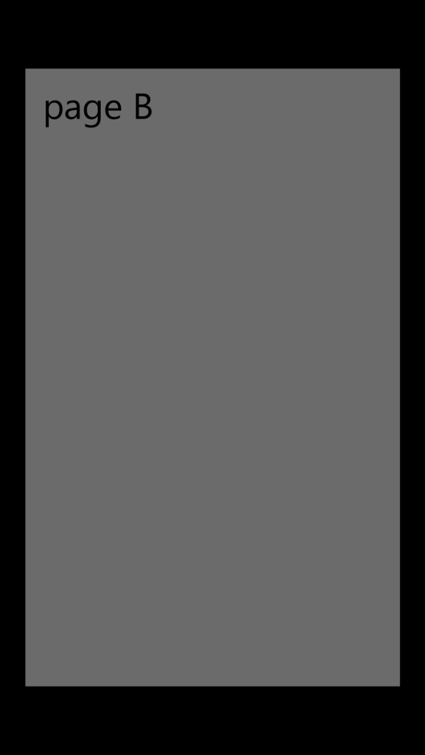
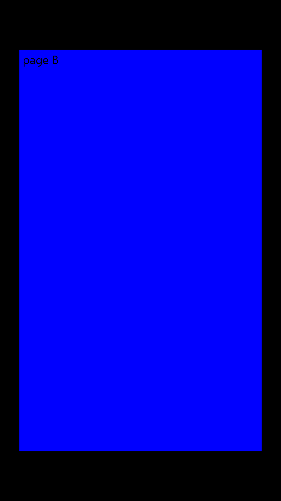

# Page and Frame: comparison

**The phone:** five frames of the reference app's `pages` probe, recorded on Emulator 8.1 U1 1080P 5.5 inch (device 11),
run `20261110-0810-dev11`, in [`ref/wp81/Page/`](../../../ref/wp81/Page/README.md): 540 × 960 grey frames of the screen
recording. The motion is read from that run, `20261110-0748-dev11` and `20261115-2053-dev11` (`tools/refapp/README.md`,
"Page transitions" and "The turnstile's forward start"); where the page and its content go, from `-Native`'s readings
(`20261111-1759-dev11`, `20261115-2050-dev11`). Segoe WP.
**Ours:** headless frames from `tests/Cornflower.Tests/Controls/PageFrames.cs`, Avalonia 12.1.4 with Skia, 1080 × 1920,
the probe's two sheets as two ContentPages in a NavigationPage, caught on the emulator's frame grid at the same tick of
each transition, in [`frames/`](frames). Selawik; the labels' size isn't the probe's.

## The frames

| Moment | Phone | Ours |
|---|---|---|
| At rest |  |  |
| Turnstile forward, tick 0 (−67.0°) |  |  |
| Turnstile back, tick 0 (+42.0°) |  |  |
| Slide forward, tick 1 (152.8 px) |  |  |
| Continuum forward, the new page's first frame |  |  |

The phone's frames are the recording's grey; ours are colour. In the turnstile frames the sheet's corners are where the
fitted turn puts them: forward, the recording's bounding box of the sheet is 87.9 to 230.0 view px across, and the fitted turn puts its edges
at 87.95 and 229.7; back, the near edge is off the left of the screen and the far edge at 249.9, the fit's 250.4.

## Measurements

| Behaviour | Phone | Ours | |
|---|---|---|---|
| The page fills the window | 0, 0, 450 × 800 in every reading | 0, 0, 450 × 800 | match |
| The content, tray shown, `UseVisible` | 0, 27.92, 450 × 772.08 | the same, the safe area 27.92 | match |
| The page's background under the tray | the page reaches under it | `ApplicationPageBackgroundThemeBrush` at y 10 | match |
| The content, `UseCoreWindow` | 0, 0, 450 × 800 | the same, `AutomaticallyApplySafeAreaPadding` off | match |
| The content above a compact app bar | `VisibleBounds` ends at 737.08 | ends at the bar's top, 737.08 for a 62.92 bar | match, given the bar's height (#118) |
| The content above a minimal app bar | ends at 773.75 | 773.75 for a 26.25 bar | match, as above |
| An open bar | drawn over the page, nothing moves | drawn over the content, nothing moves | match |
| Navigation bar | none | none by default | match |
| Turnstile forward | −67.10° on `ExponentialEase` 6 over 425 ms; ticks 0, 1, 2 shown as −67.0, −53.8, −43.1 | the same curve; every frame's corners within 0.05 px of the fitted turn | match |
| Turnstile back | +41.97° over 430 ms | the same | match |
| The page going out, turnstile and slide | gone at once | hidden from the first frame | match |
| Slide forward | 200, 152.8, (tick 2), 89.2, 68.2, 52.0 … px | within 0.5 px of each | match |
| Slide back | 137.3, 94.2, 64.6 … px read backwards, then the page under it at once | 135.9 × ease-in 4.28 over 187.5 ms, within 2 px of each; the page under it on the next frame | match, to the fit's 0.78 px rms |
| Continuum forward, fade | one or two recorded frames | linear over 62.5 ms | match within a recorded frame |
| Continuum forward, black | at most 94 to 125 ms | none | **deliberate difference**: taken as the page being made, as before the other transitions' first frames |
| Continuum forward, growth | 0.941 to 0.963 at the first frame, 1 in 281 to 312 ms | 0.9427 on an ease-out over 359 ms, at rest (within 0.25 px) by 312 ms | match |
| Continuum back | the slide's back, then the page under it from 0.40, over about 344 ms | the same, from 0.393 | match |
| Continuum's exit element | flies out of the old page | not done | **gap**: not measured |
| The opt-in navigation bar | none | `PhoneChromeBrush`, header, back arrow | extension |
| A navigation mid-transition | not read | dropped (Avalonia's) | not compared |
| The turnstile on another profile | not read | the axis scales with the width | not compared |

Text isn't compared by pixel: the fonts differ by design ([ADR 0001](../../decisions/0001-what-faithful-means.md)).
