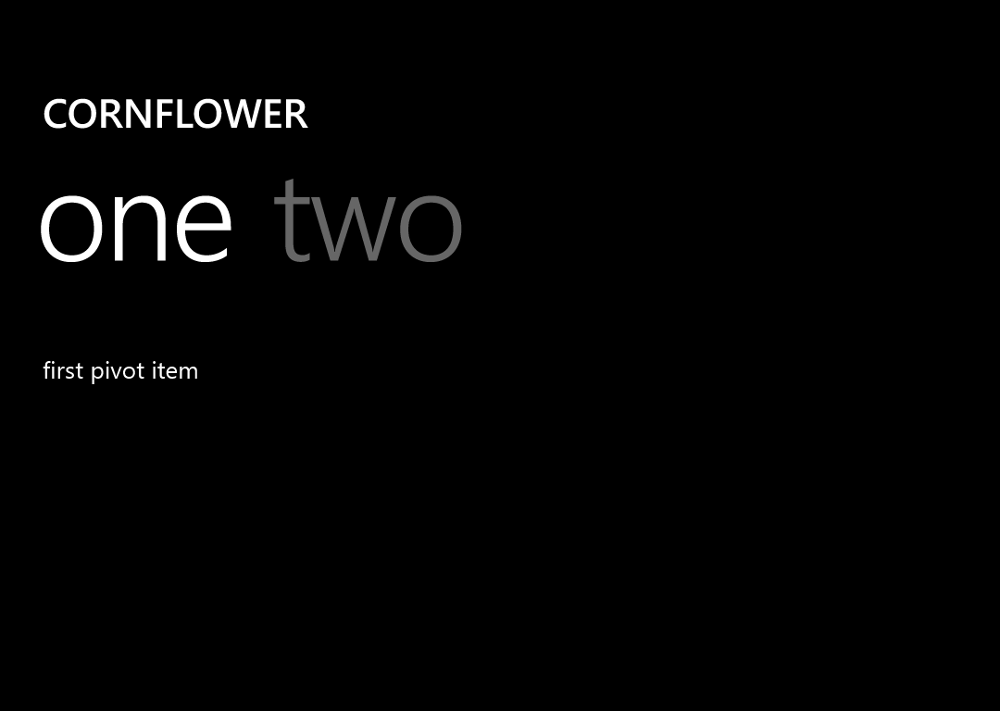
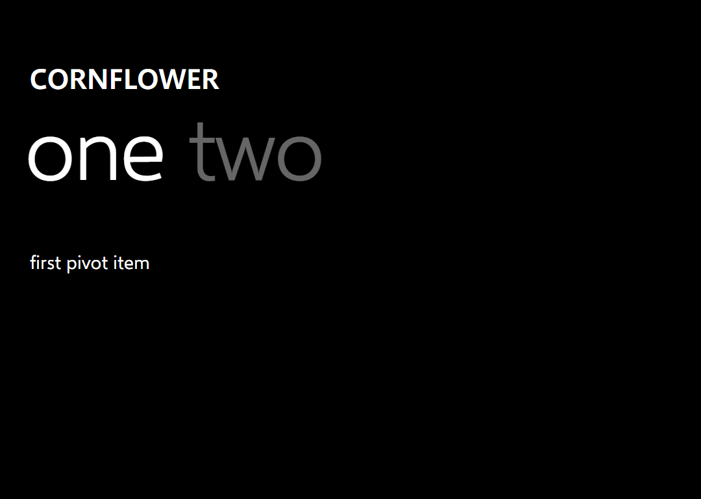
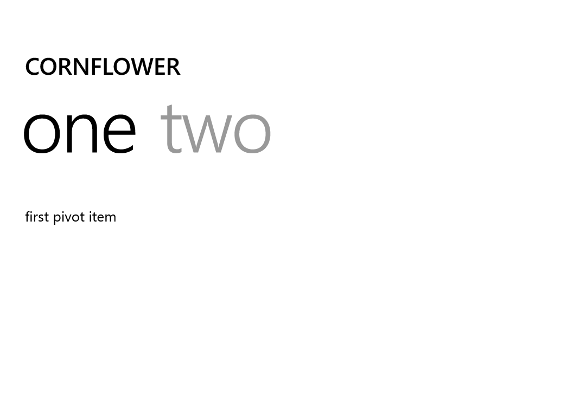

# Pivot: comparison

**The phone:** the reference app's captures, Emulator 8.1 U1 1080P 5.5 inch (device 11), 1080 × 1920 at 2.4,
2026-11-08, in [`ref/wp81/Pivot/`](../../../ref/wp81/Pivot/README.md): a Pivot titled "CORNFLOWER", items "one" and
"two", full width on a 450 × 320 stage. Its motion: the probes of #128 and #136 (runs `20261115-2056-dev11`,
`-2136-`, `-2339-`, `-2343-`), frame by frame, and #148's (`20261116-1706-dev11`: where a release goes, a press while
it moves, the item events). **Ours:** headless frames from
`tests/Cornflower.Tests/Controls/PivotFrames.cs`, Avalonia 12.1.4 with Skia, the same stage in a portrait window at
2.4, in [`frames/`](frames).

**The fonts differ by design**: the phone's Segoe WP (SemiLight 57 for the headers, SemiBold 18.14 for the title) and
ours Selawik, so the headers' widths, and so their pitches, differ by a pixel or two; what is compared is the rule (a
header's pitch is its width plus 15.83), the places of things and the colours. The item's text is the app's: the
catalogue's `TextBlock` has the phone's control default, 11 px "Global User Interface"; ours the page's.

## Dark

| | Phone | Ours |
|---|---|---|
| `base` |  |  |

## Light

| | Phone | Ours |
|---|---|---|
| `base` |  |  |

`Orientation.Portrait` is the phone's `base`, file for file; `Orientation.Landscape` moves the title to 25, which ours
does in a landscape window (`Landscape_Moves_The_Title_Up`): ours decides the state by the window's shape, so a frame of
the 450 × 320 stage in its own window would be landscape.

Part way through a drag of 60 px, four items: [`frames/dark__Pivot__four-items__dragged-60__ours.png`](frames/dark__Pivot__four-items__dragged-60__ours.png)
(no capture: the phone's motion is read from its logs, below).

## Measurements

In view pixels from the Pivot's top left. The tests hold each (`PivotTests.The_Bounds_Are_The_Dumps` and the rest).

| What | Phone (dump) | Ours | |
|---|---|---|---|
| The title's text | 19.17, 37.92, 24.17 tall | 19.17, 37.92, 24.17 tall | match |
| The ScrollViewer's top | 62.08 | 62.08 | match |
| The strip's height | 75.83 | 75.83 | match |
| The first header | 15.84, 55.42, 82.5 tall | 15.83, 55.42, 82.5 tall | match (0.01: the phone's strip translate) |
| Its text's height | 75.81 | 75.83 | match (the 1.33 em line) |
| "one"'s width | 90.83 | 89.17 | font (Selawik) |
| "two"'s left edge | 122.52 (90.83 + 15.84 + 15.84) | 120.83 (89.17 + 15.83 + 15.83) | the same rule; the font |
| The ItemsPresenter's top | 137.92 | 137.92 | match |
| The item | 19.17, 160.42, 412.08 wide | 19.17, 160.42, 411.67 wide | match; the width 0.42 short: layout rounds the 19 margins up to the raw grid (ADR 0003) |
| The selected header's text | `#FFFFFFFF` (light `#FF000000`) | the same | match |
| The others | `#66FFFFFF` (light `#66000000`) | the same | match |
| The item not selected | opacity 0, its content collapsed | not visible | match |
| Landscape title | 25 | 25 | match |

## The motion

Against #128's and #136's readings, on a clock of the emulator's 15.625 ms frames (`TestClock` on the grid), with the
probes' own gestures.

| What | Phone | Ours | |
|---|---|---|---|
| The strip against the offset, left | a straight line, the leaving header's pitch over 450 a px (0.23706, 0.23056, 0.30462, 0.24909; wide headers 0.53518 to 1.65462); worst 0.015 px | the same rule, on our pitches, to 0.01 px | match |
| Right | the incoming header's pitch | the same | match |
| The header that left | to the end, on the frame the new item comes in | the same | match |
| The selection, a swipe left | 188 to 241 ms after the press (5 frames after the inertia starts) | 228 ms for the probes' swipe (78.125 ms after the release) | match |
| Right | 152 to 174 ms | 166 ms (15.625 after the release) | match |
| A tap | at the release | at the release | match |
| A swipe's travel and settle | exactly 450; 609 to 672 ms after the press | 450; 666 ms | match |
| The swipe's offset, frame by frame | the median of 20 | `KeySpline` 0.24,0.60 0.22,1 over 515.625 ms: 1.07 px rms, worst 2.2 px | deliberate: a fit (the phone's is DirectManipulation's inertia) |
| A tap's offset | 500 ms, the median of 6 | `KeySpline` 0.20,0.08 0.02,1 over 500 ms: 0.74 px rms, worst 3.5 px | deliberate: a fit |
| A tap's settle | 531.25 ms after the release for one page, 515.625 for two ("two" and "three", run `20261115-2136-dev11`) | the same, to the frame | match |
| Back after a drag let go | 35 frames, one read | `KeySpline` 0.25,0 0.20,1 over 546.875 ms: 0.12 px rms of 109 | deliberate: a fit of one |
| The old item's slide out | 0, then 0.1474, 0.2734, 0.3812 of a page | the same, to 0.1 px | match |
| The new item's slide in | a page, one frame, then 0.8526, 0.7266, 0.6188, 0.5266 (`ExponentialEase` 4, 400 ms) | the same, to 0.1 px | match |
| Two items | wrap both ways, the strip only two headers | the same | match |
| A header cut by the edge | tapped like any | the same | match |
| A tap on the selected header | `Tapped`, nothing else | the same | match |
| Where a release goes, held still (#148) | back at 228.3 px, on at 239.3 (right: back at 201.0, on at 245.4) | on from 234 px (0.52 of 450) | match |
| Where a release goes, moving (#148) | 60 px at 0.10 to 0.48 px/ms back, at 0.6 and 1.0 on; 120 px at 0.08, 0.19 back, at 0.33 on; heading back the other way, back | on where the offset plus 385 ms of the speed passes 234 px: each of these the phone's way | deliberate: a fit, not a read (#162) |
| A press while a swipe moves (#148) | held within a frame (0 to 6.1 px over 600 ms; an 80 ms tap 22.3), then on to the next page | held where it is (0 px); let go, on | match |
| The item events (#148) | all four together after `SelectionChanged`: Unloading, Unloaded, Loading, Loaded; `SelectedIndex` the new one | the same | match |
| Their time after `SelectionChanged` | a swipe 0.1 to 2.7 ms; a tap 115; code 107 to 121 forward, 36 to 43 back | a swipe 0; a tap and code forward 109.4 (7 frames); code back 15.6 | match, but code going back: **gap** (a frame against 2 to 3) |

## Not compared

- The `UnselectedLocked` state, which the catalogue doesn't force; its values are the template's, tested at their end
  (a theme transition, ADR 0003).
- The Pivot in a real page with an app bar, and on the Android device: owed (the device run, the real-window run).
