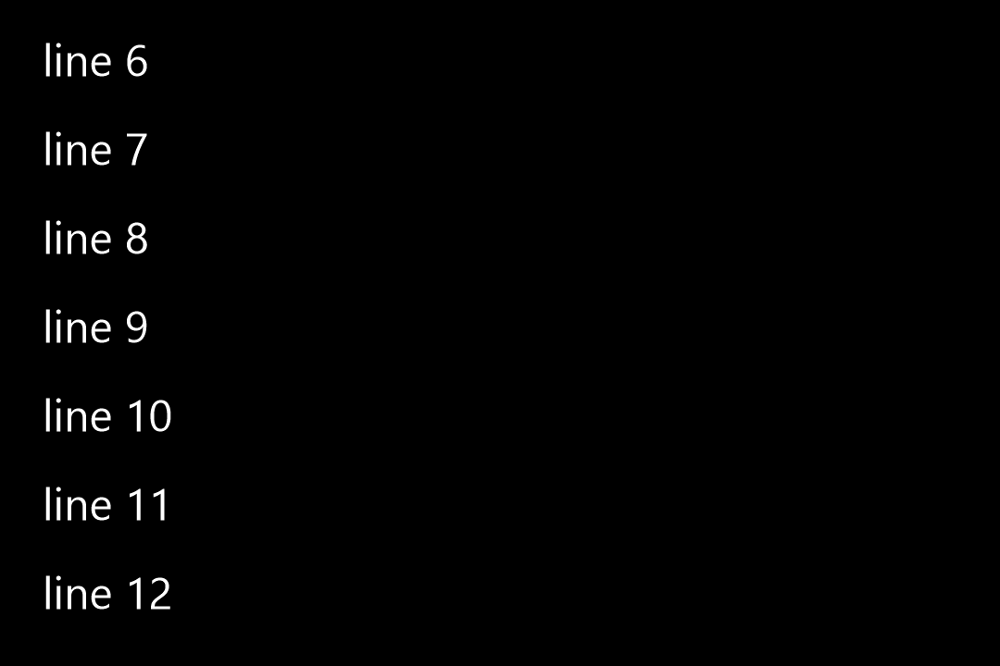
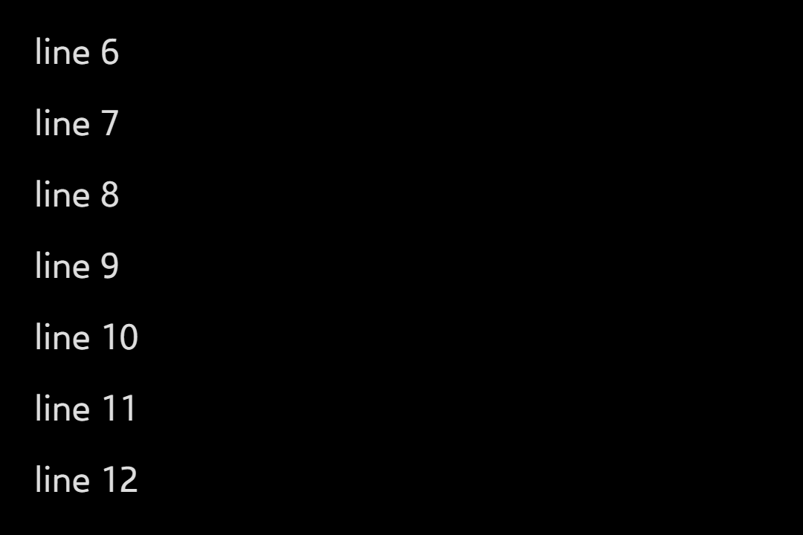

# ScrollViewer, ScrollBar and Thumb: comparison

**The phone:** the reference app's captures, Emulator 8.1 U1 1080P 5.5 inch (device 11), 1080 × 1920 at 2.4, run
`20261115-1921-dev11` (#113), in [`ref/wp81/ScrollBar/`](../../../ref/wp81/ScrollBar/README.md) and
[`ref/wp81/ScrollViewer/`](../../../ref/wp81/ScrollViewer/README.md); the indicator in a ScrollViewer, its timing and
its fades from run `20261115-1946-dev11`'s screen recording and log, and the physics from runs `20261115-1938-dev11` and
`-1946-` (`tools/refapp/README.md`, "Probes"). Segoe WP.
**Ours:** headless frames from `tests/Cornflower.Tests/Controls/ScrollViewerFrames.cs`, Avalonia 12.1.4 with Skia, on
the same stages, in [`frames/`](frames). Selawik.

`RenderTargetBitmap` never draws a ScrollViewer's own indicator, so the phone's ScrollViewer captures show its content
only; ours are taken once the indicator has gone. The standalone ScrollBars' captures are the indicator's pixels. Text
isn't compared by pixel: the fonts differ by design ([ADR 0001](../../decisions/0001-what-faithful-means.md)).

## The ScrollBars

| Specimen, state | Phone, dark | Ours, dark | Phone, light | Ours, light |
|---|---|---|---|---|
| `vertical`, `base` |  |  |  |  |
| `vertical`, `Disabled` |  |  |  |  |
| `vertical`, `NoIndicator` |  |  |  |  |
| `horizontal`, `base` |  |  |  |  |
| `horizontal`, `Disabled` |  |  |  |  |
| `horizontal`, `NoIndicator` |  |  |  |  |
| `no-indicator`, `base` |  |  |  |  |
| `no-indicator`, `MouseIndicator` |  | (ours is `base`) |  | (ours is `base`) |

`CommonStates.Normal` and `PointerOver`, and `TouchIndicator` and `MouseIndicator` of a bar already at
`TouchIndicator`, are byte for byte the phone's `base`, so they aren't shown.

## The ScrollViewer

| Specimen | Phone, dark | Ours, dark | Phone, light | Ours, light |
|---|---|---|---|---|
| `rest` |  |  |  |  |
| `offset-200` |  |  |  |  |

Ours over a page 2000 tall in the whole 450 × 800 view, with the indicator. There is no capture to set beside them:
the recording's frames stay outside the repository, and its numbers are in the table below.

| State | Dark | Light |
|---|---|---|
| `TouchIndicator`, 600 of 1200, faded in |  |  |
| `TouchIndicator`, at the end |  |  |
| Disabled, kept shown |  |  |
| Sideways |  |  |

## Measurements

In view pixels (DIP) unless raw pixels (px) are said.

| What | The phone | Ours, headless | |
|---|---|---|---|
| The vertical ScrollBar | 7.0833 × 200 at 424.1666, 12.0833 (the dump) | the same | **match** |
| Its thumb, across | px 1023 to 1028: 2.5 wide, 2.0833 in from the bar's left | px 1023 to 1028 | **match** |
| Its thumb, down | px 109 to 269: 33.33 down, 67.08 long (161 px) for 200 × 50 / 150 = 66.67 | px 109 to 268: 160 px | **deliberate difference**, 1 px: WinRT rounds the thumb's length and place apart, Avalonia's `Track` lays them out together (ADR 0003's rounding) |
| The horizontal thumb | px 126 to 286 across, 34 to 39 down | px 126 to 285, 35 to 40 | **deliberate difference**, 1 px each way: the length as above, and the 5.5 px that centre it in the 17 px bar rounded the other way |
| Its colour | 115 grey on black, 191 on white (`#73FFFFFF`, `#40000000`) | 115, 191 | **match** |
| Disabled | 58 on black, 223 on white: the root at half | 58, 223 | **match** |
| `NoIndicator` | nothing drawn | nothing drawn | **match** |
| A ScrollBar with no mode set (`no-indicator`) | nothing drawn (`None`) | shown (`MouseIndicator` unless set) | **deliberate difference**: a bar on its own isn't lost (PLAN.md) |
| Forced to `MouseIndicator` | shown, at full opacity | shown at once | **match** |
| The ScrollViewer specimen | 412.0833 × 280 at 19.1667, 15.8333 | 411.6667 (988 px, not 989) at the same place | **deliberate difference**, 1 px: the slot's rounding, as the ToggleSwitch's (ADR 0003) |
| Its content at 200 | line 6 at the top | line 6 at the top | **match** (text by position) |
| Its thumb at 200 of 280 | 140 long, 100 down (the dump) | 140, 100 | **match** |
| In the full view, the thumb across | 2.5 wide, its right edge 2.5 from the screen's (the recording's 3 px at 1.2) | 2.5 wide (6 px), its right edge 2.08 from the screen's (5 px) | **deliberate difference**, 1 px: the centring rounded the other way, as on the horizontal bar |
| In the full view, the thumb's length | 740 × 740 / 2000 = 273.8 (275 px recorded) | the same sum: 800 × 800 / 2000 = 320 in our 800-tall view | **match** |
| When it shows | `TouchIndicator` 35 to 105 ms after the press, as the pan starts | at the first offset change, as the pan starts | **match** |
| When it goes, after the inertia | 75 to 180 ms after the last move, about 130 typically | 50 to 150 ms after the last offset change | **match**, within the phone's own spread |
| A finger held still | about 115 ms after the moves stop | 50 to 150 ms | **match** |
| A `ChangeView` from code | about 180 ms | 150 ms | **match**, within the phone's spread for the same state (75 to 180) |
| A pull past the end | nothing shown | nothing shown (the offset doesn't change) | **match** |
| The fade in | 0 to 1 in about 370 ms, nearly linear, from the state change | 370 ms, linear, on `CornflowerClock` | **match** |
| The fade out | 1 to 0 in about 340 ms, nearly linear, from where it is (55 to 65% after a `ChangeView`) | 340 ms, linear, from where it is (40% after one scroll, which goes at 150 ms) | **match** |
| A mouse | the phone's template shows it nothing | the thin indicator, at once | **deliberate difference** (PLAN.md) |
| The inertia | about 0.00036 px/ms² for slow flicks; the end decided at the release; at most about 2,220 px and 2.1 s | Avalonia's exponential decay: 75 to 125% as far, 2.2 to 3.4 s | **deliberate difference**: a recorded deviation (PLAN.md, "Scroll physics") |
| Snap points | `Optional`, `Near`: a flick on a StackPanel ends on a child | none by default | **deliberate difference** (PLAN.md) |
| The end of the content | squashed to 0.910 about a point 1,550 px past the edge, back in about 200 ms | stops at the edge | **deliberate difference**: part of the recorded deviation |

The fades' and the indicator's times are by the recording's clock or the app's stopwatch, which are open against
animation time (refapp README, "Motion"); the difference, about 4%, is inside the 33 ms frames.

## Deliberate differences

- **A mouse shows the thin indicator**, which the phone's template would not.
- **`AllowAutoHide` false keeps it shown**: Avalonia's switch, which WinRT lacks.
- **A ScrollBar on its own shows, and its thumb drags**: the phone's draws nothing at `None`.
- **The scroll physics are Avalonia's**: its inertia, no snap points by default, no squash at the ends.
- **Layout rounding** (ADR 0003): one raw pixel here and there, as above.

## Gaps

- **A press in the `Padding`** doesn't pan: Avalonia's gesture recogniser is the presenter's.
