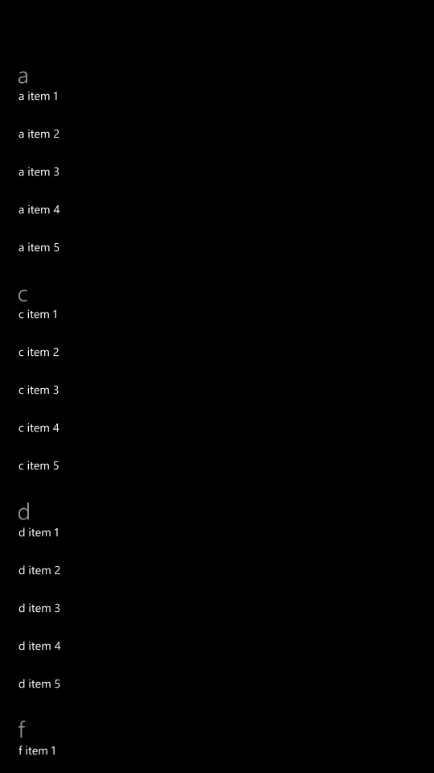
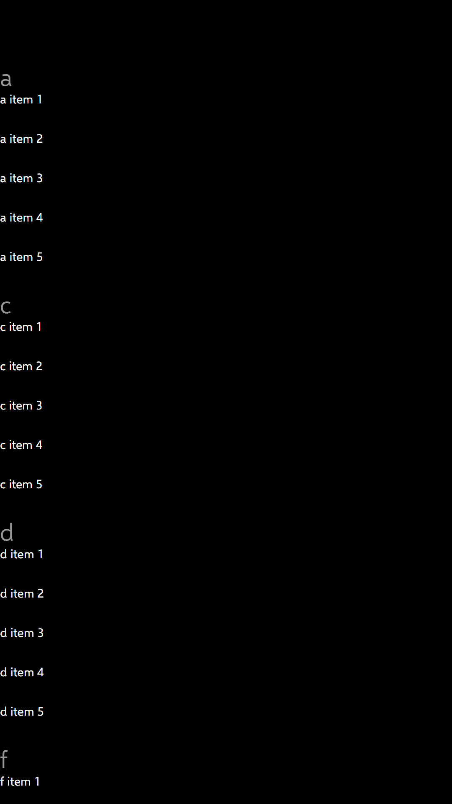
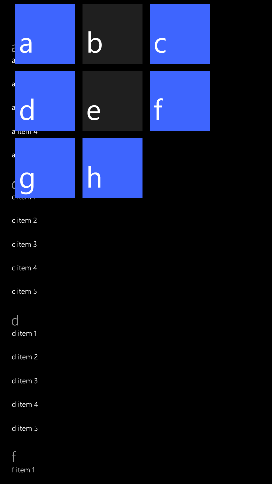
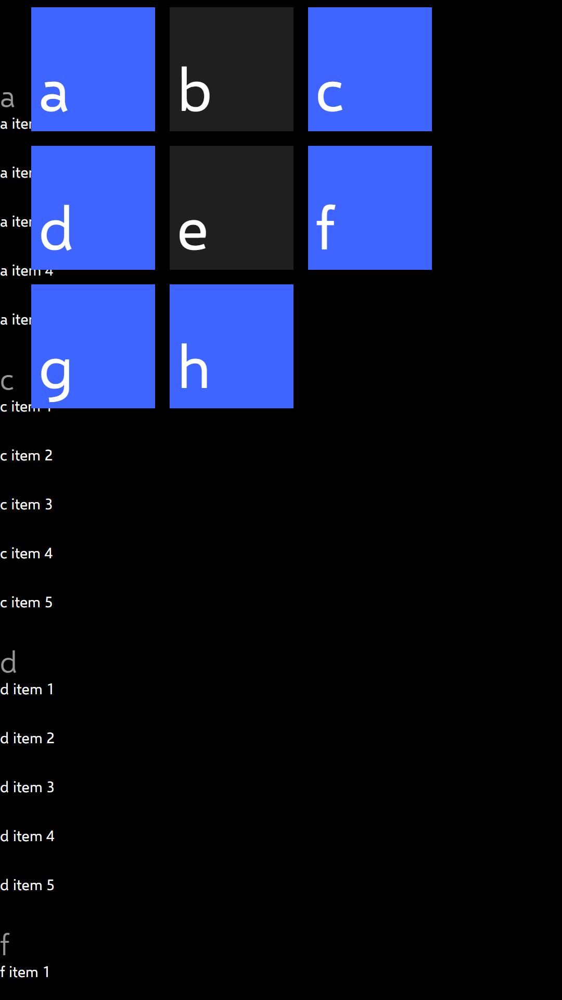
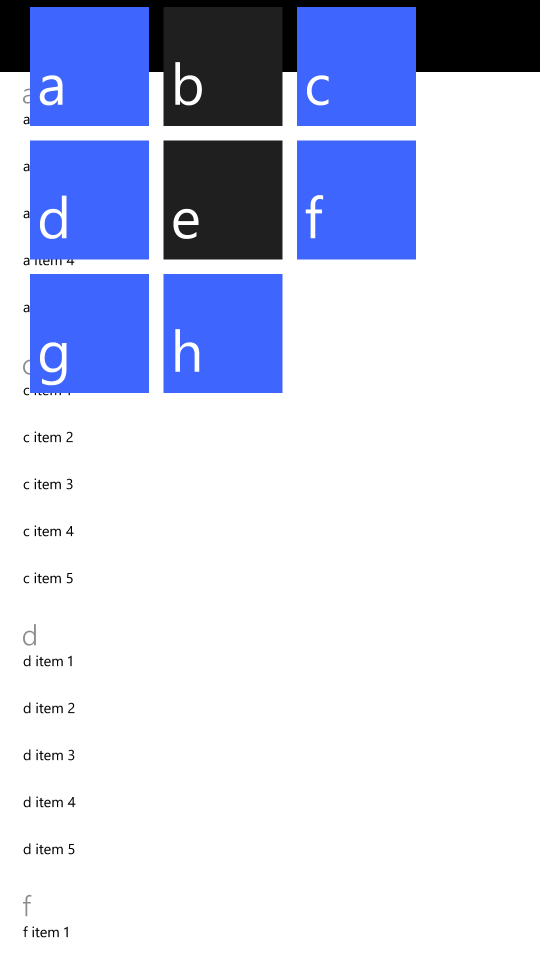
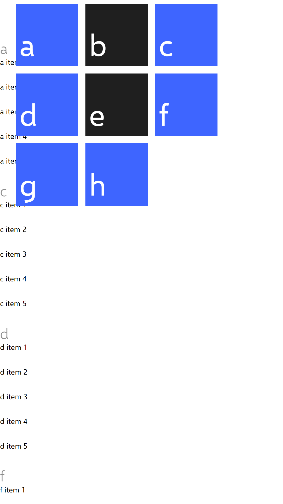

# SemanticZoom: comparison

**The phone:** stills from the recording of `-Probe semanticzoom -Record`, run `20261118-2231-dev11-partial` (#211),
Emulator 8.1 U1 1080P 5.5 inch (device 11), the display window at 540 × 960 (0.83 view px a pixel), in
[`ref/wp81/SemanticZoom/`](../../../ref/wp81/SemanticZoom/README.md), Segoe WP: the probe's SemanticZoom below its 60 px
header band, groups a to h (b and e empty), after a tap on header a.
**Ours:** headless frames from `tests/Cornflower.Tests/Controls/SemanticZoomFrames.cs`, Avalonia 12.1.4 with Skia, 450 × 800
at 2.4, in [`frames/`](frames), Selawik: the same groups and tiles in `SemanticZoom`, the Wp81 theme in the window and the
app. The stage leaves out the probe's header band and its page's 19 px margin (the SemanticZoom is 60 down, the list at
the window's left), which are the probe's page, not the control.

| | Phone | Ours |
|---|---|---|
| Zoomed in, dark |  |  |
| Zoomed out, dark |  |  |
| Zoomed out, the page light, the app dark |  |  |

## Pixels

Measured on ours by the tests; on the phone's stills by eye, at 0.83 view px a pixel.

- **The jump list** starts at the window's top left on both, over the header band on the phone's: the first tile at
  x 25, y 6 (the GridView 19 in, the tile's margin 6), 99 × 99, three a row, 111.25 apart. Match.
- **The brushes:** the accent #FF3E65FF for a, c, d, f, g, h, #FF1F1F1F for b and e, the letters white. Match.
- **No dim, no background:** the list shows between the tiles, unchanged; on the light page, white between them. Match.
- **The letters:** 48 px, padded 6, at the bottom left, in each side's font. Text by position and size only.

## Behaviours

| Behaviour | Mark |
|---|---|
| A tap on a header zooms out; both events at once, the source the top item, the destination the header's group | match |
| The tiles show 50 ms after the tap, and open over 170 ms | match, by the fit (PLAN.md, "The motion's numbers"): every row turning from 80°, where the phone's first frame is nearer edge-on |
| The jump list covers the whole window; no dim; no background | match |
| It takes the app's theme | match: the window's theme, which an app's window takes from the app |
| The converters' brushes, dark and light | match |
| A tap on a tile: both events, group to group, the list landed with the group's header at the top, in the same frame | match |
| An empty group's tile does nothing | match |
| A tile's tap closes it from about 100 ms, the top row first, over about 80 ms | match, by the fit: 100 ms, then 78 ms for eight rows |
| Back closes it the same way; no source or destination; the list stays; the app's Back not called | match |
| No zoom-out button | match: none drawn |
| `CanChangeViews` false | deliberate difference: the phone closed the app at a header's tap; ours doesn't zoom out (decided, #215) |
| Pinch | gap: unread (the emulator's mouse is one finger); not built |
| The jump list scrolled to the destination group as it opens | gap: unread; ours opens where it was left |
